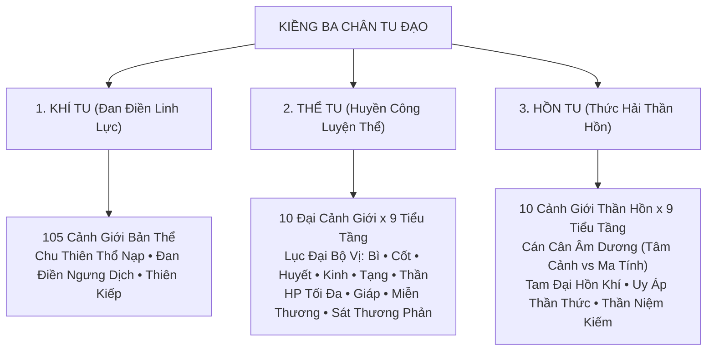

# 🏯 TÊN DỰ ÁN: GAMETUTIEN (Web Game Tu Tiên Tam Giới)

> **Vị thế kiến trúc:** Web Game Tiên Hiệp Mô Phỏng Đa Phân Hệ (Single-Player Client-First Xianxia RPG)  
> **Phiên bản hiện tại:** `v0.1.0-alpha` (Bách Nghệ, Thần Hồn, Thể Tu, Động Phủ, Cấm Địa & Thiên Kiếp)  
> **Tác giả & Kiến trúc sư:** Senior Technical Lead & Software Architect

---

## 1. 📖 TỔNG QUAN & BỐI CẢNH ĐỀ TÀI

### 1.1. Thể Loại & Định Vị Sản Phẩm
- **Thể loại:** Text-based RPG / Idle Simulation / Tiên Hiệp Tu Chân Phương Đông Cổ Phong.
- **Phong cách thị giác:** Dark Mode huyền ảo (`#07070b`), viền hào quang linh khí ngũ hành, tối ưu hóa triệt để không gian hiển thị, hoàn toàn không phụ thuộc tài nguyên ảnh nặng nề nhờ hệ thống **Zero-Asset Procedural Graphics**.
- **Không gian âm thanh:** Âm hưởng thiền định tĩnh tâm từ bộ tổng hợp sóng âm ngũ cung phương Đông (Solfeggio & Guqin Arpeggios) thuần **Web Audio API**.

### 1.2. Bối Cảnh & Cốt Truyện Kinh Điển
Khởi đầu từ một thiếu niên phàm nhân nơi sơn thôn hoang vu cằn cỗi, tình cờ nhặt được mảnh cổ ngọc tàn khuyết bên bờ suối vắng, người chơi dấn thân vào con đường nghịch thiên cải mệnh:
- **Trúc Đạo Cơ:** Bế quan thổ nạp linh khí nhật nguyệt, vận chuyển chu thiên, đả thông kinh mạch, ngưng khí hóa dịch, đúc thành Đạo Đài vạn năm.
- **Tam Trục Đồng Tu:** Không chỉ tu luyện Đan Điền Linh Lực (**Khí Tu**), tu sĩ còn phải rèn giũa huyết nhục qua Lục Đại Bộ Vị (**Thể Tu**) và khai mở thức hải, trảm diệt tâm ma, cô đọng thần niệm (**Hồn Tu**).
- **Vấn Đỉnh Tam Giới:** Vượt qua chín tầng thiên kiếp lôi đình, bách nghệ luyện đan đúc khí, thám hiểm bí cảnh thái cổ, săn lùng dị bảo tại Vạn Bảo Thương Hội, cuối cùng đạp phá hư không, vấn đỉnh **Vạn Cổ Đế Tổ**.

### 1.3. Giá Trị Cốt Lõi Về Mặt Kỹ Thuật (Architectural Values)
```
                                ┌──────────────────────────────────────────────┐
                                │          GAMETUTIEN CORE ARCHITECTURE        │
                                └──────────────────────┬───────────────────────┘
                                                       │
         ┌─────────────────────────┬───────────────────┴───────────────┬─────────────────────────┐
         ▼                         ▼                                   ▼                         ▼
┌──────────────────┐     ┌──────────────────┐                ┌──────────────────┐      ┌──────────────────┐
│  CLEAN DOMAIN    │     │ ZERO-ASSET ENGINE│                │ DATA RESILIENCE  │      │ DUAL-LAYER COMBAT│
│  ARCHITECTURE    │     │ (PROCEDURAL FX)  │                │ (MIGRATION v1-v7)│      │ & ROGUELITE LOOP │
│ - 25+ Hooks      │     │ - 100% SVG/CSS   │                │ - Auto Debounce  │      │ - FCT Floating   │
│ - 7 Pure Logics  │     │ - Web Audio API  │                │ - Self-Healing   │      │ - Ghost Bar      │
│ - 20+ Type Modules│    │ - Anti-Clipping  │                │ - Backward-Compat│      │ - Turn Trigger   │
└──────────────────┘     └──────────────────┘                └──────────────────┘      └──────────────────┘
```

1. **Cân Bằng Số Học Chặt Chẽ:** Mô hình toán học cấp số nhân lũy thừa cho tu vi và cảnh giới; ma trận ngũ hành tương sinh tương khắc; công thức combat chuẩn RPG với tỷ lệ bạo kích, xuyên giáp, né tránh tự nhiên và nhịp độ thân pháp đòn kép.
2. **Zero-Asset Procedural Visuals:** Toàn bộ hiệu ứng cảnh giới, đan điền, hào quang, hư ảnh Nguyên Anh và Pháp Tướng Hóa Thần được kiến tạo hoàn toàn bằng SVG động và CSS GPU Keyframes, đạt tốc độ khung hình 60 FPS ổn định mà kích thước tải trang gần như bằng 0.
3. **Web Audio Synthesizer Độc Lập:** Tạo nhạc nền và hiệu ứng trảm kích, thiên lôi, lò đan bằng bộ dao động sóng âm (OscillatorNode, BiquadFilterNode), tích hợp Master Dynamics Compressor chống rè loa tuyệt đối.
4. **Hệ Thống Dữ Liệu Tự Phục Hồi (Self-Healing & Data Migration):** Trải qua 7 chu kỳ nâng cấp schema (`v1` đến `v7`), game đảm bảo lưu trữ an toàn tại `localStorage`, tự vá lỗi và chuẩn hóa dữ liệu khi người chơi nạp save cũ.

---

## 2. 🛠 TECH STACK & CÔNG NGHỆ

| Công nghệ | Phiên bản | Vai trò & Ứng dụng trong dự án |
|:---|:---:|:---|
| **Next.js** | `16.3.5` | Framework nền tảng (App Router), quản lý Route Handlers backend serverless (`/api/battle`, `/api/cultivate`, `/api/breakthrough`, `/api/event`) |
| **React** | `19.2.8` | UI Library thế hệ mới, tối ưu hóa luồng re-render với hooks tách biệt, không lạm dụng state toàn cục |
| **TypeScript** | `^5.0.0` | Hệ thống kiểm soát kiểu tĩnh nghiêm ngặt (Strict Mode, 0 compile errors), phân rã 20+ domain type modules |
| **Tailwind CSS** | `^4.0.0` | Styling thế hệ mới với `@tailwindcss/postcss`, phối màu Dark Mode Tiên Hiệp cổ phong, custom scrollbar siêu mảnh |
| **Lucide React** | `^1.45.0` | Bộ biểu tượng vector sắc nét đại diện cho kiếm khí, lò đan, linh thạch, ngọc bội, túi trữ vật |
| **Web Audio API** | Native Browser | Bộ tổng hợp âm thanh procedural cho BGM ngũ cung Solfeggio và toàn bộ SFX thiên lôi, kiếm kích, đột phá |
| **LocalStorage Engine** | Custom | Lưu trữ tiến trình tại Client với bộ đệm Debounce 1.0s, hỗ trợ Schema Migrations v1-v7 và Self-Healing |

---

## 3. 📂 CẤU TRÚC THƯ MỤC & DANH MỤC TẤT CẢ CÁC TỆP TIN (FILE CATALOG)

### 3.1. Sơ Đồ Cây Thư Mục Tổng Quan
```text
gametutien/
├── app/                               # Next.js App Router (Entrypoint & Serverless API Routes)
│   ├── api/                           # RESTful Route Handlers
│   │   ├── battle/route.ts
│   │   ├── breakthrough/route.ts
│   │   ├── cultivate/route.ts
│   │   └── event/route.ts
│   ├── favicon.ico
│   ├── globals.css                    # CSS Tokens, Keyframes, Custom Scrollbar
│   ├── layout.tsx                     # Root Layout bọc ứng dụng (Font Geist)
│   └── page.tsx                       # Single Page Entrypoint nạp GameDashboard
├── components/                        # Kiến Trúc Giao Diện UI Module Hóa
│   ├── GameDashboard.tsx              # Component Tổng Điều Phối (Orchestrator ~850 LOC)
│   ├── abode/                         # Sa bàn Động Thiên Phúc Địa
│   ├── battle/                        # Thành phần hiển thị Combat (Ghost Bar, FCT Damage)
│   ├── dashboard/                     # Bố cục 3 Cột: HeaderNav, LeftColumn, MiddleColumn
│   │   └── left/                      # 9 Modular Cards Cột Trái Thông Tin Nhân Vật
│   ├── modals/                        # 14 Hộp Thoại Modal Độc Lập Chức Năng
│   ├── physique/                      # Giao diện Luyện Thể Dịch Cốt
│   ├── realm/                         # Hoạt Họa Cảnh Giới Vector SVG Procedural
│   ├── soul/                          # Giao diện Thức Hải Thần Hồn
│   └── tabs/                          # 12 Phân Hệ Tabs Cột Phải (Bách Nghệ, Thương Hội, Bí Cảnh...)
├── data/                              # Dữ Liệu Tĩnh Cấu Hình Cốt Lõi (JSON Datasets)
├── hooks/                             # 25+ Custom Domain Hooks (Business State Orchestration)
├── lib/                               # Core Game Logic & Pure Mathematical Engines
│   ├── game-logic/                    # 7 Pure Logic Modules (Combat, Cultivation, Refinement...)
│   └── types/                         # 20+ Domain Type Definitions Chuẩn TypeScript
├── scripts/                           # Reproducible Code Generation & Migration Scripts
├── CHANGELOG.md                       # Nhật Ký Phát Triển & Bản Đồ Thời Gian (Temporal Dev Log)
├── report.md                          # Đặc Tả Kiến Trúc Dự Án (Living Architecture Specs)
└── README.md                          # Tài Liệu Toàn Diện Dự Án (Tài Liệu Này)
```

---

### 3.2. Danh Mục Chi Tiết Từng File Trong Dự Án (File Catalog)

#### Nhóm 1: `app/` (Next.js App Router & Server APIs)
| Đường dẫn file | Vai trò trong hệ thống | Thành phần chính / Exports / Ghi chú |
|:---|:---|:---|
| [`app/api/battle/route.ts`](file:///c:/Users/hoang/.gemini/antigravity-ide/scratch/gametutien/app/api/battle/route.ts) | API Route xử lý giao tranh với Boss thế giới và ải quái | `GET` (lấy danh sách Boss), `POST` (tính toán hiệp đấu turn-based, trả về combat logs và chiến lợi phẩm) |
| [`app/api/breakthrough/route.ts`](file:///c:/Users/hoang/.gemini/antigravity-ide/scratch/gametutien/app/api/breakthrough/route.ts) | API Route kiểm tra điều kiện và thực hiện đột phá cảnh giới | `GET` (kiểm tra tỷ lệ thành công, đan dược phụ trợ), `POST` (thực hiện đột phá, xử lý thiên kiếp & tâm ma) |
| [`app/api/cultivate/route.ts`](file:///c:/Users/hoang/.gemini/antigravity-ide/scratch/gametutien/app/api/cultivate/route.ts) | API Route xử lý bế quan thổ nạp | `POST` (tính toán tu vi tích lũy theo thời gian bế quan, tư thế tu luyện và tỷ lệ kích hoạt kỳ duyên) |
| [`app/api/event/route.ts`](file:///c:/Users/hoang/.gemini/antigravity-ide/scratch/gametutien/app/api/event/route.ts) | API Route kích hoạt sự kiện ngẫu nhiên | `GET` (rút thăm kỳ duyên ngẫu nhiên), `POST` (giải quyết nhánh lựa chọn của người chơi và trả thưởng) |
| [`app/globals.css`](file:///c:/Users/hoang/.gemini/antigravity-ide/scratch/gametutien/app/globals.css) | Toàn bộ style nền, animation keyframes và CSS custom scrollbars | Cấu hình theme Tailwind v4, keyframes hào quang, đan hỏa, sương mù trận pháp, custom scrollbar cổ phong |
| [`app/layout.tsx`](file:///c:/Users/hoang/.gemini/antigravity-ide/scratch/gametutien/app/layout.tsx) | Root Layout bọc ứng dụng | Metadata Tiên Hiệp, cấu hình font chữ Geist Sans & Geist Mono |
| [`app/page.tsx`](file:///c:/Users/hoang/.gemini/antigravity-ide/scratch/gametutien/app/page.tsx) | Trang chủ khởi chạy ứng dụng | Render [`GameDashboard`](file:///c:/Users/hoang/.gemini/antigravity-ide/scratch/gametutien/components/GameDashboard.tsx) |

#### Nhóm 2: `components/dashboard/` & `components/dashboard/left/` (Giao Diện Trung Tâm)
| Đường dẫn file | Vai trò trong hệ thống | Thành phần chính / Exports / Ghi chú |
|:---|:---|:---|
| [`components/GameDashboard.tsx`](file:///c:/Users/hoang/.gemini/antigravity-ide/scratch/gametutien/components/GameDashboard.tsx) | **Orchestrator Component** tổng điều phối toàn bộ state và layout | Kết nối 25+ hooks, quản lý tabs điều hướng, render 3 cột layout và mount 14 modals độc lập |
| [`components/dashboard/HeaderNav.tsx`](file:///c:/Users/hoang/.gemini/antigravity-ide/scratch/gametutien/components/dashboard/HeaderNav.tsx) | Thanh điều hướng trên cùng (Top Navigation Bar) | Hiển thị 5 cấp Linh Thạch, Danh Vọng, Thọ Nguyên, nút mở Động Phủ, Đấu Giá, Save/Load/Export JSON |
| [`components/dashboard/LeftColumn.tsx`](file:///c:/Users/hoang/.gemini/antigravity-ide/scratch/gametutien/components/dashboard/LeftColumn.tsx) | Cột Trái Điều Phối thông tin tu sĩ | Tích hợp thanh chọn nhanh Cảnh Giới Preview (0-30), bao bọc 9 Modular Cards thông tin nhân vật |
| [`components/dashboard/MiddleColumn.tsx`](file:///c:/Users/hoang/.gemini/antigravity-ide/scratch/gametutien/components/dashboard/MiddleColumn.tsx) | Cột Giữa: Nhật ký tu tiên & Thao tác bế quan | Nhật Ký Hành Trình (Live Logs), Tuế Nguyệt Bế Quan, Cửu Trọng Thiên Kiếp HUD, Tiên Duyên Kỳ Ngộ Widget |
| [`components/dashboard/left/CharacterIdentityCard.tsx`](file:///c:/Users/hoang/.gemini/antigravity-ide/scratch/gametutien/components/dashboard/left/CharacterIdentityCard.tsx) | Card danh tính, đạo hiệu, cảnh giới & nút Đột Phá | Hiển thị Đạo Hiệu, Cảnh Giới (105 bậc), Thanh Tu Vi, Tuổi Thọ / Thọ Nguyên, nút Đột Phá Cảnh Giới |
| [`components/dashboard/left/CombatStatsCard.tsx`](file:///c:/Users/hoang/.gemini/antigravity-ide/scratch/gametutien/components/dashboard/left/CombatStatsCard.tsx) | Bảng chỉ số chiến đấu chi tiết | 8 chỉ số: Lực Chiến Tổng, Công Kích, Phòng Ngự, Thần Thức, Tốc Độ, Bạo Kích, Bạo Thương, Miễn Thương |
| [`components/dashboard/left/FourAttributesCard.tsx`](file:///c:/Users/hoang/.gemini/antigravity-ide/scratch/gametutien/components/dashboard/left/FourAttributesCard.tsx) | Card Tứ Đại Thuộc Tính & Trần Động | Căn Cốt, Ngộ Tính, Khí Vận, Tâm Cảnh; HUD 4 mốc đột biến bị động phát quang khi kích hoạt |
| [`components/dashboard/left/TwinCultivationTrackCard.tsx`](file:///c:/Users/hoang/.gemini/antigravity-ide/scratch/gametutien/components/dashboard/left/TwinCultivationTrackCard.tsx) | Song trục Nhục Thân (Thể Tu) & Thần Hồn (Hồn Tu) | Nút mở modal Luyện Thể và modal Thức Hải; thanh tiến độ 10 đại cảnh giới thể phách và thần thức |
| [`components/dashboard/left/HeritageAndCultivationCard.tsx`](file:///c:/Users/hoang/.gemini/antigravity-ide/scratch/gametutien/components/dashboard/left/HeritageAndCultivationCard.tsx) | Thể chất tiên thiên & Ngũ hành linh căn | Hiển thị Thể Chất (Đa Thể Chất), Phẩm cấp Linh Căn ngũ hành, nút Tẩy Tủy & Thăng Hoa Linh Căn |
| [`components/dashboard/left/DestinyCard.tsx`](file:///c:/Users/hoang/.gemini/antigravity-ide/scratch/gametutien/components/dashboard/left/DestinyCard.tsx) | Mệnh Cách Khí Vận & Bát Quái Càn Khôn | Hiển thị các ô Mệnh Cách đã khảm, nút mở modal Nghịch Thiên Cải Mệnh • Bát Quái Thiên Đàn |
| [`components/dashboard/left/CompanionAndGardenCard.tsx`](file:///c:/Users/hoang/.gemini/antigravity-ide/scratch/gametutien/components/dashboard/left/CompanionAndGardenCard.tsx) | Đạo lữ xuất chiến & Linh Điền thu nhỏ | Thông tin tiên tử đang đồng hành trợ chiến, tình trạng các luống thảo dược đang lớn |
| [`components/dashboard/left/CompanionCard.tsx`](file:///c:/Users/hoang/.gemini/antigravity-ide/scratch/gametutien/components/dashboard/left/CompanionCard.tsx) | Card Đạo Lữ chuyên biệt | Chi tiết hảo cảm, buff đồng hành và tuyệt kỹ hợp kích |
| [`components/dashboard/left/AstralSoulExpeditionModal.tsx`](file:///c:/Users/hoang/.gemini/antigravity-ide/scratch/gametutien/components/dashboard/left/AstralSoulExpeditionModal.tsx) | Modal Phân Thần Du Ngoạn AFK | Xuất khiếu thần niệm thám hiểm 3 lộ trình (2h, 4h, 8h) độc lập hoàn toàn với việc bế quan bản thể |
| [`components/dashboard/left/DivinationFateModal.tsx`](file:///c:/Users/hoang/.gemini/antigravity-ide/scratch/gametutien/components/dashboard/left/DivinationFateModal.tsx) | Modal Chiêm Tinh Bói Quẻ Thiên Cơ | Bói 64 quẻ Kinh Dịch, nhận định vận thế (Đại Cát -> Đại Hung), buff/debuff Khí Vận trong ngày |
| [`components/dashboard/left/types.ts`](file:///c:/Users/hoang/.gemini/antigravity-ide/scratch/gametutien/components/dashboard/left/types.ts) | Định nghĩa TypeScript Props chuyên biệt | Interface chuẩn cho 9 Modular Cards |
| [`components/dashboard/left/index.ts`](file:///c:/Users/hoang/.gemini/antigravity-ide/scratch/gametutien/components/dashboard/left/index.ts) | Barrel export cho module left | Export tập trung toàn bộ Card components |

#### Nhóm 3: `components/tabs/` (12 Phân Hệ Tabs Chức Năng Cột Phải)
| Đường dẫn file | Phân hệ nghiệp vụ | Chức năng chi tiết |
|:---|:---|:---|
| [`components/tabs/AlchemyTab.tsx`](file:///c:/Users/hoang/.gemini/antigravity-ide/scratch/gametutien/components/tabs/AlchemyTab.tsx) | **Luyện Đan Các** | Lò luyện đan dược, 20+ đan phương từ Nhất Giai đến Cửu Giai, hệ thống cấp bậc Đan Sư |
| [`components/tabs/ForgingTab.tsx`](file:///c:/Users/hoang/.gemini/antigravity-ide/scratch/gametutien/components/tabs/ForgingTab.tsx) | **Thần Binh Luyện Khí** | Rèn trang bị, Đục 1-4 lỗ khảm 7 loại Linh Ngọc, Lò Tẩy Luyện khóa dòng thuộc tính ẩn (Affixes), Lò Dung Luyện phân giải & tái chế trang bị thu hồi Khoáng Thạch, Tinh Hoa và bảo tồn Linh Ngọc 100% |
| [`components/tabs/FormationTab.tsx`](file:///c:/Users/hoang/.gemini/antigravity-ide/scratch/gametutien/components/tabs/FormationTab.tsx) | **Trận Pháp Các** | Khắc Trận Bàn, bố trí 18 trận đồ, cơ chế kích hoạt kỹ năng trận pháp theo lượt trong combat |
| [`components/tabs/TalismanTab.tsx`](file:///c:/Users/hoang/.gemini/antigravity-ide/scratch/gametutien/components/tabs/TalismanTab.tsx) | **Phù Lục Các** | Án thư vẽ bùa chu sa linh mặc, trang bị 3 túi Phù Nang xuất chiến, bùa công kích & bùa hộ mệnh |
| [`components/tabs/NatalArtifactView.tsx`](file:///c:/Users/hoang/.gemini/antigravity-ide/scratch/gametutien/components/tabs/NatalArtifactView.tsx) | **Bản Mệnh Pháp Bảo** | Nghi thức tế luyện giọt máu, bồi dưỡng Khí Linh 5 bậc linh trí, 4 bản tính chiến đấu, thôn phệ |
| [`components/tabs/BattleTab.tsx`](file:///c:/Users/hoang/.gemini/antigravity-ide/scratch/gametutien/components/tabs/BattleTab.tsx) | **Thí Luyện Trảm Yêu** | Khiêu chiến Boss theo cảnh giới, Trấn Ma Tháp 100 tầng, Boss thế giới liên kích |
| [`components/tabs/SecretRealmTab.tsx`](file:///c:/Users/hoang/.gemini/antigravity-ide/scratch/gametutien/components/tabs/SecretRealmTab.tsx) | **Bí Cảnh Roguelite** | 5 Đại Bí Cảnh đa tầng, khám phá phân nhánh ngẫu nhiên, túi loot tạm thời, cơ chế rút lui an toàn |
| [`components/tabs/InventoryTab.tsx`](file:///c:/Users/hoang/.gemini/antigravity-ide/scratch/gametutien/components/tabs/InventoryTab.tsx) | **Túi Trữ Vật** | Single Scrollbar Viewport Lock, live search, phân loại 8 danh mục, Tệ Điếm hối đoái 5 cấp linh thạch |
| [`components/tabs/MerchantTab.tsx`](file:///c:/Users/hoang/.gemini/antigravity-ide/scratch/gametutien/components/tabs/MerchantTab.tsx) | **Vạn Bảo Thương Hội** | **13 Sub-tabs**: `✨ Toàn Bộ` \| `💊 Đan Dược` \| `⚡ Tu Luyện` \| `🧘 Công Pháp` \| `📜 Thần Thông` \| `🌿 Dược Thảo` \| `⛏️ Khoáng Thạch (Nhất→Cửu Giai)` \| `⚔️ Trang Bị` \| `🌸 Đạo Lữ` \| `🐾 Linh Thú` \| `🎒 Trữ Vật` \| `♻️ Thu Mua` \| `💰 Tệ Điếm`. Tích hợp **Thanh Bộ Lọc Nhanh Giai Vị (Tier 1-9)** và **Engine Sắp Xếp Đa Tầng Tự Động** (Tier → Grade → Price → ID), memoized render, reset hàng ngày 24h, khóa vĩnh viễn đồ độc bản |
| [`components/tabs/ManualsTab.tsx`](file:///c:/Users/hoang/.gemini/antigravity-ide/scratch/gametutien/components/tabs/ManualsTab.tsx) | **Công Pháp Các** | 26+ bí tịch tâm pháp/thể thuật/thần thông, 4 slot trang bị, kích hoạt cộng hưởng ngũ hành +50% |
| [`components/tabs/SectTab.tsx`](file:///c:/Users/hoang/.gemini/antigravity-ide/scratch/gametutien/components/tabs/SectTab.tsx) | **Tông Môn Tu Chân** | Gia nhập 20 đại môn phái phân cấp 5 Tier, nhận nhiệm vụ cống hiến, thăng chức vị từ Tạp Dịch lên Chưởng Môn, Luận Kiếm Đường |
| [`components/tabs/CompanionTab.tsx`](file:///c:/Users/hoang/.gemini/antigravity-ide/scratch/gametutien/components/tabs/CompanionTab.tsx) | **Đạo Lữ Tiên Duyên** | 8 đại tiên tử, du lịch tầm duyên, đàm đạo, tặng quà tăng hảo cảm, 4 phương thức song tu |
| [`components/tabs/BeastTab.tsx`](file:///c:/Users/hoang/.gemini/antigravity-ide/scratch/gametutien/components/tabs/BeastTab.tsx) | **Linh Thú Tiên Gia** | Ấp trứng thần thú, 4 giai đoạn tiến hóa huyết mạch, xuất chiến trợ trận, thiết lập Tọa Kỵ |

#### Nhóm 4: `components/modals/`, `physique/`, `soul/`, `abode/`, `realm/`, `battle/`
| Đường dẫn file | Phân loại | Chức năng chính |
|:---|:---|:---|
| [`components/abode/AbodeHubModal.tsx`](file:///c:/Users/hoang/.gemini/antigravity-ide/scratch/gametutien/components/abode/AbodeHubModal.tsx) | Động Thiên Phúc Địa | Sa bàn 4 phân khu: Tụ Linh Đạo Đài, Huyền Thiên Dược Viên (12 ô đất), Linh Thú Viên, Tàng Kinh Các |
| [`components/soul/SoulHubModal.tsx`](file:///c:/Users/hoang/.gemini/antigravity-ide/scratch/gametutien/components/soul/SoulHubModal.tsx) | Thức Hải Thần Hồn | 10 cảnh giới Thần Hồn, Cán Cân Âm Dương (Tâm Cảnh vs Ma Tính), Tam Đại Hồn Khí, trảm tâm ma |
| [`components/physique/PhysiqueModal.tsx`](file:///c:/Users/hoang/.gemini/antigravity-ide/scratch/gametutien/components/physique/PhysiqueModal.tsx) | Huyền Công Luyện Thể | 10 đại cảnh giới nhục thân x 9 tiểu tầng, tôi luyện Lục Đại Bộ Vị (Bì, Cốt, Huyết, Kinh, Tạng, Thần) |
| [`components/modals/ForbiddenZoneModal.tsx`](file:///c:/Users/hoang/.gemini/antigravity-ide/scratch/gametutien/components/modals/ForbiddenZoneModal.tsx) | Thái Cổ Cấm Địa | Sa bàn sương mù Fog of War 6x6 & 7x7, quản lý hộ thân quang, tầm nhìn thần thức, tìm cổng thoát |
| [`components/modals/TribulationModal.tsx`](file:///c:/Users/hoang/.gemini/antigravity-ide/scratch/gametutien/components/modals/TribulationModal.tsx) | Cửu Trọng Thiên Kiếp | Minigame thời gian thực 3 pha (Thiên uy tụ -> Quyết sách 4s -> Oanh kích) khi đột phá Đại Cảnh Giới |
| [`components/modals/AuctionModal.tsx`](file:///c:/Users/hoang/.gemini/antigravity-ide/scratch/gametutien/components/modals/AuctionModal.tsx) | Đấu Giá Thiên Cổ | Bidding war với 8 NPC đa tính cách, Uy Áp Thần Thức Dằn Mặt lũy tiến, ngắt giá hard-cap |
| [`components/modals/AchievementsModal.tsx`](file:///c:/Users/hoang/.gemini/antigravity-ide/scratch/gametutien/components/modals/AchievementsModal.tsx) | Thành Tựu & Danh Hiệu | 65 mốc thành tựu đa phân hệ, 28 danh hiệu mang hiệu ứng buff vĩnh viễn cho nhân vật, sub-tabs 12 danh mục & thanh tiến độ % Đạo Quả Hoàn Thành |
| [`components/modals/SaveManagementModal.tsx`](file:///c:/Users/hoang/.gemini/antigravity-ide/scratch/gametutien/components/modals/SaveManagementModal.tsx) | Quản Lý Lưu Trữ | Modal sao lưu đa tầng: Lưu nhanh, Sao chép Tiên Thư mã hóa (Base64 + Adler-32), Khôi phục Tiên Thư kèm kiểm tra toàn vẹn, và Quản lý 3 bản lưu Snapshot luân phiên |
| [`components/modals/StorylineModal.tsx`](file:///c:/Users/hoang/.gemini/antigravity-ide/scratch/gametutien/components/modals/StorylineModal.tsx) | Cốt Truyện Chính Tuyến | Khung đọc tiểu thuyết cổ phong 9 chương hồi kinh điển (Phàm Nhân -> Hóa Thần -> Luyện Hư Tinh Không -> Độ Kiếp Phi Thăng), lựa chọn phân nhánh nhân quả biến chuyển thuộc tính, danh hiệu & cổ bảo |
| [`components/modals/StoryEncounterModal.tsx`](file:///c:/Users/hoang/.gemini/antigravity-ide/scratch/gametutien/components/modals/StoryEncounterModal.tsx) | Tiên Duyên Kỳ Ngộ | Hộp thoại tương tác quyết định khi gặp kỳ ngộ bất ngờ trong lúc bế quan hoặc thám hiểm |
| [`components/modals/DestinyModal.tsx`](file:///c:/Users/hoang/.gemini/antigravity-ide/scratch/gametutien/components/modals/DestinyModal.tsx) | Mệnh Bàn Bát Quái | Khảm 3-5 ô Mệnh Cách, kích hoạt 5 đại tổ hợp thiên mệnh (Ma Đạo, Thiên Mệnh Chi Tử...) |
| [`components/modals/SpiritualRootModal.tsx`](file:///c:/Users/hoang/.gemini/antigravity-ide/scratch/gametutien/components/modals/SpiritualRootModal.tsx) | Thăng Hoa Linh Căn | Tiêu hao Ngũ Hành Tinh Thạch tẩy luyện phẩm cấp linh căn (Tạp Linh Căn -> Hỗn Độn Linh Căn) |
| [`components/modals/OfflineProgressModal.tsx`](file:///c:/Users/hoang/.gemini/antigravity-ide/scratch/gametutien/components/modals/OfflineProgressModal.tsx) | Báo Cáo AFK Trở Về | Bảng kết toán tu vi, linh thạch, thảo dược và dược liệu thu hoạch trong thời gian ngoại tuyến |
| [`components/realm/RealmVisualAnimation.tsx`](file:///c:/Users/hoang/.gemini/antigravity-ide/scratch/gametutien/components/realm/RealmVisualAnimation.tsx) | Visual Cảnh Giới SVG | Hoạt họa vector SVG 100% không ảnh: Đan điền kim quang, Đạo Đài Trúc Cơ, Kim Đan, Nguyên Anh, Hóa Thần |
| [`components/battle/FloatingDamageOverlay.tsx`](file:///c:/Users/hoang/.gemini/antigravity-ide/scratch/gametutien/components/battle/FloatingDamageOverlay.tsx) | Số Sát Thương Bay | Hiệu ứng FCT (Floating Combat Text) cho Sát thương thường, Bạo kích kim quang, Hồi máu, Né đòn |
| [`components/battle/SmoothHealthBar.tsx`](file:///c:/Users/hoang/.gemini/antigravity-ide/scratch/gametutien/components/battle/SmoothHealthBar.tsx) | Thanh Máu 2 Lớp | Dual-Layer Trailing Ghost Bar: Lớp máu đỏ co lập tức, lớp máu vàng rút chậm tạo độ trễ đối kháng |
| [`components/battle/PvPLadderView.tsx`](file:///c:/Users/hoang/.gemini/antigravity-ide/scratch/gametutien/components/battle/PvPLadderView.tsx) | Thiên Kiêu Bảng PvP | Đấu trường 100 Thiên Kiêu, Bảng Phong Thần Top 3, Sàn đấu turn-based trực tiếp, FCT popups |

#### Nhóm 5: `hooks/` (Custom Domain State Hooks)
| Đường dẫn file | Nhiệm vụ / Trách nhiệm |
|:---|:---|
| [`hooks/usePvPLadderActions.ts`](file:///c:/Users/hoang/.gemini/antigravity-ide/scratch/gametutien/hooks/usePvPLadderActions.ts) | Thiên Kiêu Bảng: điều phối lượt khiêu chiến, matchmaking 3-4 đối thủ, mô phỏng đấu pháp, hoán đổi thứ hạng & kết toán tuần |
| [`hooks/useGameSave.ts`](file:///c:/Users/hoang/.gemini/antigravity-ide/scratch/gametutien/hooks/useGameSave.ts) | Tự động lưu save game với Debounce 1.0s, lưu khi đóng tab (`beforeunload`), quản lý 3 slot Snapshot luân phiên, auto snapshot 30 phút, xuất/nhập Tiên Thư mã hóa & tệp JSON |
| [`hooks/useGameActions.ts`](file:///c:/Users/hoang/.gemini/antigravity-ide/scratch/gametutien/hooks/useGameActions.ts) | API Handlers chính: bế quan (`cultivate`), kiểm tra đột phá (`breakthrough`), chiến đấu (`battle`), giải quyết sự kiện (`event`) |
| [`hooks/useAbodeActions.ts`](file:///c:/Users/hoang/.gemini/antigravity-ide/scratch/gametutien/hooks/useAbodeActions.ts) | Vận hành Động Phủ: nâng cấp Tụ Linh Trận, đổi thổ nhưỡng dược viên, thả rông linh thú thu phân bón, chiêu mộ đệ tử |
| [`hooks/useSoulActions.ts`](file:///c:/Users/hoang/.gemini/antigravity-ide/scratch/gametutien/hooks/useSoulActions.ts) | Thức Hải Thần Hồn: tĩnh tọa ngưng thần, luyện Hồn Khí, trảm tâm ma, kích hoạt uy áp thần thức |
| [`hooks/usePhysiqueActions.ts`](file:///c:/Users/hoang/.gemini/antigravity-ide/scratch/gametutien/hooks/usePhysiqueActions.ts) | Luyện Thể: tôi luyện Lục Đại Bộ Vị, đột phá 10 đại cảnh giới nhục thân, dùng Khí Huyết Đan |
| [`hooks/useForbiddenZoneActions.ts`](file:///c:/Users/hoang/.gemini/antigravity-ide/scratch/gametutien/hooks/useForbiddenZoneActions.ts) | Thái Cổ Cấm Địa: di chuyển sa bàn sương mù, mở ô sương mù bằng thần thức, nhặt bảo vật, kích hoạt cổng dịch chuyển |
| [`hooks/useTribulationActions.ts`](file:///c:/Users/hoang/.gemini/antigravity-ide/scratch/gametutien/hooks/useTribulationActions.ts) | Thiên Kiếp: đếm ngược 4s quyết sách, kích hoạt pháp bảo kháng lôi, uống hộ tâm đan, chịu thiên lôi oanh kích |
| [`hooks/useFormationActions.ts`](file:///c:/Users/hoang/.gemini/antigravity-ide/scratch/gametutien/hooks/useFormationActions.ts) | Trận Pháp: lĩnh ngộ trận đồ, bố trí trận bàn xuất chiến, kích hoạt hiệu ứng trận pháp theo hiệp |
| [`hooks/useTalismanActions.ts`](file:///c:/Users/hoang/.gemini/antigravity-ide/scratch/gametutien/hooks/useTalismanActions.ts) | Phù Lục: vẽ bùa trên án thư, nạp phù nang 3 ô, kích hoạt bùa chiến đấu hoặc bùa hộ thân khi nguy cấp |
| [`hooks/useNatalArtifactActions.ts`](file:///c:/Users/hoang/.gemini/antigravity-ide/scratch/gametutien/hooks/useNatalArtifactActions.ts) | Bản Mệnh: tế luyện trang bị thành Bản Mệnh, ôn dưỡng Chân Nguyên, thức tỉnh Khí Linh, thôn phệ trang bị khác |
| [`hooks/useAuctionActions.ts`](file:///c:/Users/hoang/.gemini/antigravity-ide/scratch/gametutien/hooks/useAuctionActions.ts) | Đấu Giá: quản lý vòng búa 3 nhịp, tính năng Dằn Mặt Thần Thức lũy tiến, kiểm soát ngân sách đối thủ |
| [`hooks/useCraftingActions.ts`](file:///c:/Users/hoang/.gemini/antigravity-ide/scratch/gametutien/hooks/useCraftingActions.ts) | Luyện Đan & Đúc Trang Bị: kiểm tra công thức, trừ nguyên liệu khoáng thạch/thảo dược, sinh trang bị mới |
| [`hooks/useMerchantInventoryActions.ts`](file:///c:/Users/hoang/.gemini/antigravity-ide/scratch/gametutien/hooks/useMerchantInventoryActions.ts) | Mua bán Thương Hội: mua 16 trang bị / phôi bản mệnh, kiểm tra độc bản, hối đoái 5 cấp bậc linh thạch, bán đồ |
| [`hooks/useSecretRealmActions.ts`](file:///c:/Users/hoang/.gemini/antigravity-ide/scratch/gametutien/hooks/useSecretRealmActions.ts) | Bí Cảnh Crawler: di chuyển qua các phòng, giải quyết cạm bẫy, mở rương tàng bảo, rút lui an toàn mang 100% đồ về |
| [`hooks/useCompanionActions.ts`](file:///c:/Users/hoang/.gemini/antigravity-ide/scratch/gametutien/hooks/useCompanionActions.ts) | Đạo Lữ: du lịch tầm duyên, đàm đạo, tặng quà, kết duyên đại điển, kích hoạt 4 loại hình song tu |
| [`hooks/useManualActions.ts`](file:///c:/Users/hoang/.gemini/antigravity-ide/scratch/gametutien/hooks/useManualActions.ts) | Công Pháp: lĩnh ngộ bí kíp, trang bị vào 4 slot (Tâm Pháp, Thể Thuật, Thần Thông 1 & 2), tính cộng hưởng |
| [`hooks/useSectActions.ts`](file:///c:/Users/hoang/.gemini/antigravity-ide/scratch/gametutien/hooks/useSectActions.ts) | Tông Môn: gia nhập phái, nhận bổng lộc hàng ngày, làm nhiệm vụ cống hiến, tỷ thí luận kiếm đường |
| [`hooks/useOfflineProgress.ts`](file:///c:/Users/hoang/.gemini/antigravity-ide/scratch/gametutien/hooks/useOfflineProgress.ts) | AFK Engine: tính chênh lệch `Date.now() - lastSaveTime`, cộng tu vi và tài nguyên khi người chơi mở lại tab |
| [`hooks/useSound.ts`](file:///c:/Users/hoang/.gemini/antigravity-ide/scratch/gametutien/hooks/useSound.ts) | Bộ điều khiển phát âm thanh Web Audio API: playBGM, stopBGM, playSoundEffect (`thunder`, `slash`, `breakthrough`...) |
| [`hooks/useAchievements.ts`](file:///c:/Users/hoang/.gemini/antigravity-ide/scratch/gametutien/hooks/useAchievements.ts) | Quản lý tiến độ 65 thành tựu tiên giới toàn phân hệ và trang bị 28 danh hiệu độc quyền |
| [`hooks/useGardenTimer.ts`](file:///c:/Users/hoang/.gemini/antigravity-ide/scratch/gametutien/hooks/useGardenTimer.ts) | Ticker 1s độc lập cho chu kỳ sinh trưởng của dược điền |
| [`hooks/useStorylineActions.ts`](file:///c:/Users/hoang/.gemini/antigravity-ide/scratch/gametutien/hooks/useStorylineActions.ts) | Cốt truyện: kích hoạt chương hồi, ghi nhận lựa chọn phân nhánh, trao phần thưởng độc quyền |

#### Nhóm 6: `lib/` & `lib/game-logic/` (Engine & Pure Business Logic)
| Đường dẫn file | Vai trò trong hệ thống |
|:---|:---|
| [`lib/save-encryption.ts`](file:///c:/Users/hoang/.gemini/antigravity-ide/scratch/gametutien/lib/save-encryption.ts) | Pure engine mã hóa chuỗi Tiên Thư Bản Thể (`GTT_SAVE_V1$[CHECKSUM]$[BASE64]`), thuật toán Adler-32 Checksum chống lỗi file/sửa đổi, nén và quản lý 3 khe lưu trữ Snapshot đa tầng |
| [`lib/achievements-data.ts`](file:///c:/Users/hoang/.gemini/antigravity-ide/scratch/gametutien/lib/achievements-data.ts) | Kho tàng 65 thành tựu tiên giới bao phủ 12 phân hệ, 28 danh hiệu tiên giới kèm hiệu ứng buff thuộc tính, hàm tính tiến trình chi tiết |
| [`lib/game-logic/character.ts`](file:///c:/Users/hoang/.gemini/antigravity-ide/scratch/gametutien/lib/game-logic/character.ts) | Khởi tạo nhân vật mới, tính toán tuổi tác, thọ nguyên tối đa theo cảnh giới và nguy cơ tọa hóa |
| [`lib/game-logic/combat.ts`](file:///c:/Users/hoang/.gemini/antigravity-ide/scratch/gametutien/lib/game-logic/combat.ts) | Vòng lặp chiến đấu theo lượt (Turn-based Combat Loop), tính toán Sát thương, Bạo kích, Né tránh, Đòn kép, Hút máu |
| [`lib/game-logic/cultivation.ts`](file:///c:/Users/hoang/.gemini/antigravity-ide/scratch/gametutien/lib/game-logic/cultivation.ts) | Thổ nạp tính tu vi theo thời gian, tính tỷ lệ đột phá cảnh giới và kiểm tra nguy cơ tâm ma xâm lấn |
| [`lib/game-logic/stats.ts`](file:///c:/Users/hoang/.gemini/antigravity-ide/scratch/gametutien/lib/game-logic/stats.ts) | Tính toán chỉ số chiến đấu hiệu dụng (Effective Stats), tổng Lực Chiến, HP/MP tối đa từ mọi nguồn buff |
| [`lib/game-logic/refinement.ts`](file:///c:/Users/hoang/.gemini/antigravity-ide/scratch/gametutien/lib/game-logic/refinement.ts) | Logic tôi thể dịch cốt, thăng cấp thể chất tiên thiên và chuyển sinh luân hồi |
| [`lib/game-logic/events.ts`](file:///c:/Users/hoang/.gemini/antigravity-ide/scratch/gametutien/lib/game-logic/events.ts) | Rút thăm sự kiện kỳ duyên ngẫu nhiên dựa trên Khí Vận của tu sĩ |
| [`lib/game-logic/rewards.ts`](file:///c:/Users/hoang/.gemini/antigravity-ide/scratch/gametutien/lib/game-logic/rewards.ts) | Kết toán phần thưởng khi hoàn thành sự kiện hoặc thắng trận |
| [`lib/attribute-perks.ts`](file:///c:/Users/hoang/.gemini/antigravity-ide/scratch/gametutien/lib/attribute-perks.ts) | Thuật toán nâng trần thuộc tính động (100 -> 250 -> 500 -> 1000) và 4 mốc đột biến bị động |
| [`lib/artisan-lock-logic.ts`](file:///c:/Users/hoang/.gemini/antigravity-ide/scratch/gametutien/lib/artisan-lock-logic.ts) | Ma trận khóa Tứ Đại Bách Nghệ (Đan • Khí • Trận • Phù) neo chặt theo cảnh giới Khí Tu (Dual-Lock) |
| [`lib/navigation-utils.ts`](file:///c:/Users/hoang/.gemini/antigravity-ide/scratch/gametutien/lib/navigation-utils.ts) | Tiện ích điều hướng cuộn mượt và hào quang phát sáng 1.5s (scrollToElementWithHighlight) |
| [`lib/audio-engine.ts`](file:///c:/Users/hoang/.gemini/antigravity-ide/scratch/gametutien/lib/audio-engine.ts) | Procedural Audio Synthesizer: Nhạc cổ cầm Solfeggio, gió tiên sơn Kellet Noise, compressor chống rè loa |
| [`lib/forbidden-zone-data.ts`](file:///c:/Users/hoang/.gemini/antigravity-ide/scratch/gametutien/lib/forbidden-zone-data.ts) | Cấu hình 5 Thái Cổ Cấm Địa, kích thước sa bàn 6x6 & 7x7, ma trận quái vật và bảo vật cấm khu |
| [`lib/forbidden-zone-logic.ts`](file:///c:/Users/hoang/.gemini/antigravity-ide/scratch/gametutien/lib/forbidden-zone-logic.ts) | Thuật toán sinh sa bàn sương mù ngẫu nhiên, mở sương mù theo tầm nhìn thần thức, xử lý cổng thoát an toàn |
| [`lib/tribulation-logic.ts`](file:///c:/Users/hoang/.gemini/antigravity-ide/scratch/gametutien/lib/tribulation-logic.ts) | Logic Cửu Trọng Thiên Kiếp: tính toán thiên uy lôi kiếp, sát thương lôi đình, cơ chế kích hoạt pháp bảo chống lôi |
| [`lib/formation-data.ts`](file:///c:/Users/hoang/.gemini/antigravity-ide/scratch/gametutien/lib/formation-data.ts) | 18 trận đồ tiên môn từ Sơ Giai đến Thần Giai, yêu cầu trận bàn và vật phẩm kích hoạt |
| [`lib/formation-logic.ts`](file:///c:/Users/hoang/.gemini/antigravity-ide/scratch/gametutien/lib/formation-logic.ts) | Tính toán hiệu ứng buff công thủ và Turn Trigger kích hoạt kỹ năng trận pháp trong combat |
| [`lib/talisman-data.ts`](file:///c:/Users/hoang/.gemini/antigravity-ide/scratch/gametutien/lib/talisman-data.ts) | Công thức vẽ 16 loại phù lục, nguyên liệu chu sa, hoàng chỉ, phẩm cấp từ Hạ Phẩm đến Cực Phẩm |
| [`lib/talisman-logic.ts`](file:///c:/Users/hoang/.gemini/antigravity-ide/scratch/gametutien/lib/talisman-logic.ts) | Xử lý thành bại khi hạ bút vẽ bùa, hiệu ứng phù lục chiến đấu và phù lục kháng tâm ma khi đột phá |
| [`lib/natal-artifact-data.ts`](file:///c:/Users/hoang/.gemini/antigravity-ide/scratch/gametutien/lib/natal-artifact-data.ts) | Cấu hình 5 bậc linh trí Khí Linh, 4 bản tính chiến đấu (Sát Phạt, Thủ Hộ, Cơ Xảo, Tịnh Hóa) |
| [`lib/natal-artifact-logic.ts`](file:///c:/Users/hoang/.gemini/antigravity-ide/scratch/gametutien/lib/natal-artifact-logic.ts) | Xử lý nghi thức tế luyện Bản Mệnh, ôn dưỡng chân nguyên, kích hoạt chiến kỹ hộ chủ khi nguy cấp |
| [`lib/soul-data.ts`](file:///c:/Users/hoang/.gemini/antigravity-ide/scratch/gametutien/lib/soul-data.ts) | Dữ liệu 10 cảnh giới Thần Hồn, Tam Đại Hồn Khí trấn thủ thức hải |
| [`lib/soul-logic.ts`](file:///c:/Users/hoang/.gemini/antigravity-ide/scratch/gametutien/lib/soul-logic.ts) | Cán cân Âm Dương (Tâm Cảnh vs Ma Tính), tính toán tỷ lệ áp chế Thần Thức và sát thương Thần Niệm Kiếm |
| [`lib/physique-system-data.ts`](file:///c:/Users/hoang/.gemini/antigravity-ide/scratch/gametutien/lib/physique-system-data.ts) | Dữ liệu 10 cảnh giới Luyện Thể và 6 bộ vị tôi luyện cơ thể |
| [`lib/physique-logic.ts`](file:///c:/Users/hoang/.gemini/antigravity-ide/scratch/gametutien/lib/physique-logic.ts) | Tính toán chi phí tinh huyết tôi thể, tỷ lệ thành công và buff sinh tồn nhục thân |
| [`lib/abode-data.ts`](file:///c:/Users/hoang/.gemini/antigravity-ide/scratch/gametutien/lib/abode-data.ts) | Cấu hình 10 cấp Tụ Linh Đạo Đài, 3 loại thổ nhưỡng Dược Viên, 4 phẩm chất đệ tử bái sư |
| [`lib/abode-logic.ts`](file:///c:/Users/hoang/.gemini/antigravity-ide/scratch/gametutien/lib/abode-logic.ts) | Tính toán tốc độ tu vi Động Phủ, sinh phân bón linh thú và kết toán bổng lộc đệ tử chu kỳ 12h |
| [`lib/forging-gem-data.ts`](file:///c:/Users/hoang/.gemini/antigravity-ide/scratch/gametutien/lib/forging-gem-data.ts) | 35 Linh Ngọc ngũ hành & dị biến, bảng giá trị thuộc tính ẩn Affixes |
| [`lib/forging-logic.ts`](file:///c:/Users/hoang/.gemini/antigravity-ide/scratch/gametutien/lib/forging-logic.ts) | Thuật toán đục lỗ (1-4 lỗ), khảm ngọc, tháo ngọc an toàn 100%, tẩy luyện và khóa dòng ẩn |
| [`lib/auction-data.ts`](file:///c:/Users/hoang/.gemini/antigravity-ide/scratch/gametutien/lib/auction-data.ts) | 16 kỳ trân dị bảo tuyệt thế đấu giá, 8 NPC đối thủ thuộc 4 nhóm thân phận |
| [`lib/auction-logic.ts`](file:///c:/Users/hoang/.gemini/antigravity-ide/scratch/gametutien/lib/auction-logic.ts) | AI nâng giá búa 3 nhịp, Thần Thức Dằn Mặt lũy tiến (lần 3 chắc chắn 100% NPC rút lui), ngắt giá hard-cap |
| [`lib/save-migration.ts`](file:///c:/Users/hoang/.gemini/antigravity-ide/scratch/gametutien/lib/save-migration.ts) | Hệ thống chuyển đổi dữ liệu save v1-v7, `repairCorruptedSaveData()`, bảo toàn dữ liệu người chơi |
| [`lib/secret-realm-logic.ts`](file:///c:/Users/hoang/.gemini/antigravity-ide/scratch/gametutien/lib/secret-realm-logic.ts) | Thuật toán sinh phòng Roguelite phân nhánh, xử lý rút lui an toàn và trừ 50% đồ khi tử trận |
| [`lib/sect-logic.ts`](file:///c:/Users/hoang/.gemini/antigravity-ide/scratch/gametutien/lib/sect-logic.ts) | Logic kiểm tra điều kiện bái sư 20 tông môn 5 tier (Cảnh giới, Căn cốt, Linh căn) và visual tokens |
| [`lib/sect-data.ts`](file:///c:/Users/hoang/.gemini/antigravity-ide/scratch/gametutien/lib/sect-data.ts) | Cấu hình 20 tông môn phân cấp 5 Tier, chức vị, bổng lộc, Tàng Kinh Các và Luận Kiếm Đường |
| [`lib/merchant-data.ts`](file:///c:/Users/hoang/.gemini/antigravity-ide/scratch/gametutien/lib/merchant-data.ts) | Kho dữ liệu Thương Hội, bảng trọng số `TIER_WEIGHT` & `GRADE_WEIGHT`, `MERCHANT_TIER_TABS`, bộ lọc Giai Vị `matchMerchantTier`, Engine so sánh đa tầng `compareMerchantItems` và hàm sắp xếp `sortMerchantItems` |
| [`lib/pvp-ladder-data.ts`](file:///c:/Users/hoang/.gemini/antigravity-ide/scratch/gametutien/lib/pvp-ladder-data.ts) | Dữ liệu tĩnh Thiên Kiêu Bảng: pool danh xưng, 20 tông môn, bộ sinh 100 NPC Thiên Kiêu tiến trình (Procedural NPC Generator) |
| [`lib/pvp-ladder-logic.ts`](file:///c:/Users/hoang/.gemini/antigravity-ide/scratch/gametutien/lib/pvp-ladder-logic.ts) | Pure business logic: hồi vé khiêu chiến, Matchmaking 3-4 đối thủ, mô phỏng đấu pháp 20 hiệp (Thần thức, Thân pháp, Khí linh), Rank Swap |

#### Nhóm 7: `lib/types/` (Hệ Thống Kiểu Dữ Liệu TypeScript)
| Đường dẫn file | Định nghĩa các thực thể dữ liệu chính |
|:---|:---|
| [`lib/types/pvp-ladder.ts`](file:///c:/Users/hoang/.gemini/antigravity-ide/scratch/gametutien/lib/types/pvp-ladder.ts) | `LadderOpponent`, `PvPLadderState`, `PvPLadderCombatLog`, `PvPTurnLog`, `PvPBattleResult` |
| [`lib/types/player.ts`](file:///c:/Users/hoang/.gemini/antigravity-ide/scratch/gametutien/lib/types/player.ts) | `PlayerStats` (trạng thái người chơi toàn cục), `GameSaveData` |
| [`lib/types/character.ts`](file:///c:/Users/hoang/.gemini/antigravity-ide/scratch/gametutien/lib/types/character.ts) | `CharacterAttributes`, `LinhCan`, `Physique` |
| [`lib/types/items.ts`](file:///c:/Users/hoang/.gemini/antigravity-ide/scratch/gametutien/lib/types/items.ts) | `InventoryItem`, `Equipment`, `GemItem`, `EquipmentAffix`, `MerchantItem` |
| [`lib/types/combat.ts`](file:///c:/Users/hoang/.gemini/antigravity-ide/scratch/gametutien/lib/types/combat.ts) | `CombatEntity`, `CombatLogEntry`, `BossData`, `BossTrialState` |
| [`lib/types/cultivation.ts`](file:///c:/Users/hoang/.gemini/antigravity-ide/scratch/gametutien/lib/types/cultivation.ts) | `RealmData`, `CultivateStance`, `BreakthroughResult` |
| [`lib/types/natal-artifact.ts`](file:///c:/Users/hoang/.gemini/antigravity-ide/scratch/gametutien/lib/types/natal-artifact.ts) | `NatalArtifactState`, `SpiritSentienceLevel`, `SpiritPersonality` |
| [`lib/types/forbidden-zone.ts`](file:///c:/Users/hoang/.gemini/antigravity-ide/scratch/gametutien/lib/types/forbidden-zone.ts) | `ForbiddenZoneState`, `ZoneCell`, `ZoneEncounter` |
| [`lib/types/tribulation.ts`](file:///c:/Users/hoang/.gemini/antigravity-ide/scratch/gametutien/lib/types/tribulation.ts) | `TribulationWave`, `TribulationChoice`, `TribulationState` |
| [`lib/types/formation.ts`](file:///c:/Users/hoang/.gemini/antigravity-ide/scratch/gametutien/lib/types/formation.ts) | `FormationData`, `ActiveFormationState` |
| [`lib/types/talisman.ts`](file:///c:/Users/hoang/.gemini/antigravity-ide/scratch/gametutien/lib/types/talisman.ts) | `TalismanRecipe`, `EquippedTalismanSlot` |
| [`lib/types/soul.ts`](file:///c:/Users/hoang/.gemini/antigravity-ide/scratch/gametutien/lib/types/soul.ts) | `SoulCultivationState`, `SoulArtifact`, `YinYangBalance` |
| [`lib/types/physique.ts`](file:///c:/Users/hoang/.gemini/antigravity-ide/scratch/gametutien/lib/types/physique.ts) | `PhysiqueRefineState`, `BodyPartRefinement` |
| [`lib/types/abode.ts`](file:///c:/Users/hoang/.gemini/antigravity-ide/scratch/gametutien/lib/types/abode.ts) | `AbodeHubState`, `SpiritArrayState`, `AbodePlotState`, `DiscipleState` |
| [`lib/types/auction.ts`](file:///c:/Users/hoang/.gemini/antigravity-ide/scratch/gametutien/lib/types/auction.ts) | `AuctionLot`, `AuctionParticipant`, `AuctionState` |
| [`lib/types/dungeon.ts`](file:///c:/Users/hoang/.gemini/antigravity-ide/scratch/gametutien/lib/types/dungeon.ts) | `SecretRealmState`, `RealmRoom`, `RealmAltarBuff` |
| [`lib/types/companions.ts`](file:///c:/Users/hoang/.gemini/antigravity-ide/scratch/gametutien/lib/types/companions.ts) | `Companion`, `CompanionGift`, `DualCultivationMethod` |
| [`lib/types/beasts.ts`](file:///c:/Users/hoang/.gemini/antigravity-ide/scratch/gametutien/lib/types/beasts.ts) | `Beast`, `BeastEgg`, `BeastEvolutionStage` |
| [`lib/types/sect.ts`](file:///c:/Users/hoang/.gemini/antigravity-ide/scratch/gametutien/lib/types/sect.ts) | `SectData`, `SectMission`, `SectRank` |
| [`lib/types/lifespan.ts`](file:///c:/Users/hoang/.gemini/antigravity-ide/scratch/gametutien/lib/types/lifespan.ts) | `LifespanState`, `LongevityPillEffect` |
| [`lib/types/storyline.ts`](file:///c:/Users/hoang/.gemini/antigravity-ide/scratch/gametutien/lib/types/storyline.ts) | `StoryChapter`, `StoryNode`, `StoryBranchChoice` |
| [`lib/types/index.ts`](file:///c:/Users/hoang/.gemini/antigravity-ide/scratch/gametutien/lib/types/index.ts) | Barrel export re-export toàn bộ 20+ modules kiểu dữ liệu |

#### Nhóm 8: `data/` & `scripts/`
| Đường dẫn file | Nội dung & Vai trò |
|:---|:---|
| [`data/realms-data.json`](file:///c:/Users/hoang/.gemini/antigravity-ide/scratch/gametutien/data/realms-data.json) | 105 Cảnh giới chuẩn hóa nghiêm ngặt từ Phàm Nhân (0) đến Vạn Cổ Đế Tổ Đỉnh Phong (104) |
| [`data/bosses-data.json`](file:///c:/Users/hoang/.gemini/antigravity-ide/scratch/gametutien/data/bosses-data.json) | Danh sách Boss theo từng đại cảnh giới: chỉ số công thủ, kỹ năng đặc thù, bảng rơi đồ |
| [`data/events-data.json`](file:///c:/Users/hoang/.gemini/antigravity-ide/scratch/gametutien/data/events-data.json) | Kho tàng sự kiện ngẫu nhiên kỳ duyên, tâm ma, di trạch tiền nhân khi bế quan |
| [`scripts/build_complete_types.js`](file:///c:/Users/hoang/.gemini/antigravity-ide/scratch/gametutien/scripts/build_complete_types.js) | Script tự động hóa sinh và đồng bộ hóa các module kiểu dữ liệu trong `lib/types/` |
| [`scripts/split_left_column_perfect.js`](file:///c:/Users/hoang/.gemini/antigravity-ide/scratch/gametutien/scripts/split_left_column_perfect.js) | Script tách giao diện nguyên khối thành 9 Modular Cards cho Cột Trái Dashboard |

---

## 4. 🎮 TỔNG HỢP CÁC PHÂN HỆ CHỨC NĂNG & CƠ CHẾ GAMEPLAY (CORE MECHANICS)

### 4.1. Chuẩn Hóa 105 Cảnh Giới Tu Tiên & Bế Quan Thổ Nạp
- **Hệ Thống 105 Bậc Thang Tiên Lộ (`data/realms-data.json`):**
  - **Phàm Nhân (0):** Thiếu niên sơn thôn, thể chất phàm thai, tu vi ban đầu 0.
  - **Luyện Khí Kỳ (1-10):** 10 tầng chuẩn mực (Tầng 1 đến Tầng 10 / Viên Mãn), tu vi tăng trưởng mượt mà từ 100 đến 1,250.
  - **Trúc Cơ Kỳ (11-15):** Sơ Kỳ, Trung Kỳ, Hậu Kỳ, Đỉnh Phong, Đại Viên Mãn (Tu vi từ 1,450 đến 4,500).
  - **Kim Đan Kỳ (16-20) ➔ Nguyên Anh Kỳ (21-25) ➔ Hóa Thần Kỳ (26-30)**
  - **Luyện Hư (31-35) ➔ Hợp Thể (36-40) ➔ Đại Thừa (41-45) ➔ Độ Kiếp (46-50) ➔ Phi Thăng (51-55)**
  - **Tiên Giới:** Chân Tiên (56-60) ➔ Huyền Tiên (61-65) ➔ Địa Tiên (66-70) ➔ Thiên Tiên (71-75) ➔ Kim Tiên (76-80) ➔ Thái Ất Kim Tiên (81-85).
  - **Tối Thượng Đế Cảnh:** Chuẩn Đế (86-90) ➔ Đại Đế (91-95) ➔ Tiên Đế (96-100) ➔ Đế Tổ (101-104: Sơ Kỳ, Trung Kỳ, Hậu Kỳ, Đỉnh Phong).
  - Mọi thuật toán kẹp biên đều dùng động `realmsData.length - 1`, triệt tiêu hoàn toàn lỗi magic number.
- **Bế Quan Thổ Nạp & 3 Tư Thế Tu Luyện (Cultivation Stance):**
  - *An Toàn (Thuần Khiết):* 100% an toàn, tăng trưởng ổn định, không rủi ro tẩu hỏa nhập ma.
  - *Bình Thường (Cân Bằng):* 85% an toàn, 10% cơ may gặp kỳ duyên, 5% nội thương nhẹ.
  - *Mạo Hiểm (Cực Hạn):* 60% an toàn, 25% kích hoạt đại cơ duyên (x2 tu vi tích lũy), 15% tẩu hỏa nhập ma tổn thất khí huyết.
- **Tỷ Lệ Đột Phá & Cơ Chế Kháng Tâm Ma:**
  $$\text{Tỷ Lệ Thành Công} = \text{BaseRate} + (\text{Ngộ Tính} \times 0.1\%) + (\text{Khí Vận} \times 0.05\%) + \text{Đan Dược Bonus} - \text{Tâm Ma Phạt}$$
  Nếu thất bại, tu sĩ tổn hao chân nguyên, bị thương hoặc tụt tiểu tầng nếu không có Phù Hộ Mệnh hoặc Đan Dược bảo hộ.

---

### 4.2. Tứ Đại Thuộc Tính & Trần Động (Dynamic Stat Cap)
- **Tứ Đại Thuộc Tính Cốt Lõi:** **Căn Cốt** (Khí huyết & Phòng ngự), **Ngộ Tính** (Tốc độ lĩnh ngộ & Tiêu hao tu vi), **Khí Vận** (May mắn, Rơi đồ & Bạo kích), **Tâm Cảnh** (Kháng tâm ma & Thần thức ổn định).
- **Cơ Chế Phá Vỡ Giới Hạn Cảnh Giới (Dynamic Stat Cap - `lib/attribute-perks.ts`):**
  - Khác biệt với RPG truyền thống bị gò bó trong trần 100 điểm, trần thuộc tính tự động mở rộng theo Đại Cảnh Giới:
    - *Phàm Nhân - Luyện Khí (Index 0-10):* Giới hạn **100 điểm**.
    - *Trúc Cơ - Kim Đan (Index 11-20):* Khai thông huyệt vị, nâng trần lên **250 điểm**.
    - *Nguyên Anh - Hóa Thần (Index 21-30):* Ngưng tụ nguyên thần thức hải, nâng trần lên **500 điểm**.
    - *Luyện Hư trở lên (> 30):* Hợp đạo thiên địa, nâng trần lên **1.000 điểm**.
- **4 Mốc Đột Biến Bị Động (Milestone Perks):**
  - 🧠 **Ngộ Tính $\ge 80$ (Nhất Niệm Thông Thiên):** Giảm vĩnh viễn 15% số Tu Vi cần thiết khi bế quan đột phá cảnh giới.
  - 🧘 **Tâm Cảnh $\ge 90$ (Bất Động Minh Vương):** Miễn nhiễm hoàn toàn 100% nguy cơ Tâm Ma xâm lấn khi độ kiếp tiểu cảnh giới.
  - 🛡️ **Căn Cốt $\ge 80$ (Đồng Cân Thiết Cốt):** Nhận 1 tầng Miễn Thương vĩnh viễn +5% trong mọi trận chiến.
  - ⭐ **Khí Vận $\ge 80$ (Thiên Mệnh Chi Tử):** Nhân đôi (x2) tỷ lệ xuất hiện phòng Tàng Bảo Các và nhân đôi cơ hội nhận Linh Ngọc Dị Bảo trong Bí Cảnh Roguelite.

---

### 4.3. Kiềng Ba Chân Tu Đạo: Khí Tu - Thể Tu - Hồn Tu



1. **Khí Tu (105 Cảnh Giới Bản Thể):**
   - Trục tu luyện chính yếu, tích lũy tu vi, mở rộng đan điền, gia tăng linh lực tối đa và quyết định cấp bậc thọ nguyên.
2. **Huyền Công Luyện Thể (Thể Tu - `components/physique/PhysiqueModal.tsx`):**
   - 10 Đại cảnh giới x 9 tiểu tầng (Phàm Thai -> Đoạn Cốt -> Hoán Huyết -> Bất Diệt Kim Thân -> Tiên Thiên Thần Ma).
   - Tôi luyện **Lục Đại Bộ Vị**: *Luyện Bì* (tăng giáp), *Đoán Cốt* (tăng HP), *Ngưng Huyết* (tăng tự hồi phục), *Thông Kinh* (tăng tốc độ chân khí), *Cường Tạng* (tăng kháng bạo), *Luyện Thần* (tăng phản sát thương).
   - Tiêu hao Tinh Huyết Yêu Thú + Khí Huyết Đan + Linh Thạch.
3. **Thức Hải Thần Hồn (Hồn Tu - `components/soul/SoulHubModal.tsx`):**
   - 10 Cảnh giới Thần Hồn x 9 tiểu tầng (Phàm Hồn -> Hóa Niệm -> Hỗn Độn Thần Thức).
   - **Cán Cân Âm Dương:** Điều hòa giữa Tâm Cảnh Bạch Minh và Ma Tính Hắc Ám. Ma tính quá cao kích hoạt Ma Tâm Nộ Phát, tăng sát thương nhưng giảm thọ nguyên và tăng tỷ lệ tẩu hỏa nhập ma; Tĩnh Tọa Trảm Ma giúp lấy lại sự thanh tịnh.
   - **Tam Đại Hồn Khí Trấn Thủ:** *Trảm Thần Kiếm* (gây True Damage), *Dưỡng Hồn Châu* (hồi MP và Thần Thức), *Trấn Hồn Chung* (kháng choáng và kháng uy áp).
   - **Uy Áp Thần Thức (Combat Suppression):**
     - Khi Thần Thức vượt trội đối thủ $\ge 30\%$: Giảm 15% Tốc Độ của địch và 20% tỷ lệ khiến địch tê liệt mất lượt đầu tiên.
     - Phóng ra **Thần Niệm Kiếm (Mind Blade)** bỏ qua 100% giáp của đối thủ ở Turn 1.
4. **Cơ Chế Khóa Cảnh Giới Nhục Thân & Thần Hồn Theo Tu Vi Bản Thể (Realm Lock Matrix):**
   - Tái hiện chân thực định luật tiên hiệp: *Bản thể kinh mạch/thức hải chưa đủ thâm sâu thì không thể dung nạp nhục thân bất hoại hay thần niệm viễn cổ*.
   - Khóa cứng nút Đột Phá Lên Đại Cảnh Giới Kế Tiếp nếu `currentRealm` bản thể chưa đạt mốc yêu cầu:
     - *Phàm Nhân (0):* Khóa trần Tier 1 (Phàm Thai / Phàm Hồn).
     - *Luyện Khí (1-10):* Khóa trần Tier 2 (Đồng Bì Thiết Cốt / Ngưng Thần).
     - *Trúc Cơ (11-15):* Khóa trần Tier 3 (Ngọc Nhũ Huyết / Dục Thần).
     - *Kim Đan (16-20):* Khóa trần Tier 4 (Tinh Thể Chân Nhân / Hóa Thần).
     - *Nguyên Anh (21-25):* Khóa trần Tier 5 (Vạn Tượng Lực / Du Thần).
     - *Hóa Thần (26-30):* Khóa trần Tier 6 (Kim Cang Bất Hoại / Nguyên Thần).
     - *Luyện Hư (31-35):* Khóa trần Tier 7 (Đạo Thể Sơ Thành / Phân Thần).
     - *Hợp Thể (36-40):* Khóa trần Tier 8 (Hư Không Chi Thân / Hợp Đạo Chân Linh).
     - *Đại Thừa – Độ Kiếp (41-50):* Khóa trần Tier 9 (Thánh Thể Viễn Cổ / Bất Hủ Thần Hồn).
     - *Tiên Giới – Đế Cảnh (51-104):* Khai mở cảnh giới tối thượng Tier 10 (Bất Diệt Tiên Thể / Hỗn Độn Thần Niệm).
   - Hiển thị Badge cảnh báo và vô hiệu hóa nút bấm kèm icon `Lock`, triệt tiêu hoàn toàn chấm đỏ notification khi bị khóa.
   - **Lối Tắt Điều Hướng (Quick Navigation):** Tích hợp nút thao tác nhanh `⚡ Đột Phá Bản Thể Ngay` hoặc `🧘 Đi Bế Quan Thổ Nạp` ngay trong banner cảnh báo khóa cảnh giới của `PhysiqueModal` và `SoulHubModal`, tự động đóng modal, cuộn mượt mà (smooth scroll) tới `#breakthrough-panel` hoặc `#cultivation-panel` ở Cột Giữa (`MiddleColumn.tsx`), kèm hiệu ứng phát quang viền vàng (`ring-amber-400 glow`) 1.5s dẫn dắt người chơi.

---

### 4.4. Tứ Đại Bách Nghệ (Đan • Khí • Trận • Phù)
- **Luyện Đan Các (`AlchemyTab.tsx`):**
  - Thu thập dược thảo từ Linh Điền và Bí Cảnh, đốt lửa luyện đan theo công thức.
  - Cấp bậc Luyện Đan Sư tăng dần từ Nhất Phẩm đến Cửu Phẩm, quyết định tỷ lệ xuất hiện đan dược Cực Phẩm với hiệu quả gấp đôi.
- **Thần Binh Luyện Khí (`ForgingTab.tsx`):**
  - *Đài Rèn Đúc:* Đúc vũ khí, phòng cụ, pháp bảo từ quặng khoáng; tôi luyện cường hóa chỉ số từ +1 đến +9.
  - *Đài Đục Lỗ & Khảm Ngọc:* Đục 1 - 4 lỗ khảm tùy phẩm cấp trang bị; khảm 7 loại Linh Ngọc (Kim, Mộc, Thủy, Hỏa, Thổ, Lôi, Phong) với 5 cấp bậc ngọc; tháo gỡ bảo toàn 100% ngọc.
  - *Lò Tẩy Luyện (Reforging & Affix Locking):* Trang bị Thượng Phẩm trở lên mở ra 2 - 4 dòng thuộc tính ẩn (Hút Máu, Xuyên Giáp, Phản Đòn, Sát Thương Bạo Kích). Cho phép khóa dòng quý hiếm khi tẩy lại toàn bộ các dòng khác.
  - *Lò Dung Luyện (Dismantle & Forge Recycling Loop):* Phân giải trang bị rác thừa từ Bí Cảnh & Cấm Địa, đóng kín vòng lặp tài nguyên:
    - **Thu hồi Khoáng Thạch:** Hoàn trả quặng tương ứng theo Giai Vị (Tier 1 trả Hắc Thiết, Tier 2 trả Huyền Thiết, Tier 3 trả Huyền Thiết Tinh Thạch, Tier 4 trả Tử Tinh Thạch, Tier 5+ trả Ngũ Hành Tinh Kim).
    - **Thu hồi Tinh Hoa Rèn Đúc & Linh Thạch:** Nhận `forgingEssence` và Linh Thạch tương ứng với Phẩm Cấp (Hạ, Trung, Thượng, Cực, Tuyệt, Tiên/Thần).
    - **Bảo tồn Linh Ngọc 100%:** Toàn bộ Linh Ngọc đang khảm trên các lỗ socket của trang bị phân giải được tự động tháo dỡ an toàn hoàn trả về Túi Trữ Vật (`player.inventory.gems`).
    - **Phân giải hàng loạt & Chọn nhanh:** 1-click chọn tất cả Hạ Phẩm, Trung Phẩm, lọc theo Slot/Tier, hiển thị Bảng Dự Toán Thu Hồi Thời Gian Thực (Live Preview Yield).
    - **Cơ chế an toàn tuyệt đối:** Chặn 100% trang bị đang mặc trên người và trang bị đã phong làm Bản Mệnh Pháp Bảo.
- **Trận Pháp Các (`FormationTab.tsx`):**
  - Khắc Trận Bàn, bố trí 18 trận đồ mẫu (Chu Tước Phần Thiên Trận, Huyền Vũ Quy Giáp Trận, Lưỡng Nghi Tru Tiên Trận...).
  - **Cơ Chế Turn Trigger:** Kích hoạt hiệu ứng kỹ năng trận pháp theo hiệp định sẵn trong combat (ví dụ: cứ mỗi 3 hiệp triệu hồi Lôi Đình giáng 1,200 sát thương chuẩn).
- **Phù Lục Các (`TalismanTab.tsx`):**
  - Án thư cổ phong: Trộn chu sa, trải hoàng chỉ, vận chuyển thần niệm hạ bút vẽ bùa.
  - Trang bị tối đa 3 lá bùa vào **Phù Nang Xuất Chiến**: Bùa Chiến Đấu (tăng bạo kích, phóng kiếm khí trong combat), Bùa Đột Phá Hộ Mệnh (triệt tiêu 100% sát thương tâm ma khi phá cảnh thất bại).
- **Ma Trận Khóa Tứ Đại Bách Nghệ Theo Cảnh Giới Khí Tu (Dual-Lock Matrix):**
  - Tuân thủ nguyên lý tiên hiệp: Tu sĩ cảnh giới thấp không thể khống chế thiên địa linh khí, chân hỏa hay thần thức để luyện chế hoặc thăng giai bách nghệ vượt cảnh giới.
  - **Bảng Ma Trận Giới Hạn Giai Vị Tối Đa:**
    | Đại Cảnh Giới Khí Tu (`currentRealm`) | Trần Giai Vị Tối Đa | Danh Xưng Bách Nghệ Trần | Giới Hạn Cho Phép |
    | :--- | :---: | :--- | :--- |
    | **Phàm Nhân & Luyện Khí (0 – 10)** | **Giai 1 (Nhất Giai)** | Nhất Giai Học Đồ / Sơ Cấp Sư | Đan / Khí / Trận / Phù Nhất Giai |
    | **Trúc Cơ (11 – 15)** | **Giai 2 (Nhị Giai)** | Nhị Giai Đại Sư | Tối đa Nhị Giai (Chân Hỏa) |
    | **Kim Đan (16 – 20)** | **Giai 3 (Tam Giai)** | Tam Giai Tông Sư | Tối đa Tam Giai (Đan Hỏa ngưng tụ, đục lỗ 3) |
    | **Nguyên Anh (21 – 25)** | **Giai 4 (Tứ Giai)** | Tứ Giai Đại Tông Sư | Tối đa Tứ Giai (Thần thức nhập vi, đục lỗ 4) |
    | **Hóa Thần (26 – 30)** | **Giai 5 (Ngũ Giai)** | Ngũ Giai Thái Đẩu | Tối đa Ngũ Giai (Quy tắc thiên địa) |
    | **Luyện Hư (31 – 35)** | **Giai 6 (Lục Giai)** | Lục Giai Thánh Thủ | Tối đa Lục Giai (Tru Tiên Kiếm Trận) |
    | **Hợp Thể (36 – 40)** | **Giai 7 (Thất Giai)** | Thất Giai Chuẩn Tiên Sư | Tối đa Thất Giai |
    | **Đại Thừa – Độ Kiếp (41 – 50)** | **Giai 8 (Bát Giai)** | Bát Giai Tiên Thiên Đạo Sư | Tối đa Bát Giai (Khí tức chuẩn tiên) |
    | **Tiên Giới – Đế Cảnh (51 – 104)**| **Giai 9 (Cửu Giai / Thần Giai)**| Cửu Giai Thần Cấp / Thánh Tổ | Không giới hạn (Tiên Thiên Dị Bảo) |
  - **Cơ Chế Khóa Kép (Dual-Lock):**
    - *Khóa Chế Tác Vượt Phẩm:* Chặn bắt đầu luyện đan, rèn đúc, bố trận, họa phù cao hơn trần giai vị; hiển thị nhãn `🔒 Cần đạt [Cảnh Giới] để chế tác` và bắn Toast nhắc nhở khi bấm.
    - *Khóa Đột Phá Danh Xưng Nghề:* Khi EXP nghề chạm `maxExp`, chặn thăng cấp nếu bậc kế tiếp vượt trần tu vi, hiển thị badge `🔒 Đạo nghiệp chạm trần` và triệt tiêu chấm đỏ notification.

---

### 4.5. Bản Mệnh Pháp Bảo & Khí Linh (`components/tabs/NatalArtifactView.tsx`)
- **Nghi Thức Nhỏ Máu Tế Luyện (Trúc Cơ Kỳ+):**
  - Tu sĩ chọn một trang bị đạt phẩm chất Cực Phẩm trở lên để làm lễ hiến tế máu bản mệnh, biến vật phẩm thành **Bản Mệnh Pháp Bảo**.
  - Nhận ngay buff vĩnh viễn +25% toàn bộ chỉ số gốc và tăng thêm +5% mỗi khi tu sĩ đột phá một Đại Cảnh Giới.
- **5 Bậc Linh Trí Khí Linh:** *Mông Muội ➔ Thức Giác ➔ Thông Tuệ ➔ Khí Hồn ➔ Hóa Hình (Linh thể xuất hiện).*
- **4 Bản Tính Chiến Đấu & Kỹ Năng Hộ Chủ:**
  - ⚔️ **Sát Phạt:** Khi đối thủ tụt máu dưới 35%, Khí Linh xuất kích bồi thêm 1 đòn trảm kích bằng 180% lực tấn công.
  - 🛡️ **Thủ Hộ:** Khi máu tu sĩ tụt dưới 25%, Khí Linh lập tức ngưng tụ khiên chắn hấp thụ 100% sát thương trong 2 hiệp.
  - 🌀 **Cơ Xảo:** Tăng 20% tốc độ thân pháp và hồi 15% Chân Nguyên mỗi 4 hiệp đấu.
  - 🌿 **Tịnh Hóa:** Hóa giải toàn bộ trạng thái bất lợi (trúng độc, thiêu đốt, choáng váng) ngay đầu hiệp.
- **Ôn Dưỡng & Thôn Phệ:** Tu sĩ truyền Chân Nguyên mỗi ngày để tăng độ thân mật với Khí Linh; cho Khí Linh thôn phệ khoáng thạch và trang bị dư thừa để hấp thu thuộc tính đặc thù.

---

### 4.6. Tuế Nguyệt Bế Quan & Hệ Thống Thọ Nguyên
- **Quy Luật Thời Gian & Tuổi Tác:**
  - Nhân vật có Tuổi Tác thực và Thọ Nguyên Tối Đa được neo chặt theo Cảnh Giới:
    - *Phàm Nhân:* 100 năm.
    - *Luyện Khí:* 150 năm.
    - *Trúc Cơ:* 300 năm.
    - *Kim Đan:* 800 năm.
    - *Nguyên Anh:* 2,000 năm.
    - *Hóa Thần:* 5,000 năm.
    - *Độ Kiếp / Đại Thừa:* 25,550 năm.
    - *Tiên Nhân trở lên:* **Vĩnh Sinh** (Vô Hạn Thọ Nguyên).
- **Nguy Cơ Tọa Hóa:** Nếu tuổi tác chạm ngưỡng thọ nguyên mà chưa kịp đột phá cảnh giới mới, nhân vật sẽ rơi vào trạng thái Tọa Hóa (thiên nhân ngũ suy), buộc phải dùng Chuyển Sinh Luân Hồi hoặc uống Duyên Thọ Đan kéo dài mạng sống.
- **Tuế Nguyệt Bế Quan (Time-Skip Cultivation):** Nhập trực tiếp số Ngày / Tháng / Năm muốn bế quan; hệ thống tiêu hao Tích Cốc Đan và Linh Thạch tương ứng để chuyển hóa thành hàng trăm vạn tu vi sau một cái nhắm mắt.

---

### 4.7. Cửu Trọng Thiên Kiếp Tương Tác (`components/modals/TribulationModal.tsx`)
- Kích hoạt bắt buộc khi tu sĩ đột phá Đại Cảnh Giới từ Đại Thừa / Độ Kiếp trở lên hoặc khi Phi Thăng Tiên Giới.
- **Minigame Thời Gian Thực 3 Pha:**
  1. **Pha 1 - Thiên Uy Tụ Huyết:** Mây đen cuộn trào, sấm sét tím giật xé rách bầu trời, thanh Thiên Kiếp Uy Lực tích tụ năng lượng.
  2. **Pha 2 - Quyết Sách Khẩn Cấp (4 Giây Đếm Ngược):** Người chơi có đúng 4 giây để lựa chọn 1 trong các sách lược ứng biến:
     - *Dĩ Thân Ngạnh Kháng:* Dùng nhục thân đỡ lôi kiếp (tăng mạnh căn cốt nhưng rủi ro tử thương).
     - *Tế Xuất Pháp Bảo:* Hy sinh 1 pháp bảo hộ thân giảm 70% sát thương lôi kiếp.
     - *Uống Cửu Chuyển Hộ Tâm Đan:* Hồi phục lập tức và bảo lưu tâm mạch.
     - *Khởi Động Trận Pháp Kháng Lôi:* Tiêu hao Linh Thạch triệt tiêu lôi đình.
  3. **Pha 3 - Lôi Đình Oanh Kích:** Tính toán thương tổn thực tế, nếu vượt qua thành công sẽ xuất hiện kim quang quán đỉnh, tăng vọt toàn bộ thuộc tính cơ bản.

---

### 4.8. Thái Cổ Cấm Địa Sa Bàn Sương Mù (`components/modals/ForbiddenZoneModal.tsx`)
- Khám phá 5 đại cấm khu thời viễn cổ (Thái Cổ Thần Mộc, Cửu U Minh Giới, Hắc Ám Thâm Uyên...).
- **Sa Bàn Sương Mù (Procedural Fog of War):** Bản đồ dạng lưới 6x6 hoặc 7x7 được phủ kín bởi chướng khí sương mù cổ đại.
- **Cơ Chế Sinh Tồn:**
  - Tầm nhìn mở ô phụ thuộc vào chỉ số **Thần Thức** của tu sĩ.
  - Mỗi bước di chuyển tiêu hao điểm **Hộ Thân Linh Quang**. Khi hết linh quang, chướng khí độc ăn mòn trực tiếp vào Khí Huyết.
  - Nhiệm vụ: Dò tìm bảo rương thái cổ, diệt sát Thần Thú Trấn Giới và tìm kiếm Cổng Dịch Chuyển Thoát Thân an toàn trước khi cạn kiệt khí huyết.

---

### 4.9. Động Thiên Phúc Địa (Homestead Hub - `components/abode/AbodeHubModal.tsx`)
- Sa bàn cổ phong hợp nhất 4 phân khu trung tâm của một tu tiên động phủ:
  1. **Tụ Linh Đạo Đài (10 Cấp):** Trận nhãn tụ tập linh khí thiên địa, xoay chuyển Bát Quái Càn Khôn, tăng từ +5% đến +60% tốc độ tu luyện bế quan toàn cục và tăng tỷ lệ đột phá.
  2. **Huyền Thiên Dược Viên (12 Ô Đất & 3 Loại Thổ Nhưỡng):**
     - *Hoàng Thổ Thường:* Thích nghi mọi loại thảo dược.
     - *Hàn Băng Thổ:* Giảm 40% thời gian chín dược thảo hệ Băng/Thủy, 30% rơi Băng Tinh Linh Ngọc.
     - *Hỏa Diễm Thổ:* Giảm 40% thời gian chín dược thảo hệ Hỏa, tăng 50% sản lượng thu hoạch.
  3. **Linh Thú Thảo Nguyên (Fertilizer Loop):** Thả rông tối đa 3 Linh Thú đã thuần hóa; thú ăn cỏ linh sinh ra phân bón (Yêu Thú Linh Phân rút ngắn 30% thời gian chín, Thần Thú Linh Phân rút ngắn 50%).
  4. **Tàng Kinh Các & Đệ Tử Bái Sư:** Trưng bày các bộ công pháp tâm đắc để gia tăng Uy Danh động phủ; thu nhận đệ tử theo 4 phẩm chất (Hạ Phẩm đến Thiên Kiêu); đệ tử nộp bổng lộc Linh Thạch và khoáng dược chu kỳ 12 giờ.

---

### 4.10. Bí Cảnh Roguelite Crawler (`components/tabs/SecretRealmTab.tsx`)
- 5 Đại Cổ Bí Cảnh phân cấp theo cảnh giới: *U Minh Cổ Lâm*, *Huyết Ma Động Phủ*, *Cửu U Hắc Uyên*, *Chân Ma Cổ Mộ*, *Thái Hư Huyễn Cảnh*.
- **Lộ Trình Phân Nhánh Ngẫu Nhiên:** Mật Thất Yêu Ma, Tinh Anh Thủ Vệ, Tàng Bảo Các (Rương Bạc, Rương Hoàng Kim, Rương Thái Hư), Tế Đàn Thần Chúc (hiến tế HP đổi buff sát thương), Cạm Bẫy Cổ Trận (thử thách Căn Cốt/Ngộ Tính), Linh Tuyền Thạch Thất (hồi máu/MP).
- **Cơ Chế Push-Your-Luck:**
  - Chiến lợi phẩm nhặt được lưu vào **Túi Chiến Lợi Phẩm Tạm Thời (`lootBag`)**.
  - **Rút lui an toàn (Safe Retreat):** Rời bí cảnh bất cứ lúc nào để bảo toàn 100% đồ thu thập được.
  - **Tử vong (Defeat Penalty):** Nếu cạn HP, người chơi bị tống xuất khỏi bí cảnh, rơi vào trọng thương (1 HP) và tổn thất 50% toàn bộ tài nguyên kiếm được trong chuyến đi.

---

### 4.11. Hệ Thống Chiến Đấu PVE & Trấn Ma Tháp
- **Turn-based Combat Engine Chặt Chẽ:**
  - Hiển thị nhật ký chiến đấu thời gian thực với tên chiêu thức và kiếm quyết cổ phong.
  - **Floating Combat Text (FCT):** Sát thương bay phân loại màu sắc (Trắng: Thường, Vàng: Bạo Kích, Xanh lá: Hồi Máu, Xám: Né Đòn).
  - **Dual-Layer Ghost Health Bar:** Thanh máu 2 lớp (lớp đỏ phản hồi tức thời, lớp vàng trôi chậm tạo cảm giác lực đánh đối kháng).
- **Nhịp Độ Thân Pháp & Đòn Kép (Double Action):**
  - Khi Tốc Độ của tu sĩ vượt trội đối thủ $\ge 1.5$ lần, kích hoạt 35% tỷ lệ **Liên Hoàn Kích (Đòn Kép)** đánh 2 lần trong 1 hiệp.
  - Cơ chế **Né Tránh Tự Nhiên (Evasion Cap 25%):** Thân pháp cao kích hoạt huyễn ảnh né sạch sát thương của đối thủ.
- **Trấn Ma Tháp 100 Tầng:** Thử thách leo tháp với quái vật tăng tiến sức mạnh vượt bậc, trao thưởng danh hiệu và công pháp tuyệt thế sau mỗi 10 tầng.

---

### 4.12. Vạn Bảo Thương Hội & Đấu Giá Hội
- **Vạn Bảo Thương Hội (`MerchantTab.tsx`):**
  - **13 Sub-tabs chuyên biệt:** ✨ Toàn Bộ, 💊 Đan Dược, ⚡ Tu Luyện, ⛏️ Khoáng Thạch, 🧘 Công Pháp, 📜 Thần Thông, 🌿 Dược Thảo, ⚔️ Trang Bị, 🌸 Đạo Lữ, 🐾 Linh Thú, 🎒 Trữ Vật, ♻️ Thu Mua, 💰 Tệ Điếm.
  - **Engine So Sánh Đa Tầng Tự Động (Deterministic Multi-Level Comparator):**
    - Toàn bộ hàng hóa trong mọi sub-tab luôn tự động hiển thị từ **Phẩm Cấp / Giai Vị / Giá Trị Thấp đến Cao**.
    - **Quy tắc 4 tầng so sánh chuẩn mực:**
      1. *Tiêu chí 1 - Giai Vị (Tier):* Ưu tiên so sánh cấp giai từ Nhất Giai (1) đến Cửu Giai (9) qua bảng trọng số `TIER_WEIGHT`, trích xuất thông minh từ `tier`, `equipmentData.tier`, `manualTier` và tên/mô tả.
      2. *Tiêu chí 2 - Phẩm Cấp (Grade/Quality):* So sánh phẩm cấp từ Phàm/Hạ Phẩm (1) -> Trung Phẩm (2) -> Thượng Phẩm (3) -> Cực Phẩm (4) -> Tuyệt Phẩm (5) -> Chí Tôn (6) -> Tiên Phẩm (7) -> Thần Phẩm (8) -> Hỗn Độn (9) -> Đế Khí (10) qua `GRADE_WEIGHT`.
      3. *Tiêu chí 3 - Giá Bán (Price):* Nếu cùng Giai và Phẩm, xếp tăng dần theo giá bán Linh Thạch.
      4. *Tiêu chí 4 - Mã Định Danh (ID Determinism):* Tie-breaker ổn định tuyệt đối `a.id.localeCompare(b.id)`, chống nhảy giật layout khi re-render.
    - **Cơ chế kế thừa vĩnh viễn (Future-Proof):** Tích hợp xuyên suốt 3 tầng kiến trúc: Tầng sinh dữ liệu (`generateMerchantInventory`), Tầng nạp/di trú save game (`normalizePlayerData`), và Tầng UI selector (`useMemo` với `sortMerchantItems` trong `MerchantTab.tsx`). Bất kỳ vật phẩm mới nào thêm vào source array trong tương lai đều tự động được xếp đúng vị trí.
  - **Thanh Bộ Lọc Nhanh Giai Vị (Tier 1-9 Pill Bar):**
    - 10 Nút Pill Bar cuộn ngang siêu gọn đặt ngay trên danh sách hàng hóa: `✨ Toàn Giai`, `1 Giai (Luyện Khí)`, `2 Giai (Trúc Cơ)`, `3 Giai (Kim Đan)`, `4 Giai (Nguyên Anh)`, `5 Giai (Hóa Thần)`, `6 Giai (Luyện Hư)`, `7 Giai (Hợp Thể)`, `8 Giai (Độ Kiếp)`, `9 Giai (Tiên / Đế)`.
    - Tích hợp Badge đếm số lượng vật phẩm khả dụng theo từng Giai (`tierItemCounts`).
    - Tự động reset về `Toàn Giai` khi người chơi chuyển sub-tab (ngăn ngừa lỗi kẹt bộ lọc làm trống danh sách).
    - Tự động ẩn thanh lọc khi ở tab không dùng Giai Vị như `♻️ Thu Mua` và `💰 Tệ Điếm`.
    - Trạng thái Empty State thông minh cổ phong kèm nút bấm nhanh `✨ Xem Toàn Bộ Giai`.
  - **Tách Bạch Đan Dược & Bảo Vật Tu Luyện:** Phân mục **💊 Đan Dược** độc lập cung cấp các loại linh đan phá cảnh, đan tu vi, đan thọ nguyên, tích cốc đan; phân mục **⚡ Tu Luyện** chuyên biệt cho các dị bảo, bồ đoàn ngộ đạo, ngưng thần hương, tụ linh trận kỳ và đỉnh đồng tụ khí hỗ trợ thổ nạp; phân mục **⛏️ Khoáng Thạch** chuyên biệt 15 loại quặng từ Nhất Giai đến Cửu Giai kết nối Thần Binh Các.
  - Kho 16 trang bị chuẩn theo cảnh giới (Nhất Giai -> Ngũ Giai), tích hợp phôi Bản Mệnh Pháp Bảo và bảo vật độc bản **Hỗn Độn Khai Thiên Đỉnh**.
  - Tự động làm mới kho hàng tiêu hao sau 24 giờ; cơ chế khóa vĩnh viễn đồ độc bản đã mua.
- **Đấu Giá Thiên Cổ (`AuctionModal.tsx`):**
  - Kích hoạt định kỳ hoặc khi đột phá đại cảnh giới.
  - 8 NPC đối thủ thuộc 4 nhóm thân phận (Tán Tu, Thế Gia, Tông Môn, Thương Hội) với trần ngân sách neo chặt vào giá trị thị trường của lô hàng.
  - **Cơ Chế Uy Áp Thần Thức Dằn Mặt:** So sánh Thần Thức tu sĩ với NPC:
    - *Lần 1:* 45% NPC bỏ cuộc, nếu không giảm 25% ngân sách.
    - *Lần 2:* 75% NPC bỏ cuộc, nếu không giảm 30% ngân sách.
    - *Lần 3:* **100% Chắc Chắn Bắt Buộc NPC Phải Bỏ Cuộc Rút Lui!**

---

### 4.13. Cốt Truyện Phân Nhánh & Nhiệm Vụ Chính Tuyến
- **9 Đại Chương Hồi Kinh Điển:** Dẫn dắt liền mạch từ một thiếu niên áo vải nơi sơn thôn hẻo lánh vượt qua các tầng phàm trần, bước ra Vực Ngoại Tinh Không và đối mặt Cửu Cửu Thiên Kiếp phi thăng Tiên Giới:
  - *Chương I - VII:* Từ Phàm Nhân nhập môn, Luyện Khí, Trúc Cơ, Kim Đan, Nguyên Anh tới Hóa Thần Vấn Đạo (Hóa phàm ngộ đạo, ngưng tụ Ý Cảnh Sinh - Tử, khai mở Thần Chi Lĩnh Vực).
  - *Chương VIII - Tinh Không Vấn Đạo (`chap_8`, Luyện Hư Kỳ - Cảnh giới 31+):* Vung kiếm phá giới xé toạc ranh giới không gian hoặc thận trọng vượt ải; tiến vào Vực Ngoại Tinh Không trảm thú đoạt tinh hoặc thuần hóa cổ linh nhận Cổ Bảo *Tinh Hải Thần Trâm* và danh hiệu *Tinh Không Du Giả*; lựa chọn trận doanh thế lực chư thiên: gia nhập Thái Cổ Tiên Minh (*Tiên Minh Chấp Pháp Sứ*) hay quy phục Vạn Ma Tinh Vực (*Tinh Vực Ma Quân*).
  - *Chương IX - Cửu Cửu Thiên Kiếp & Phi Thăng Tiên Giới (`chap_9`, Độ Kiếp Kỳ - Cảnh giới 46+):* Đối diện 81 đạo Hỗn Độn Tử Lôi (Dĩ Thân Hóa Lôi tôi thể nhận +15% Miễn Thương vĩnh viễn vs Vạn Bảo Trừ Kiếp); đàm đạo vấn tâm trước Thiên Đạo Chi Ý (Nghịch Thiên Độc Tôn nhận danh hiệu Thần Phẩm *Nghịch Thiên Đạo Tôn* vs Hợp Đạo Tự Nhiên nhận dị bảo *Hỗn Độn Đạo Chủng*); quyết định tối hậu khi Tiên Giới Chi Môn mở ra: Hạo Nhiên Phi Thăng (*Chân Tiên Hóa Thân*) hay Trấn Áp Giới Môn thủ hộ cố thổ quê hương (*Nhân Gian Trấn Thủ Giả*).
- **Giao Diện Cuộn Tranh Tiên Hiệp (Ancient Scroll UI):** Đọc đối thoại tương tác đa dạng nhân vật (Giới Linh Hộ Đạo, Tinh Không Cổ Thú, Sứ Giả Tiên Minh, Ma Tộc Tôn Giả, Thiên Lôi Chi Hồn, Thiên Đạo Chi Ý, Tiên Giới Tiếp Dẫn Sứ), huy hiệu phát quang và avatar độc bản.
- **Lựa Chọn Phân Nhánh & Nhân Quả (Branching Decisions & Karma):**
  - Mọi lựa chọn đều tác động trực tiếp và vĩnh viễn vào Căn Cốt, Ngộ Tính, Thần Thức, Tâm Cảnh, Khí Vận, Công Thủ, Bạo Kích, Miễn Thương, Ma Tính, Danh Hiệu và Cổ Bảo trang bị.
  - Lưu trữ hoàn toàn tại `localStorage` với cơ chế `autoCatchUpStorylineForHighRealm` an toàn tuyệt đối cho người chơi cảnh giới cao.

---

### 4.14. Đạo Lữ Tiên Duyên & Linh Thú Tiên Gia
- **Đạo Lữ Tiên Duyên:**
  - 8 Vị tiên tử tài sắc vẹn toàn (Lạc Thanh Tuyết, Sở Linh Nhi, Nam Cung Uyển...).
  - Tương ngộ qua du lịch tầm duyên; tặng quà theo sở thích gia tăng độ hảo cảm; làm lễ kết duyên đại điển.
  - **4 Hình Thức Song Tu:** *Tâm Thần Hợp Nhất*, *Âm Dương Tế Độ*, *Đan Đạo Tham Ngộ*, *Kiếm Ý Cộng Hưởng* mang lại buff chỉ số và tăng mạnh tu vi.
- **Linh Thú Tiên Gia:**
  - Ấp linh noãn (Thanh Diệp Lang, Cửu Vĩ Linh Hồ, Huyền Vũ, Hắc Long).
  - Bồi dưỡng qua 4 giai đoạn tiến hóa; xuất chiến hỗ trợ phòng ngự hoặc làm Tọa Kỵ gia tăng tốc độ tu luyện bế quan.

---

### 4.15. Hệ Thống Âm Thanh & Hoạt Họa Zero-Asset
- **Zero-Asset Procedural Realm Animation (`RealmVisualAnimation.tsx`):**
  - Hoạt họa 100% SVG + GPU CSS Keyframes, không tải ảnh hay video ngoài.
  - Visual độc nhất cho từng cảnh giới:
    - *Phàm Nhân & Luyện Khí (0-10):* Cổ thụ ngọn núi, dẫn khí tụ đan điền, xoắn ốc kinh mạch, kiếm khí tí hon xoay quanh thân.
    - *Trúc Cơ (11-15):* Bát Giác Đạo Đài xoay 20s, linh dịch ngọc bích dâng trào, cột sáng thanh thiên thông thiên triệt địa.
    - *Kim Đan (16-20):* Cầu Kim Đan hoàng kim xoay tít, 2 vòng Cửu Chuyển Đan Văn xoay nghịch chiều, vầng Đan Hỏa tam muội bập bùng.
    - *Nguyên Anh (21-25):* Hư ảnh tiểu hài đồng Nguyên Anh lơ lửng trước ngực thở theo nhịp thần thức, ngân hà cực quang tử khí sau lưng.
    - *Hóa Thần (26-30):* Hư ảnh Cự Thần Pháp Tướng khổng lồ uy nghiêm sau lưng, Thần Mục phát sáng, tia chớp thiên lôi xé rách không gian hư vô.
- **Web Audio API Procedural Synthesizer (`audio-engine.ts`):**
  - Nhạc nền thiền định Solfeggio hòa âm cùng tiếng gió núi Kellet Pink Noise 480Hz và arpeggio đàn tranh Guzheng ngũ cung.
  - Bộ nén Master Dynamics Compressor/Limiter triệt tiêu 100% hiện tượng rè loa (anti-clipping).

---

### 4.16. Cơ Chế Lưu Trữ & Tự Phục Hồi (Self-Healing & Data Migration)
- **Auto-Save Debounce 1.0s:** Tránh ghi đè liên tục gây nghẽn `localStorage`.
- **Hệ Thống Migration v1 - v7 (`lib/save-migration.ts`):**
  - Tự động nhận diện cấu trúc lưu trữ từ các phiên bản cũ (`v1` đến `v6`) và nâng cấp an toàn lên schema `v7`.
  - Khởi tạo đầy đủ các trường mới (Động Phủ, Luyện Thể, Thần Hồn, Bản Mệnh, Trận Pháp, Phù Lục) mà không làm mất tu vi hay linh thạch cũ.
- **Self-Healing Module:** Kiểm tra và sửa chữa cảnh giới hỏng (nếu `currentRealm` ngoài dải 0..104, tự động điều chỉnh về mốc hợp lệ gần nhất và bảo toàn chỉ số).

---

### 4.17. Tông Môn Tu Chân & 20 Đại Môn Phái 5 Tier (`components/tabs/SectTab.tsx`)
- **Tái Cấu Trúc Toàn Diện 20 Tông Môn Phân Cấp 5 Tier:**
  Mỗi Tier đại diện cho một tầng nấc thế lực trong Tu Chân Giới với yêu cầu tư chất bái sư (Cảnh Giới Khí Tu, Căn Cốt, Phẩm Cấp Linh Căn) lũy tiến:

| Tier | Phẩm Cấp Thế Lực | Yêu Cầu Cảnh Giới | Yêu Cầu Căn Cốt | Yêu Cầu Linh Căn | Danh Sách 4 Đại Môn Phái & Trường Phái Đặc Thù |
|:---:|:---|:---|:---:|:---|:---|
| **Tier 1** | Bát Cửu Phàm Trần (Cửu Lưu Tông Môn) | Luyện Khí Tầng 1+ (`index >= 1`) | $\ge 15$ | Tạp Linh Căn trở lên | • **Thanh Vân Môn** (Kiếm Tu - Cân bằng tu vi)<br>• **Thiết Khí Môn** (Thể Tu - Luyện thể & rèn đúc)<br>• **Thảo Dược Cốc** (Đan Đạo - Dược điền & đan dược)<br>• **Hoang Nguyệt Phái** (Tán Tu - Bổng lộc linh thạch) |
| **Tier 2** | Huyền Môn Nhập Đạo (Thất-Lục Lưu) | Trúc Cơ Sơ Kỳ+ (`index >= 11`) | $\ge 35$ | Chân Linh Căn trở lên | • **Kim Kiếm Tông** (Kiếm Tu - Công kích & bạo kích)<br>• **Huyền Thủy Cung** (Âm Dương - Tăng MP & hồi phục)<br>• **Man Hoang Tông** (Thể Tu - Tăng Khí Huyết tối đa)<br>• **U Minh Giáo** (Ma Đạo - Hút máu & quỷ đạo) |
| **Tier 3** | Danh Môn Thế Gia (Ngũ-Tứ Lưu) | Kim Đan Sơ Kỳ+ (`index >= 16`) | $\ge 60$ | Địa Linh Căn trở lên | • **Đan Đỉnh Tông** (Đan Đạo - +25% đan cực phẩm)<br>• **Thiên Trận Các** (Trận Phù - Uy lực trận bàn & thủ)<br>• **Vạn Thú Sơn** (Ngự Thú - EXP & chỉ số linh thú)<br>• **Huyết Sát Tông** (Ma Đạo - Cuồng bạo khi thấp máu) |
| **Tier 4** | Cổ Lão Tông Tộc (Tam-Nhị Lưu) | Nguyên Anh Sơ Kỳ+ (`index >= 21`) | $\ge 85$ | Thiên Linh Căn trở lên | • **Thái Ất Kiếm Tông** (Kiếm Tu - Bỏ qua phòng ngự)<br>• **Bát Quái Tiên Môn** (Trận Phù - +30% hiệu ứng Mệnh Cách)<br>• **Cửu U Ma Điện** (Ma Đạo - Sát thương chân thực True DMG)<br>• **Lạc Hà Tiên Cung** (Âm Dương - Tiên duyên & ngộ đạo) |
| **Tier 5** | Vạn Cổ Thánh Địa (Nhất Lưu Cổ Giáo) | Hóa Thần Sơ Kỳ+ (`index >= 26`) | $\ge 100$ | Biến Dị / Hỗn Độn | • **Thái Sơ Thánh Địa** (Hỗn Độn - +40% tốc độ tu vi)<br>• **Luân Hồi Tiên Điện** (Âm Dương - Thọ nguyên & hồi sinh)<br>• **Hỗn Độn Đạo Tông** (Hỗn Độn - +25% toàn chỉ số)<br>• **Bất Diệt Ma Cung** (Ma Đạo - Miễn tử 1 lần & phản đòn) |

- **Cơ Chế Bái Sư & Chuyển Phái (Pure Logic Guard):**
  - **Checklist Điều Kiện Trực Quan:** Thẻ môn phái hiển thị bộ 3 điều kiện (Cảnh giới `✓/🔒`, Căn cốt `${cur}/${req}`, Phẩm cấp Linh Căn).
  - **Kiểm Soát Nhập Môn Khắt Khe:** Nếu chưa đạt yêu cầu, nút chuyển thành `🔒 Tư Chất Chưa Đạt` (disabled); thao tác bái sư trái phép sẽ kích hoạt âm thanh cấm chế `thunder` kèm thông điệp từ chối cổ phong chỉ rõ tiêu chuẩn còn thiếu.
  - **Phản Xuất Môn Phái:** Cho phép chuyển đổi môn phái với cơ chế khấu trừ điểm cống hiến hợp lý, tạo động lực người chơi vươn lên các Thánh Địa cao cấp khi tu vi và căn cốt tăng tiến.
- **Hệ Thống Chức Vị & Quyền Lợi:**
  - 6 Cấp bậc thứ bậc: *Tạp Dịch Đệ Tử* ➔ *Ngoại Môn Đệ Tử* ➔ *Nội Môn Đệ Tử* ➔ *Chân Truyền Đệ Tử* ➔ *Trưởng Lão* ➔ *Chưởng Môn*.
  - Nhận bổng lộc hàng ngày (Linh thạch, Tu vi, Tinh huyết), nhận nhiệm vụ môn quy tích lũy cống hiến, thăng cấp chức vụ theo cảnh giới và cống hiến.
  - **Tàng Kinh Các Tông Môn:** Đổi đan phương, bí tịch công pháp, hạt giống quý hiếm theo cấp bậc chức vị.
  - **Luận Kiếm Đường:** Khiêu chiến đệ tử cùng phái với cấp độ và lực chiến tự động cân bằng theo Tier tông môn, tranh đoạt bài vị và vinh dự đồng môn.

- **Tranh Đoạt Linh Mạch Thái Cổ (Simulated Sect Vein Wars):**
  - **Kiến trúc Client-First 100%:** Mô phỏng toán học hoàn toàn ở Client, không server hay multiplayer. Thế cục giằng co giữa môn phái của người chơi và 3 môn phái NPC cùng Tier.
  - **Hệ thống 15 Cực Phẩm Linh Mạch qua 5 Tier:**
    - *Tier 1:* Bách Thảo Nhất Giai Mạch (Dược), Hắc Thiết Quặng Mạch (Khoáng), Tụ Khí Linh Nhãn (Tu Vi).
    - *Tier 2:* Thanh Thủy Chu Quả Sơn (Dược), Huyền Thiết Khoáng Mạch (Khoáng), Ôn Tuyền Đạo Cốc (Tu Vi).
    - *Tier 3:* Vạn Niên Huyết Chi Cốc (Dược), Thiên Canh Thần Khoáng (Khoáng), Ngũ Hành Tụ Linh Phong (Tu Vi).
    - *Tier 4:* Thái Ất Tinh Vân Động (Dược), Tử Tinh Thần Mạch (Khoáng), Hư Không Linh Tuyền (Tu Vi).
    - *Tier 5:* Hỗn Độn Dược Điền Thái Cổ (Dược), Vạn Cổ Lôi Thần Mạch (Khoáng), Sinh Mệnh Bản Nguyên Trì (Tu Vi).
  - **Giao Tranh Turn-based Khai Chiến Đoạt Mạch:** Người chơi xuất chiến khiêu chiến NPC Thủ Hộ Trưởng Lão / Đệ Tử của môn phái chiếm giữ, tích hợp đầy đủ chỉ số bạo kích, né tránh, giảm thương và khiên chắn. Thắng trận đoạt ngay quyền kiểm soát mạch, nhận 200 Điểm Cống Hiến và 1,000 Linh Thạch.
  - **Buff Thụ Động & Bổng Lộc Linh Mạch:** Tăng tốc độ tu vi bế quan thời gian thực (`tuViSpeedBonus`), tăng tốc độ chín dược thảo (`herbGrowthSpeedBonus`), tăng sản lượng khai khoáng (`oreYieldBonus`) và kết toán bổng lộc Linh Thạch hàng ngày (`dailyLinhThachStipend`).
  - **Mô Phỏng Đổi Chủ (NPC Incursions Simulation):** Khi bế quan hoặc sang ngày mới, có tỷ lệ 15% môn phái NPC cùng Tier tổ chức phản công chiếm lại mạch nếu cứ điểm có phòng ngự thấp (`defensePower < 1500`), thúc đẩy người chơi tiêu hao tài nguyên để [Gia Cố Trận Địa].

- **Đại Trận Hộ Sơn Tông Môn (Sect Guardian Array):**
  - **10 Cấp Độ Đại Trận Lũy Tiến:** Từ Cấp 1 (*Cửu Cung Bát Quái Trận*) đến Cấp 10 (*Vạn Cổ Hỗn Độn Tru Tiên Trận*).
  - **3 Phương Thức Đóng Góp Năng Lượng:**
    - *Linh Thạch:* 100 Linh Thạch = +10 EXP.
    - *Điểm Cống Hiến:* 50 Điểm = +25 EXP.
    - *Nung Chảy Trận Bàn (Bách Nghệ):* 1 Trận Bàn Nhất Giai (+200 EXP) ➔ Tam Giai (+1,500 EXP) ➔ Ngũ Giai (+10,000 EXP).
  - **Gia Trì 3 Buff Vĩnh Viễn Tối Thượng:**
    - *Miễn Thương Toàn Cục (`damageReduction`):* Giảm trực tiếp từ +2% (Cấp 1) đến +20% (Cấp 10) toàn bộ sát thương gánh chịu trong mọi trận combat.
    - *Kim Cang Hộ Thuẫn Turn 1 (`combatStartShieldHp`):* Khởi tạo lớp khiên hấp thụ sát thương từ 500 HP đến 30,000 HP ở lượt đầu tiên khi đối đầu Boss, Bí Cảnh và Luận Kiếm.
    - *Bảo Toàn Đạo Quả Độ Kiếp (`tribulationInjuryReduction`):* Giảm từ 5% đến 50% lượng tu vi bị tổn thất khi đột phá thiên kiếp thất bại.
  - **Giao Diện Trận Đồ Bát Quái Sống Động:** Hoạt họa Bát Quái đồ xoay chuyển phát quang với 3 dải màu phong thủy theo phẩm cấp: Lam quang thanh tĩnh (Cấp 1-3), Hoàng kim hộ thể (Cấp 4-7), Cực quang tử khí chí tôn (Cấp 8-10).

---

### 4.18. Lục Đạo Luân Hồi & Đạo Vận Kế Thừa (Roguelite Meta-Progression) (`components/modals/RebornModal.tsx`)
- **Định vị & Kiến trúc Client-First 100%:**
  - Chuyển hóa biến cố Tọa Hóa (hết thọ nguyên) hoặc quyết định chủ động Binh Giải (xuất khiếu luân hồi khi đạt Kim Đan Kỳ trở lên) thành vòng lặp **Roguelite Meta-Progression** hoàn chỉnh.
  - Toàn bộ dữ liệu Điểm Luân Hồi (Karma), pháp bảo phong ấn, linh căn thăng hoa, cây Perk vĩnh viễn và lịch sử Bia Mộ Tiền Kiếp được lưu trữ và đồng bộ hóa an toàn tại `localStorage`.
- **Quy Đổi Điểm Luân Hồi (Karma Points):**
  - Công thức: $\text{Karma} = (\text{RealmIndex} \times 150) + \lfloor\frac{\text{Age}}{10}\rfloor + (\text{AchievementsCount} \times 50) + \text{TribulationBonus}$.
  - *Chủ động Binh Giải:* Yêu cầu tu vi từ Kim Đan Kỳ (Realm Index $\ge 16$) trở lên; nhận thêm 20% điểm thưởng "Tự Tại Giải Thoát".
  - *Tọa Hóa Tự Nhiên:* Khi thọ nguyên cạn kiệt, hệ thống kích hoạt sự kiện Thiên Nhân Ngũ Suy đưa tu sĩ vào Luân Hồi Đài kết toán 100% đạo quả kiếp này.
- **Kế Thừa Bản Mệnh Pháp Bảo (Sealed Natal Artifact):**
  - Người chơi được chọn 1 Bản Mệnh Pháp Bảo của kiếp trước phong ấn thành **Phôi Cổ**.
  - Trong giai đoạn Luyện Khí Kỳ nhận 30% chỉ số nền; khi đột phá **Trúc Cơ Kỳ (Realm 11)** sẽ tự động phá phong thức tỉnh trọn vẹn Khí Linh và uy lực kiếp trước.
- **Thăng Hoa Tiên Thiên Linh Căn:**
  - Tiêu hao Karma để nâng cấp phẩm cấp Linh Căn: Tạp ➔ Chân ➔ Địa ➔ Thiên ➔ Biến Dị ➔ Hỗn Độn Linh Căn, tăng vĩnh viễn sát thương và thân pháp.
- **Phân Cấp Mở Khóa Mệnh Cách Luân Hồi 5 Bậc (Realm-Gated Destinies):**
  - Mở rộng 11 Mệnh Cách Luân Hồi phân cấp chặt chẽ theo cảnh giới cao nhất đạt được trong tiền kiếp, ngăn chặn tu sĩ sơ cảnh khảm mệnh cách tối thượng:
    - *Hoàng Giai (Realm 0+ - Phàm Nhân / Luyện Khí):* Phàm Thai Bất Khuất, Cần Năng Bổ Chuyết.
    - *Địa Giai (Realm 11+ - Trúc Cơ):* Thông Tuệ Đạo Tâm, Khí Vận Tiểu Hưng.
    - *Thiên Giai (Realm 21+ - Nguyên Anh):* Đại Năng Chuyển Thế, Kim Cang Pháp Thân.
    - *Tuyệt Giai (Realm 31+ - Luyện Hư):* Tinh Không Vấn Đạo, Thấu Triệt Thần Thức.
    - *Thần Giai (Realm 41+ - Độ Kiếp / Đại Thừa / Tiên Nhân):* Trọng Sinh Tiên Tôn, Túc Mệnh Thông Thiên, Cửu Chuyển Hỗn Độn Thai.
- **Thiên Đạo Luân Hồi Các (6 Perks Vĩnh Viễn):**
  - *Trường Sinh Tiên Cốt:* +10 năm thọ nguyên khởi đầu mỗi cấp (Max 5).
  - *Tiên Thiên Ngộ Tính:* +5 ngộ tính cơ bản mỗi cấp (Max 5).
  - *Kim Cang Bất Hoại Thai:* +5 căn cốt cơ bản mỗi cấp (Max 5).
  - *Phú Quý Nhập Thế:* Bắt đầu kiếp mới với +500 linh thạch khởi nghiệp mỗi cấp (Max 10).
  - *Thiên Địa Tùy Linh:* +5% tốc độ tu vi toàn cục vĩnh viễn mỗi cấp (Max 5).
  - *Tiên Duyên Định Mệnh:* Bắt đầu kiếp sau với +15 hảo cảm với toàn bộ Đạo Lữ (Max 3).
- **Lục Đạo Tiên Bi • Bia Mộ Tiền Kiếp & Danh Hiệu Kiếp Tu (Ancestral Memorial & Lifetime Epithets) (`components/modals/AncestralMemorialModal.tsx`):**
  - **Thuật Toán Sinh Danh Hiệu Kiếp Tu Tự Động (`generateLifetimeEpithet`):**
    - Phân tích đa chiều toàn bộ cuộc đời tu sĩ khi quy tiên (Cảnh giới cao nhất, Tuổi thọ, Phong cách chiến đấu, Bách nghệ, Hào phú, Đạo lữ, Xếp hạng Thiên Kiêu Bảng, và Nguyên nhân tử vong).
    - Ban tặng 1 Danh Hiệu Kiếp Tu cổ phong kèm câu đề từ văn bia khắc cốt ghi tâm:
      + *Thần Giai (Realm $\ge 46$):* Vạn Cổ Đế Tôn, Hỗn Độn Luân Hồi Giả, Vũ Hóa Tiên Nhân, Thiên Kiêu Vẫn Lạc, Độ Kiếp Thần Tôn.
      + *Thiên Giai (Realm $26-45$):* Đương Thế Kiếm Tôn, Vạn Bảo Hào Phú, Phong Lưu Đạo Quân, Cực Cảnh Trảm Lôi, Thông Thiên Đại Năng.
      + *Địa Giai (Realm $16-25$):* Nghịch Lôi Vẫn Lạc, Giải Thoát Chân Nhân, Thiên Nhai Kiếm Si, Bách Niên Đạo Tu, Vấn Đạo Chân Nhân.
      + *Huyền / Hoàng Giai (Realm $\le 15$):* Bách Tuế Thọ Tinh, Trúc Cơ Tu Sĩ, Lôi Đình Tán Khí, Sơn Thôn Ẩn Tu.
  - **Lưu Trữ Bia Mộ Tiền Kiếp (`PastLifeRecord`):**
    - Tự động ghi chép đầy đủ: Kiếp thứ mấy (Đời I, Đời II...), Đạo hiệu, Giới tính, Cảnh giới đỉnh cao, Số năm tu đạo, Môn phái xuất thân & Chức vị, Nguyên nhân quy thiên, Điểm Karma tích lũy, Bản mệnh pháp bảo mang theo, Số lượng đạo lữ, Thứ hạng PvP và Danh hiệu kiếp đó.
    - Lưu trữ an toàn trong `player.reincarnationState.pastLives` tại `localStorage` (bảo lưu tối đa 50 kiếp gần nhất).
  - **Giao Diện Thạch Bi Cổ Phong (Ancient Stone Stele):**
    - Thiết kế theo phong cách thạch bi rêu phong với văn hoa Bát Quái và Lôi văn Procedural SVG phát quang mờ.
    - Bộ lọc tìm kiếm 8 tiêu chí: Tất cả, Thần Giai, Thiên Giai, Địa Giai, Huyền/Hoàng Giai, Binh Giải, Lôi Kiếp, Tọa Hóa.
    - Popup "Văn Bia Tiên Đạo" (Epitaph Inscription) tóm lược thăng trầm cả đời của tu sĩ khi nhấp vào từng phiến đá.
    - Empty State uy nghiêm khi đang ở kiếp đầu tiên: *"Bia đá vô danh, chưa khắc tiền kiếp. Đạo hữu đang ở kiếp sơ khai đầu tiên, hãy nỗ lực chứng đạo!"*.
  - **Điểm Truy Cập & Kết Nối Giao Diện:**
    - Nút `📜 Xem Lục Đạo Tiên Bi` tại màn hình Kết Toán của `RebornModal.tsx`.
    - Nút `🏛️ Tiên Bi` kèm số lượng kiếp tu bên cạnh huy hiệu `[Kiếp Thứ X]` tại `HeaderNav.tsx`.
    - Nút nhỏ `🏛️ Tiên Bi` bên cạnh tiêu đề Bản Thể Chân Nhân tại `CharacterIdentityCard.tsx`.

---

### 4.19. Vạn Tiên Đại Hội • Thiên Kiêu Bảng (Simulated Async PvP Ladder) (`components/battle/PvPLadderView.tsx`)
- **Định vị & Kiến trúc Single-Player Client-First 100%:**
  - Mô phỏng đấu trường tranh phong đỉnh cao giữa người chơi và 100 Thiên Kiêu đồng thế hệ từ 20 Đại Môn Phái (Tier 1 đến Tier 5).
  - Tuyệt đối không phụ thuộc WebSocket, backend server hay database bên ngoài. Toàn bộ 100 NPC Thiên Kiêu, lịch sử thi đấu và thứ hạng được sinh theo thủ tục (Procedural Generation) và lưu trữ an toàn trong `player.pvpLadderState` tại `localStorage`.
- **Phân Bố Thứ Hạng & Procedural NPC Generation (`lib/pvp-ladder-data.ts`):**
  - *Hạng 81–100:* Cảnh giới Luyện Khí Đỉnh Phong $\rightarrow$ Trúc Cơ Sơ Kỳ (Realm 10–12), Tông Môn Tier 1.
  - *Hạng 51–80:* Cảnh giới Trúc Cơ Hậu Kỳ $\rightarrow$ Kim Đan Sơ Kỳ (Realm 13–17), Tông Môn Tier 2.
  - *Hạng 21–50:* Cảnh giới Kim Đan Hậu Kỳ $\rightarrow$ Nguyên Anh (Realm 18–25), Tông Môn Tier 3.
  - *Hạng 11–20:* Cảnh giới Hóa Thần Sơ Kỳ $\rightarrow$ Luyện Hư (Realm 26–35), Tông Môn Tier 4.
  - *Hạng 4–10 (Thập Đại Thiên Kiêu):* Hợp Thể $\rightarrow$ Đại Thừa (Realm 36–45), Tông Môn Tier 5 Thánh Địa.
  - *Hạng 2–3 (Á Quân & Quý Quân):* Độ Kiếp $\rightarrow$ Chân Tiên (Realm 48–56).
  - *Hạng 1 (Đương Thế Vô Địch - Quán Quân):* "Độc Cô Cầu Bại • Diệp Vô Nhai", Tiên Nhân Cực Cảnh (Realm 65), Tiên Thiên Linh Bảo và Khí Linh Sát Phạt Hóa Hình (Lực chiến ~9.88M).
- **Vòng Lặp Đấu Pháp Đỉnh Cao (Full Combat Mechanics Integration) (`lib/pvp-ladder-logic.ts`):**
  - *Uy Áp Thần Thức Turn 1:* Bên có Thần Thức cao hơn $\ge 30\%$ làm đối phương giảm 15% tốc độ, có 20% tỷ lệ choáng Turn 1 và phóng xuất Thần Niệm Kiếm gây sát thương chuẩn.
  - *Nhịp độ Thân Pháp & Đòn Kép:* Tốc độ $\ge 1.5\times$ kích hoạt 35% tỷ lệ Đòn Kép (Double Action); Né Tránh tự nhiên từ 25% đến 45%.
  - *Kích hoạt Bản Mệnh Khí Linh:* Khi HP rơi xuống $<35\%$, Khí Linh Sát Phạt chém bồi 120% sát thương hoặc Khí Linh Thủ Hộ ngưng tụ khiên chắn cương khí 30% HP.
  - *Tương Khắc Ngũ Hành & Trận Pháp:* Áp dụng đầy đủ ngũ hành tương sinh tương khắc và phản xạ trận bàn theo từng hiệp đấu.
- **Cơ Chế Leo Bảng & Hoán Đổi Thứ Hạng (Rank Swap):**
  - Người chơi khởi đầu ngoài bảng (Hạng 101+). 5 Lệnh Bài Khiêu Chiến mỗi ngày (hồi 1 vé mỗi 2 giờ).
  - Matchmaking lọc 3–4 đối thủ: 1 đối thủ vượt cấp nhiều (thăng hạng nhanh), 2 đối thủ cận kề thứ hạng, 1 đối thủ sát nút phía sau.
  - Chiến thắng đối thủ có thứ hạng cao hơn lập tức đoạt lấy thứ hạng của đối thủ (Rank Swap).
- **Danh Hiệu Độc Quyền Kèm Hào Quang Động (Visual Aura) (`CharacterIdentityCard.tsx`):**
  - `title_van_gioi_de_nhat_kiem` (Hạng 1 - Thần Phẩm): +30% Công Kích, +15% Bạo Kích, +20% Sát Thương Bạo. Hào quang: `divine_gold` (Vàng rực hoàng kim chói lọi).
  - `title_thien_kieu_van_dinh` (Top 2–3 - Thần Phẩm): +20% Toàn Thuộc Tính Chiến Đấu. Hào quang: `celestial_purple` (Tử khí đông lai).
  - `title_thap_dai_thien_kieu` (Top 4–10 - Tuyệt Phẩm): +15% Công/Thủ, +10% Miễn Thương. Hào quang: `crimson_flame` (Xích diễm hồng liên).
  - `title_bach_cuong_thien_kieu` (Top 11–100 - Thiên Phẩm): +8% Công/Thủ, +5% Tốc Độ.
  - Hiệu ứng hào quang phát quang rực rỡ xung quanh Avatar nhân vật tại Cột Trái.

---

### 4.20. Tiên Thư Bản Thể & Cơ Chế Đa Bản Lưu Snapshot (Encrypted Save String & Multi-slot Snapshots) (`lib/save-encryption.ts`, `hooks/useGameSave.ts`, `components/modals/SaveManagementModal.tsx`)
- **Định vị & Bảo Toàn Dữ Liệu Client-First 100%:**
  - Dự án vận hành hoàn toàn phía client không thông qua máy chủ mạng hay cơ sở dữ liệu cloud. Nhằm giải quyết triệt để rủi ro mất mát dữ liệu do trình duyệt dọn cache hoặc thao tác nhầm lẫn, hệ thống cung cấp 2 cơ chế bảo vệ kép độc lập:
- **Chuỗi Mã Hóa "Tiên Thư Bản Thể" (Encrypted Base64 Save String):**
  - Cấu trúc chuỗi định dạng: `GTT_SAVE_V1$[CHECKSUM]$[BASE64_PAYLOAD]`.
  - Thuật toán băm Checksum Adler-32 thuần JavaScript: Tính toán 32-bit checksum nhanh và ổn định, mã hóa dạng Hex 8 ký tự.
  - Kiểm tra tính toàn vẹn (Integrity Check): Trước khi nạp dữ liệu, hệ thống tự động băm lại payload và đối chiếu với Checksum đính kèm. Nếu chuỗi bị cắt xén hoặc sửa đổi trái phép dù chỉ 1 ký tự, hệ thống lập tức từ chối khôi phục và hiển thị cảnh báo trực quan thay vì gây crash ứng dụng.
  - Chuẩn hóa dữ liệu tương thích ngược: Sau khi giải mã thành công, dữ liệu chạy qua bộ lọc `normalizePlayerData()` từ `save-migration.ts` để đảm bảo tương thích mọi phiên bản schema.
  - Sao chép một chạm vào Clipboard: Cho phép người chơi lưu trữ ra các công cụ ghi chú cá nhân (Google Keep, Notion, Zalo) hoặc chia sẻ giữa các thiết bị mà không cần file đính kèm.
- **Cơ Chế Đa Bản Lưu Snapshot Luân Phiên (Multi-Slot Auto-Backup):**
  - Quản lý 3 khe lưu trữ độc lập tại `localStorage`:
    - `gametutien_save_slot_1`: Bản lưu chính tự động (cập nhật theo cơ chế Debounce 1.0s khi có biến động tu vi, tài nguyên).
    - `gametutien_save_slot_2`: Bản lưu định kỳ tự động mỗi 30 phút (Auto-Snapshot Timer) chống sự cố crash đột ngột.
    - `gametutien_save_slot_3`: Bản lưu mốc trọng đại (Milestone Snapshot) lưu giữ trạng thái an toàn trước các biến cố then chốt (Đột phá Cảnh giới, Khiêu chiến Thiên Kiếp, Độ Kiếp Luân Hồi).
  - Thẻ thông tin Snapshot hiển thị trực quan: Đạo hiệu, Cảnh giới, Tuổi thọ / Thọ nguyên, Thời điểm lưu thực tế.
  - Xác nhận an toàn 2 bước trước khi khôi phục hoặc ghi đè khe lưu trữ để tránh thao tác bất cẩn.

---

### 4.21. Kho Tàng 65 Thành Tựu Tiên Giới & 28 Danh Hiệu Đa Phân Hệ (`lib/achievements-data.ts`, `hooks/useAchievements.ts`, `components/modals/AchievementsModal.tsx`)
- **Bùng Nổ Chiều Sâu 65 Cột Mốc Thành Tựu:**
  - Mở rộng từ 21 thành tựu ban đầu lên **65 Thành Tựu Cổ Phong** bao phủ trọn vẹn toàn bộ 12 phân hệ tính năng trong thế giới GAMETUTIEN:
    - *✨ Cảnh Giới (Cultivation):* Từ Sơ Nhập Đạo Đồ, Trúc Cơ, Kim Đan, Nguyên Anh, Hóa Thần đến Vạn Cổ Quy Nhất (Đế Tổ).
    - *⚔️ Chiến Đấu (Combat):* Đệ Nhất Trảm, Bách Chiến Bất Bại, Trảm Yêu Trừ Ma, Thần Binh Đại Thành...
    - *🌿 Gia Viên (Garden & Abode):* Dược Viên Sơ Thành, Dược Hương Vạn Lý, Động Thiên Phúc Địa, Tụ Linh Trận Pháp.
    - *📜 Bách Nghệ (Crafting):* Luyện Đan Tông Sư, Đan Thánh Xuất Thế (10 đan Cực Phẩm), Thiên Công Khai Vật (Trang bị 4 lỗ khảm), Cửu Giai Thái Đẩu, Vạn Vật Quy Nguyên (Phân giải 50 trang bị).
    - *🌸 Đạo Lữ (Companion):* Hồng Nhan Tri Kỷ, Thần Tiên Quyến Lữ.
    - *🛡️ Tông Môn (Sect):* Danh Môn Đệ Tử, Trưởng Lão Uy Quyền, Bái Nhập Thánh Địa (Tier 5), Độc Chiếm Tinh Hoa (Chiếm 3/3 linh mạch), Kim Cang Bất Hoại Trận (Hộ Sơn Trận cấp 10).
    - *🌀 Luân Hồi (Reincarnation):* Tam Thế Luân Hồi (3 kiếp chuyển sinh), Thức Tỉnh Tiền Kiếp (Giải phong Bản Mệnh ở Trúc Cơ), Lục Đạo Quy Vị (Khai mở ô Mệnh Cách thứ 6).
    - *⚡ Thiên Kiếp & Cấm Địa (Forbidden Zone):* Lôi Kiếp Bất Diệt, Hóa Hiểm Vi Di, Tử Địa Hậu Sinh (Sống sót 5 bước khi Hộ Thân Quang = 0), Thấu Triệt Hư Không (Mở 100% sương mù 7x7), Trảm Thần Diệt Ma (Hạ Boss Cấm Khu).
    - *🏛️ Đấu Giá (Auction):* Nhất Trịch Thiên Kim, Thần Thức Nhiếp Hồn (Dằn mặt thành công 10 lần), Cự Phú Tiên Giới (Thắng vật phẩm > 200,000 LT).
    - *🌌 Chư Thiên Tinh Đồ (Cosmic):* Tinh Không Lĩnh Chủ (Chiếm 5 tinh cầu), Đế Binh Xuất Thế (Đúc trang bị Tier 9 Thần Cấp).
    - *⚔️ Hợp Kích & Thiên Kiêu (Synergy & PvP):* Tam Vị Đồng Tâm (20 lần Hợp Kích), Thiên Hủy Địa Diệt (Hợp Kích > 500k damage), Vạn Giới Đệ Nhất Kiếm (Hạng 1 PvP), Bất Bại Thần Thoại (Chuỗi 10 trận thắng).
    - *🧘 Thể Tu & Hồn Tu (Physique & Soul):* Bách Luyện Thành Thần (Cửu Giai Luyện Thể), Hồn Hải Thông Thiên (Hóa Thần Thần Hồn).
- **Hệ Thống 28 Danh Hiệu Tiên Giới & Hiệu Ứng Bị Động:**
  - Bổ sung 5 Danh Hiệu mới: *Tử Địa Chi Chủ* (+150 HP, +5% Kháng Sát Thương), *Vạn Vật Hóa Thần* (+15% Tỷ lệ Chế Tác Cực Phẩm, +10% Bạo Kích), *Thần Thức Nhiếp Thế* (+35 Thần Thức, +5% Áp Chế), *Tam Kiếp Tiên Tôn* (+10% Toàn Thuộc Tính, +50 Năm Thọ Nguyên), *Tinh Không Lĩnh Chủ* (+20% Công Kích, +10% Tốc Độ).
  - Tích hợp hiệu ứng hào quang Avatar phát quang động tại Cột Trái.
- **Giao Diện Modal Cổ Phong & Engine Quét Thời Gian Thực:**
  - Thanh Sub-tabs lọc linh hoạt 12 danh mục với số lượng thành tựu tương ứng.
  - Thanh tiến trình tổng thể Master Progress Bar hiển thị `% Đạo Quả Hoàn Thành` kèm hiệu ứng phát quang hoàng kim.
  - Từng thẻ thành tựu có thanh tiến độ con trực quan (`progress / maxProgress`) cùng phần thưởng Linh Thạch, Tu Vi, Danh Hiệu và nút nhận thưởng linh hoạt.
  - Engine `useAchievements` tự động phát hiện thành tựu vừa hoàn thành trong lúc chơi để bắn thông báo Toast chúc mừng và ghi nhận vào Thiên Đạo Ký Sự (Game Logs).

---

### 4.22. Phân Hệ Song Tu Hóa Duyên & Tiên Đồng Huyết Mạch (`lib/offspring-data.ts`, `lib/offspring-logic.ts`, `hooks/useOffspringActions.ts`, `components/tabs/OffspringSanctuaryView.tsx`)
- **Song Tu Phân Nhánh (Dual Cultivation Method Branching):**
  - *Chính Đạo Âm Dương (Chính Tông Tương Sinh):* Yêu cầu Hảo Cảm $\ge 60$. Cả hai bên cùng nhận lượng lớn Tu Vi và Khí Huyết thổ nạp (+15% hiệu suất tu luyện trong 4 giờ), +5 Tâm Cảnh, giảm 50% nguy cơ gặp Tâm Ma khi đột phá, +2 Hảo Cảm, không tăng Ma Tính.
  - *Thái Bổ Tà Pháp (Nghịch Chuyển Lô Đỉnh):* Yêu cầu Ma Tính $\ge 20$ hoặc Đạo Lữ theo Ma Môn. Cưỡng chế rút tỉa chân nguyên của Đạo Lữ, chuyển hóa thành **+20% Công Kích thuần và +15% Bạo Kích** trong 8 giờ, tăng vọt tu vi của người chơi. Cái giá phải trả: Trừ 10 Hảo Cảm Đạo Lữ (nguy cơ bỏ đi nếu Hảo Cảm < 20), tăng **+15 Ma Tính** (Ma Tính $\ge 80$ kích hoạt kiếp nạn Ma Kiếp Trừng Phạt).
- **Ngưng Tụ Linh Thai & Dưỡng Thai Thần Cấp (Immortal Conception & Gestation):**
  - *Điều kiện hoài thai:* Đang kết duyên với Đạo Lữ đạt **100 Hảo Cảm (Sinh Tử Bất Ly)**; cả người chơi và Đạo Lữ đạt từ **Nguyên Anh Kỳ trở lên (`currentRealm >= 21`)**; tiêu hao 50,000 Linh Thạch và Linh Thai Tạo Hóa Đan (hoặc 10% tỷ lệ hoài thai tự nhiên mỗi lần Song Tu Chính Đạo).
  - *Tiến trình Dưỡng Thai:* Kéo dài 48 giờ thực tế, hiển thị Procedural SVG quả trứng linh quang lượn sóng (`animate-pulse`). Người chơi có thể ban đan dược bồi đắp căn cốt:
    - *Bổ Thiên Chi Thủy:* Rút ngắn 12 giờ hoài thai.
    - *Cửu Chuyển Dục Anh Đan:* Đảm bảo linh thai sinh ra đạt Cực Phẩm hoặc Thiên Phẩm Linh Căn.
    - *Tiên Thiên Khí Linh Tinh Hoa:* Tăng 30% căn cốt và chiến lực bẩm sinh của thai nhi.
- **Thuật Toán Di Truyền Linh Căn Dị Biến & 3 Giai Đoạn Trưởng Thành:**
  - *Lai Tạo Di Truyền:* So khớp ngũ hành của Cha và Mẹ (Kim + Thủy $\rightarrow$ Huyền Minh Băng; Hỏa + Lôi $\rightarrow$ Thiên Hỏa Thần Lôi; Hỏa + Thủy $\rightarrow$ Cửu Tiêu Lôi hoặc Vạn Cổ Hỗn Độn Linh Căn Thần Cấp).
  - *Thiên Phú Thần Thông Bẩm Sinh:* Thừa hưởng ngẫu nhiên 1 trong 8 đại thần thông (Hỗn Độn Kiếm Ý, Băng Phách Huyền Tâm, Thái Cực Bất Diệt, Cửu U Ma Đồng...).
  - *3 Giai đoạn Trưởng Thành:*
    1. *Linh Thai Sơ Sinh (0–3 tuổi):* Nằm trong Nôi Tiên Động Phủ, cung cấp buff gia viên (+10% tốc độ linh thảo, +15 linh khí động phủ).
    2. *Tiên Đồng Tập Khí (3–16 tuổi):* Bắt đầu tu luyện, người chơi truyền thụ công pháp (50,000 Tu Vi), đạt Luyện Khí $\rightarrow$ Trúc Cơ.
    3. *Đạo Tử Xuất Sư (16+ tuổi / Kim Đan Kỳ trở lên):* Chính thức bước vào hàng ngũ xuất chiến, kích hoạt Huyết Mạch Thần Uy!
- **Trợ Chiến Tiên Đồng & Tứ Trận Quy Nhất (Combat Synergy Integration):**
  - Mở rộng hệ thống Tam Vị Nhất Thể thành **Tứ Trận Quy Nhất**:
    - Thanh Nộ Khí Hợp Kích được gia tốc (+25% tốc độ tích lũy, tăng tích lũy cuối hiệp từ +18 lên **+24/hiệp**).
    - Mở khóa Tuyệt Kỹ Hợp Kích Huyết Mạch: Khi kích hoạt chiêu thức Hợp Kích, Tiên Đồng bồi thêm đòn đánh **"Thiên Luân Huyết Mạch Kích"** gây thêm 150% sát thương chuẩn và xóa sạch mọi hiệu ứng bất lợi (debuff) trên người cha mẹ.

---

### 4.23. Đạo Vận Tiên Bi: Tổ Tiên Phù Hộ & Huyết Mạch Thế Gia (Ancestral Resonance & Lineage Blessings) (`lib/ancestral-blessing-data.ts`, `lib/ancestral-blessing-logic.ts`, `hooks/useAncestralBlessingActions.ts`, `components/modals/AncestralMemorialModal.tsx`)
- **Định vị & Kiến trúc Single-Player Client-First 100%:**
  - Toàn bộ trạng thái cúng tế, số tầng hương hỏa, thời hạn buff và số lượt bảo hộ tử vong lưu trữ an toàn trong `player.ancestralState` tại `localStorage`.
  - Zero-Asset Procedural Graphics: Khói nhang nghi ngút, bài vị phát quang hoàng kim và hư ảnh tổ tiên đỡ đòn sử dụng 100% Vector SVG động và CSS cổ phong.
- **Hào Quang Tiên Bi (Ancestral Resonance - Bị Động Vĩnh Viễn):**
  - Mỗi bia mộ trong `player.reincarnationState.pastLives` dựa trên **Phẩm Bậc Danh Hiệu (`grade`)** và **Danh Hiệu Cụ Thể (`title`)** tự động kích hoạt Đạo Vận phù hộ cho con cháu:
    - *Nhóm Thần Giai (Realm 46+):*
      + *Vạn Cổ Đế Tôn:* Dị tượng Tử Khí Đông Lai (Giảm 10% tiêu hao linh khí khi độ kiếp, +5% Toàn thuộc tính).
      + *Vũ Hóa Tiên Nhân:* +8% Tốc độ tu vi bế quan, +50 năm Thọ nguyên khởi đầu.
      + *Hỗn Độn Luân Hồi Giả:* +15% Tỷ lệ ngộ tính bách nghệ, giảm 15% thời gian dưỡng thai Tiên Đồng.
      + *Thiên Kiêu Vẫn Lạc:* +10% Sát thương bạo kích, +5% Kháng bạo.
    - *Nhóm Thiên Giai (Realm 26–45):*
      + *Đan Đạo Thái Đẩu:* +5% Tỷ lệ luyện chế đan dược Cực Phẩm.
      + *Đương Thế Kiếm Tôn:* +4% Sát thương Kiếm Pháp, +5 Khí Vận cơ bản.
      + *Vạn Bảo Hào Phú:* +8% Giá bán vật phẩm vào Thương Hội, giảm 5% giá mua đấu giá.
      + *Phong Lưu Đạo Quân:* +10 Tốc độ tăng Hảo Cảm với Đạo Lữ, tăng 5% tỷ lệ hoài thai tự nhiên.
    - *Nhóm Địa Giai (Realm 16–25):*
      + *Nghịch Lôi Vẫn Lạc:* +6% Kháng sát thương Lôi hệ khi vượt thiên kiếp.
      + *Giải Thoát Chân Nhân:* Giảm 10% tâm ma khi đột phá cảnh giới.
      + *Bách Niên Đạo Tu:* +20 năm Thọ nguyên cơ bản.
    - *Nhóm Huyền / Hoàng Giai (Realm $\le 15$):* Mỗi bia mộ đóng góp +100 Linh Thạch khởi nghiệp, +1 Căn Cốt, +1 Ngộ Tính.
  - **Quy Tắc Cộng Dồn & Kẹp Biên Trần (`ANCESTRAL_CAPS`):**
    - Đan Cực Phẩm tối đa +25%, Sát thương Kiếm Pháp tối đa +20%, Giảm tiêu hao độ kiếp tối đa +30%, Tốc độ tu vi tối đa +40%, Khí Vận tối đa +35.
- **Tông Tộc Bài Vị & Hương Hỏa Cúng Tế (Ancestral Worship & Offerings):**
  - Thiết lập **Tế Đài Gia Tộc** thờ phụng bài vị tổ tiên các đời với 3 cấp bậc hương đèn:
    1. *Thanh Trúc Linh Hương (Hương Phổ Thông):* Tiêu hao 2,000 Linh Thạch; hiệu lực 24 giờ; +10% Tốc độ tu vi thổ nạp, +5% Tỷ lệ rơi đồ bí cảnh.
    2. *Tử Tiêu Uẩn Hồn Nhang (Hương Thượng Phẩm):* Tiêu hao 15,000 Linh Thạch; hiệu lực 24 giờ; +18% Tốc độ tu vi, +10% Công/Thủ, ban tặng **1 Lần Hư Ảnh Tổ Tiên Bảo Mệnh**.
    3. *Thái Sơ Hỗn Độn Tiên Hương (Hương Thần Cấp):* Tiêu hao 80,000 Linh Thạch; hiệu lực 48 giờ; +25% Toàn thuộc tính, +15% Tỷ lệ bạo kích, ban tặng **2 Lần Hư Ảnh Tổ Tiên Bảo Mệnh**.
- **Cơ Chế Chiến Đấu: Hư Ảnh Tổ Tiên Đỡ Đòn Chí Tử (Ancestral Death Ward):**
  - Tích hợp xuyên suốt mọi hệ thống chiến đấu (`lib/game-logic/combat.ts`, `lib/boss-trial-data.ts`, `lib/pvp-ladder-logic.ts`):
  - Khi nhân vật chịu sát thương chí tử khiến HP $\le 0$, nếu `protectionCharges > 0`:
    - Lập tức kích hoạt bảo mệnh, hồi phục 20% Max HP (hoặc giữ lại tối thiểu 1 HP).
    - Trừ 1 lượt bảo hộ (`protectionCharges -= 1`), tăng `protectionTriggersCount`.
    - Xuất chiến báo tiên hiệp: `"🏛️ [TỔ TIÊN HIỂN LINH] Bài Vị Tiền Kiếp phát quang vạn trượng! Hư Ảnh Tiên Đế tổ tiên xuất hiện đỡ lấy đòn chí tử, nghịch chuyển sinh tử!"`.
- **Nâng Cấp Giao Diện Modal 3 Phân Khu (`components/modals/AncestralMemorialModal.tsx`):**
  - **Tab 1: 🏛️ Lục Đạo Thạch Bi:** Văn bia tiền kiếp và danh hiệu kiếp tu cổ phong.
  - **Tab 2: 🔮 Huyết Mạch Đạo Vận:** Cây Phúc Đức Gia Tộc, bảng tổng hợp toàn bộ các dòng thuộc tính vĩnh viễn, thanh tiến độ "Khí Vận Gia Tộc", và chi tiết đóng góp của từng kiếp tu.
  - **Tab 3: 🕯️ Tông Tộc Tế Đài:** Bàn thờ tổ tiên cổ phong, Bài vị trung tâm phát sáng hoàng kim (`animate-pulse`), Lư hương Bát Quái tỏa làn khói Procedural SVG uốn lượn bay lên hư không, 3 thẻ nhang cúng tế trực quan và đồng hồ đếm ngược thời gian hương hỏa.

---

### 4.24. Khai Tông Lập Phái & Chân Truyền Đệ Tử (Sect Founding & Procedural Disciples Management) (`lib/custom-sect-data.ts`, `lib/custom-sect-logic.ts`, `hooks/useCustomSectActions.ts`, `components/tabs/CustomSectTab.tsx`)
- **Định vị & Kiến trúc Single-Player Client-First 100%:**
  - Toàn bộ danh sách đệ tử procedural, cấp độ kiến trúc sơn môn, tài nguyên Khố Phòng và trạng thái Chân Truyền lưu trữ an toàn trong `player.customSectState` tại `localStorage`.
  - Zero-Asset Procedural Graphics: Bản đồ sa bàn linh sơn, cờ xí sơn môn, thẻ bài đệ tử và bàn thờ truyền thừa sử dụng 100% Vector SVG động, Canvas nhẹ và CSS keyframes cổ phong.
- **Khai Sơn Lập Phái (Lập Phái Dựng Kỳ):**
  - *Điều kiện mở khóa:* Tu vi đạt từ **Hóa Thần Kỳ trở lên (`currentRealm >= 26`)** và tiêu hao **100,000 Linh Thạch** cúng tế thiên địa dựng cờ khai tông.
  - *Sa bàn 8 Ngọn Linh Sơn Khai Phái:* Thanh Vân Sơn, Cửu Tiêu Kiếm Phong, Huyết Ma Lĩnh, Thái Hư Nhai, Bát Quái Đảo, Thiên Hỏa Lôi Lĩnh, U Minh Cốc, Bồng Lai Tiên Đảo.
  - *Định hình 5 Tôn Chỉ Môn Phái (Sect Doctrines):*
    1. *Chính Đạo Huyền Môn:* Tăng 20% tốc độ tu vi đệ tử, tăng 15% điểm Danh Vọng, giảm 50% nguy cơ đệ tử phản bội.
    2. *Ma Đạo Cực Lạc:* Tăng 30% sản lượng cướp đoạt/khai thác, tăng ma tính và sát thương.
    3. *Vạn Kiếm Quy Tông:* Môn hạ có thiên hướng kiếm đạo bẩm sinh, buff +15% Công kích và +10% Bạo kích toàn môn hạ.
    4. *Đan Đạo Dược Tông:* Tăng 35% sản lượng thảo dược, đệ tử tự động cung cấp linh dược cống nộp vào Khố Phòng.
    5. *Bát Quái Trận Tông:* Tăng 50% độ bền Hộ Sơn Trận, giảm 80% rủi ro xâm hại.
- **Chiêu Mộ & Động Cơ Sinh Đệ Tử Ngẫu Nhiên (Procedural Disciples Engine):**
  - Mở *Đại Điển Khai Môn*: Ứng viên phàm trần đến quỳ trước cổng núi xin bái sư.
  - Sinh ngẫu nhiên đa chiều: Họ tên cổ phong (30 họ, 100 tên nam/nữ), Ngũ hành / Dị biến linh căn (Hạ $\rightarrow$ Thần phẩm), Căn cốt, Ngộ tính, Khí vận (1–100), Độ trung thành (1–100), và 10 Tính cách đặc trưng (*Cần cù*, *Hiếu chiến*, *Đan si*, *Thiết cốt*, *Trung trinh*, *Thiên kiêu*, *Cẩn mật*...).
  - Phân bậc giai cấp: Ngoại Môn $\rightarrow$ Nội Môn $\rightarrow$ Chân Truyền $\rightarrow$ Trưởng Lão Chấp Sự.
  - Chỉ điểm tu vi: Chưởng Môn tiêu hao Tu Vi bản thân truyền thụ giúp đệ tử đột phá lên Trúc Cơ, Kim Đan, Nguyên Anh.
- **Phân Bổ Sai Khiến & Khố Phòng Tông Môn (Task Dispatch & Sect Vault):**
  - Phân công đệ tử vào 4 khu vực: Trồng trọt Dược Viên, Khai thác Mỏ Khoáng, Tuần Sơn Hộ Vệ, Lịch Luyện Bí Cảnh.
  - Khố Phòng tự động tích lũy Linh Thạch, thảo dược và quặng theo thời gian thực (hỗ trợ AFK tối đa 48 giờ). Nút bấm `📦 Thu Hoạch Toàn Bộ Khố Phòng` chuyển toàn bộ vào túi người chơi.
  - Nâng cấp 4 công trình kiến trúc sơn môn: Chính Điện (mở rộng sức chứa đệ tử), Dược Viên (tăng sản lượng thảo dược), Mỏ Khoáng (tăng linh thạch & quặng), Hộ Sơn Đại Trận (tăng độ bền kết giới phòng ngự).
- **Chân Truyền Y Bát & Thân Xác Chuyển Thế (Successor & Reincarnation Bridge):**
  - Người chơi chọn 1 đệ tử ưu tú nhất (lòng trung thành $\ge 70$) lập làm **Chân Truyền Y Bát**.
  - Khi nhân vật chính **Tọa Hóa (hết thọ nguyên)** hoặc **Binh Giải**: Trong `RebornModal.tsx`, mở khóa lựa chọn thứ 3: **`👑 Y BÁT TRUYỀN THỪA (Đoạt Xá Chân Truyền)`**.
  - Người chơi tái sinh trực tiếp vào thân xác đệ tử đó: Bắt đầu kiếp mới ngay tại cảnh giới của đệ tử (ví dụ Kim Đan Kỳ), thừa hưởng linh căn/chỉ số của đệ tử, giữ nguyên toàn bộ cơ nghiệp tông môn đã gầy dựng và tiếp tục nắm quyền Chưởng Môn!
- **Tích Hợp Giao Diện Quản Lý Cổ Phong (`components/tabs/CustomSectTab.tsx`):**
  - Tích hợp thanh chuyển đổi chế độ ở đầu `SectTab.tsx` giữa **"Nhị Thập Tông Môn (Thiên Hạ)"** và **"Khai Tông Lập Phái (Tông Môn Của Ta)"**.
  - Bố cục 4 phân khu: Chính Điện Kiến Trúc, Đệ Tử Viện, Khố Phòng Sai Khiến, và Truyền Thừa Đạo Đài.

---

### 4.25. Vực Ngoại Dị Tộc Tập Kích & Xây Dựng Cứ Điểm Tinh Hải (Cosmic Invasions & Star Fortification) (`lib/cosmic-defense-data.ts`, `lib/cosmic-defense-logic.ts`, `hooks/useCosmicDefenseActions.ts`, `components/cosmic/CosmicMapModal.tsx`)
- **Định vị Kỹ Thuật Single-Player Client-First 100%:**
  - Toàn bộ cơ chế hải trình tập kích của Dị Tộc, tiến độ xây dựng 4 loại Hộ Mạch Trận Bàn, bố trí Trấn Thủ Sĩ và báo cáo chiến sự lưu trữ an toàn trong `player.cosmicState.defenseState` tại `localStorage`.
  - **Zero-Asset Procedural Graphics:** Hiệu ứng hải đăng cảnh báo đỏ nhấp nháy, sóng xung kích cảnh báo trên sa bàn SVG, chùm tia laser năng lượng của Cửu Cực Tru Ma Pháo, và đường di chuyển ma hạm dị tộc được kết xuất hoàn toàn bằng Vector SVG động và CSS GPU Keyframes.
- **Hư Không Triều Tịch Engine (Cosmic Invasions Engine):**
  - *Cơ chế kích hoạt:* Cứ mỗi 4–6 giờ (hoặc rút ngắn dựa trên số lượng Tinh Cầu chiếm đóng), Hư Không Liệt Phùng sinh ra một đợt tập kích nhắm vào 1 Tinh Cầu ngẫu nhiên của người chơi.
  - *3 Cấp độ đe dọa (Threat Levels):*
    1. *Tiểu Ba (Du Tôn Tiên Phong):* Quân số ít, tốc độ hành quân nhanh (đến nơi sau 30 phút).
    2. *Trung Ba (Hư Không Ma Tộc Triều Tịch):* Đội quân ma thú đông đảo, kèm Ma Tướng (đến nơi sau 60 phút).
    3. *Đại Ba (Vực Ngoại Cổ Ma Thần Hạ Phàm):* Boss Triều Tịch viễn cổ xuất hiện từ Hỗn Độn Phế Khư (đến nơi sau 120 phút).
  - *Trạng thái cảnh báo:* Sóng xung kích đỏ nhấp nháy (`animate-ping stroke-rose-500`) trên node Tinh Cầu, đường đứt nét ma hạm, và Banner cảnh báo nguy cấp trên Header sa bàn kèm đồng hồ đếm ngược.
- **Hộ Mạch Trận Bàn & Công Trình Cứ Điểm (4 Fortifications):**
  - Tiêu hao Linh Thạch, *Hỗn Độn Thần Thiết*, và *Tiên Thiên Dị Bảo* để nâng cấp từ Cấp 1 đến Cấp 5:
    1. **Cửu Cực Tru Ma Pháo (Offensive Artillery):** Tự động nã pháo năng lượng tầm xa vào hạm đội địch ngay khi bước vào quỹ đạo Tinh Cầu; tiêu hao trước **15% – 55% HP** của quân địch trước trận đánh.
    2. **Hỗn Độn Huyễn Trận (Tactical Delay Array):** Làm rối loạn hải đồ của địch, kéo dài thời gian tiếp cận thêm **+20% – +120%**, tạo cơ hội ngự chu tới ứng cứu.
    3. **Thái Hư Hộ Cương Giáp (Fortress Hull Reinforcement):** Gia cố hầm khoang Tinh Cầu; giảm **20% – 80%** tổn thất tài nguyên mỏ khoáng nếu chẳng may bị phá vỡ trận địa.
    4. **Tụ Linh Trấn Ma Đài (Garrison Amplification Altar):** Khuếch đại **+15% – +80% Lực Chiến** cho Trấn Thủ Sĩ cắm chốt tại cứ điểm.
- **Hai Phương Thức Phòng Ngự (Dual Defense Resolution):**
  - **Phương án A: Phòng Ngự Rảnh Tay (Simulated Garrison Defense):**
    - Chỉ định 1 trong 3 thực thể cắm chốt: *Linh Thú xuất chiến* (`player.beasts`), *Khí Linh Bản Mệnh* (`player.natalArtifact.spirit`), hoặc *Chân Truyền Đệ Tử* (`player.customSectState.disciples`).
    - Kết toán tự động: Tru Ma Pháo nã đạn trừ % HP địch $\rightarrow$ Đối kháng Lực Chiến (Trấn Thủ Sĩ + Buff Tụ Linh Đài) vs Lực Chiến địch.
    - Đánh lui kẻ địch thu về Chiến Lợi Phẩm Hư Không (*Hỗn Độn Thần Thiết*, *Tiên Thiên Dị Bảo*, *Linh Thạch*).
  - **Phương án B: Ngự Chu Nghênh Chiến Trực Tiếp (Manual Interception):**
    - Người chơi trực tiếp lái *Thái Hư Tinh Chu* tới Tinh Cầu bị bao vây trước khi hết giờ đếm ngược để nghênh chiến tay đôi.
    - Tiêu diệt Boss thủ lĩnh sẽ giải trừ triều tịch và nhận thưởng **Chiến Lợi Phẩm x2**.
- **Kết Toán Thất Bại Khi Vỡ Trận (Breach Penalties):**
  - Cứ điểm bị đánh bại rơi vào trạng thái thất thủ, thất thoát 30% tài nguyên khoang mỏ (được giảm trừ nhờ Hộ Cương Giáp), và 1 công trình Hộ Mạch Trận Bàn bị giảm 1 cấp do hư hại chiến tranh.

---

### 4.26. Ký Gửi Đấu Giá & Thao Túng Phường Thị (Player Auction Consignment & Market Manipulation) (`lib/auction-consignment-data.ts`, `lib/auction-consignment-logic.ts`, `hooks/useAuctionConsignmentActions.ts`, `components/modals/AuctionModal.tsx`)
- **Định vị Kỹ Thuật Single-Player Client-First 100%:**
  - Toàn bộ danh sách vật phẩm ký gửi, phiên đấu giá đang diễn ra, danh sách NPC trả giá và điểm Uy Tín Thương Nhân lưu trữ an toàn trong `player.consignmentState` tại `localStorage`.
  - **Bảo Vệ Toàn Vẹn Túi Đồ:** Khi niêm yết vật phẩm lên sàn, món đồ được rút an toàn ra khỏi `player.inventory` chống lỗi nhân bản (Duplication Glitch). Nếu đấu giá không thành công, có cơ chế hoàn trả chuẩn xác về túi đồ.
  - **Zero-Asset Procedural Graphics:** Bục gõ búa Procedural SVG vàng gõ nhịp trung tâm khi chuyển vòng, thanh đo Nguy Cơ Bị Bóc Phốt (`Bust Meter %`), và hiệu ứng Thần Thức áp chế phát quang tử sắc.
- **Hệ Thống Ký Gửi Bảo Vật Cực Phẩm (Consignment System):**
  - *Vật phẩm được phép ký gửi:* Đan dược Cực Phẩm/Thần Phẩm/Tiên Phẩm, Thần binh giáp trụ Bậc 7–9, Linh Noãn Thần Thú, Công pháp & Bí tịch Thiên Giai.
  - *Quy trình niêm yết:* Người chơi chọn món đồ $\rightarrow$ Đặt **Giá Khởi Điểm (Starting Bid)** và **Giá Bảo Lưu Tối Thiểu (Reserve Price)**.
  - Phí niêm yết tính theo mốc Uy Tín Thương Nhân (0% – 15%).
  - Phiên đấu giá diễn ra qua **5 – 8 Vòng Kịch Tính (Rounds)**.
- **Mô Phỏng Đấu Giá Của Các Thế Gia & Đại Năng (AI NPC Bidding Simulation):**
  - Triệu tập 4–5 NPC ngẫu nhiên từ kho 15 thế gia/tông môn tài phiệt (*Diệp Khinh Chu*, *Cổ Hạc Niên*, *Lăng Tuyệt Kiếm*, *Hắc Hạc Đạo Nhân*, *Khương Thần Thông*...).
  - Mỗi NPC có: Ngân Sách Tối Đa, Chỉ Số Kiên Nhẫn, và Tính Cách (*Tycoon*, *Aggressive*, *Greedy*, *Timid*).
  - Từng vòng, các NPC cân nhắc tăng giá từ +10% đến +35% kèm lời thoại tiên hiệp sống động theo kho từ điển `BIDDER_QUOTES`.
- **Thao Túng Thị Trường & Thủ Đoạn Gian Thương (Market Manipulation):**
  - **Chiêu thức 1: Thần Thức Dằn Mặt (Divine Sense Intimidation):**
    - So sánh chỉ số Thần Thức giữa người chơi và NPC mục tiêu.
    - Thành công: Ép đối phương hoảng sợ nâng giá vọt thêm **+25% – +45%**, hoặc loại bỏ các NPC trả giá bèo bọt.
    - Thất bại: Bị phản phệ, NPC tức giận phất tay áo rời sàn đấu giá.
  - **Chiêu thức 2: Cài Cắm Chân Gỗ Kích Giá Ảo (Shill Bidding):**
    - Cử Đạo Lữ hoặc Chân Truyền Đệ Tử giơ bài kích giá ảo vọt thêm **+25% – +45%**.
    - Cơ chế **Nguy Cơ Bị Bóc Phốt (Bust Risk Engine):** Tỷ lệ bị lộ tăng dần qua mỗi lần cài chân gỗ (20% $\rightarrow$ 50% $\rightarrow$ 80%).
    - Nếu bị bóc phốt (Busted): Hội Chủ Vạn Bảo đập bàn bắt quả tang $\rightarrow$ Hủy phiên đấu giá, tịch thu tang vật giam 24 giờ, phạt tiền 15% và trừ mạnh **-25 điểm Uy Tín**.
    - Nguy cơ tự ôm bom: Nếu không ai theo giá chân gỗ, người chơi phải bồi hoàn 8% hoa hồng sàn!
- **Hệ Thống Uy Tín Thương Nhân (4 Tiers):**
  - *Gian Thương Khét Tiếng (0–29):* Phí niêm yết 15%, NPC dè chừng ít nâng giá.
  - *Thương Nhân Đứng Đắn (30–69):* Phí niêm yết tiêu chuẩn 5%, hoa hồng sàn 8%.
  - *Hào Môn Minh Độc (70–89):* Phí niêm yết ưu đãi 3%, hoa hồng sàn 5%, thu hút nhiều trưởng lão đại thế gia.
  - *Thiên Hạ Đệ Nhất Thương Thánh (90–100):* Miễn 100% phí niêm yết, hoa hồng sàn 3%, nhận thêm **+10% tiền thưởng hoa hồng**.
- **Kết Toán & Trao Thưởng:**
  - Gõ búa thành công: Khấu trừ hoa hồng sàn, chuyển thẳng toàn bộ số Linh Thạch khổng lồ vào Túi Trữ Vật của người chơi, tăng điểm Uy Tín (+3 đến +7 điểm) và lưu vào sổ sách giao dịch.

---

### 4.28. Vạn Bảo Thương Hội: Phân Hệ Vật Phẩm Tu Luyện Cửu Giai (Cultivation Items & Catalysts Tier 1 -> Tier 9) (`lib/cultivation-shop-data.ts`, `lib/cultivation-shop-logic.ts`, `lib/types/cultivation-shop.ts`, `components/tabs/MerchantTab.tsx`)
- **Định vị & Mục tiêu Hệ thống:**
  - Giải quyết bài toán thiếu hụt các bảo vật chuyên biệt phụ trợ tu hành qua 9 đại cảnh giới (Luyện Khí -> Độ Kiếp / Tiên Nhân).
  - Tích hợp trực tiếp vào Vạn Bảo Thương Hội với Tab danh mục chuyên biệt: `🧘 Tu Luyện`.
- **Danh mục 36 Vật Phẩm Tu Luyện Trải Đều 9 Giai (Tier 1 -> Tier 9):**
  - Mỗi giai vị cung cấp tối thiểu 4 nhóm bảo vật phụ trợ tu hành cốt lõi:
    1. *Tâm Pháp Thổ Nạp (Cultivation Manual Scroll):* Tăng vĩnh viễn % tốc độ tu vi cơ bản (từ +5% ở Nhất Giai đến +35% ở Cửu Giai). Giới hạn mỗi tâm pháp chỉ được lĩnh ngộ 1 lần duy nhất (`isAlreadyLearned`).
    2. *Tụ Linh Trận Bàn (Spirit Gathering Array):* Kích hoạt hoặc gia hạn buff tăng % tốc độ tu vi theo thời gian thực (từ +10% trong 12 giờ đến +75% trong 72 giờ). Hệ thống tự động dọn dẹp các trận bàn quá hạn.
    3. *Linh Tủy Tinh Hoa (Spirit Essence / Elixir):* Đột phá khí tức đan điền, gia tăng hiệu suất bế quan offline và giảm thời gian tích lũy tu vi (từ +5% đến +50%).
    4. *Ngộ Đạo Dị Bảo (Comprehension Catalyst - Trà / Hương):* Tăng vĩnh viễn Ngộ Tính, Căn Cốt và điểm Tâm Cảnh, hỗ trợ kháng tâm ma và thúc đẩy lĩnh ngộ bách nghệ.
- **Bộ Lọc Phẩm Giai & Khóa Cảnh Giới Nghiêm Ngặt (Realm-Gating Engine):**
  - Bộ lọc 9 Giai Vị: `[Tất Cả]`, `[Giai 1]` -> `[Giai 9]` với badge đếm số lượng vật phẩm khả dụng.
  - Bộ lọc phụ 4 loại hình: `[Toàn Bộ Loại]`, `[📜 Tâm Pháp]`, `[🌀 Trận Bàn]`, `[💧 Linh Tủy]`, `[🪔 Ngộ Đạo]`.
  - Khóa cảnh giới nghiêm ngặt: Chưa đạt cảnh giới yêu cầu hiển thị badge đỏ rực `🔒 Cần đạt [Cảnh Giới]`, làm mờ thẻ bài (`opacity-75`) và vô hiệu hóa nút mua.
  - Badge trạng thái thông minh: `✓ Đã Giác Ngộ` (khóa nút mua tránh lãng phí linh thạch) và `🌀 Vận Hành (Xh)` (hiển thị đồng hồ đếm ngược thời hạn trận bàn).
- **Động Cơ Tính Toán & Tích Hợp Đa Phân Hệ:**
  - `lib/cultivation-shop-logic.ts`: Hàm tính toán thuần túy `useCultivationShopItem`, `calculateActiveCultivationBuffs`, `cleanExpiredCultivationArrays`.
  - `lib/game-logic/cultivation.ts`: Tích hợp hệ số `cultShopArrayBonus` và `cultShopManualBonus` vào tốc độ thổ nạp tu vi định kỳ.
  - `lib/offline-progress.ts`: Nhân hệ số trận bàn và tâm pháp vào `calculateOfflineSpeedMultiplier`, đồng thời gia tăng hiệu suất bế quan offline qua `meditationEfficiencyModifier`.
  - `lib/save-migration.ts`: Chuẩn hóa an toàn `cultivationBuffState` (`activeArrays`, `learnedManualIds`, `meditationEfficiencyModifier`) trong `normalizePlayerData`, tự động dọn dẹp buff hết hạn khi nạp save game.

### 4.29. Vạn Bảo Thương Hội: Công Pháp Bí Tịch Cửu Giai (Martial Arts & Secret Manuals Tier 1 -> Tier 9) (`lib/manuals-shop-data.ts`, `lib/manuals-shop-logic.ts`, `lib/types/manuals-shop.ts`, `components/tabs/MerchantTab.tsx`)
- **Định vị & Mục tiêu Hệ thống:**
  - Chuẩn hóa hệ thống võ học, tâm pháp, kiếm quyết, cấm thuật phân tầng từ Nhất Giai đến Cửu Giai tương ứng với 9 đại cảnh giới (Luyện Khí -> Độ Kiếp / Tiên Nhân).
  - Tích hợp trực tiếp vào Vạn Bảo Thương Hội với Tab danh mục chuyên biệt: `📜 Công Pháp`.
- **Kho Tàng 36 Pho Công Pháp Trải Đều 9 Giai (Tier 1 -> Tier 9):**
  - Mỗi giai vị cung cấp tối thiểu 4 hệ công pháp chuyên biệt:
    1. *Công Kích Bí Điển (Offensive Art):* Tăng % Công Kích, xuyên giáp, thêm sát thương nguyên tố và uy lực đòn đánh (từ +6% ở Nhất Giai đến +50% ATK, +35% Xuyên Giáp ở Cửu Giai).
    2. *Hộ Thể Cương Khí (Defensive Stance):* Tăng % Phòng Ngự, miễn thương toàn cục, hộ thuẫn khí huyết (từ +6% ở Nhất Giai đến +50% DEF, +25% Miễn Thương ở Cửu Giai).
    3. *Thân Pháp Bộ Pháp (Agility Technique):* Tăng Thân Pháp (tốc độ ra chiêu), tỷ lệ né tránh và cơ hội phản xạ tiên thủ (từ +5 Thân Pháp, +3% Né Tránh ở Nhất Giai đến +150 Thân Pháp, +30% Né Tránh ở Cửu Giai).
    4. *Tâm Thần Cấm Thuật (Spiritual / Forbidden Art):* Tăng Tỷ lệ Bạo Kích, Sát thương Bạo Kích, Hút Khí Huyết và áp chế Thần Thức (từ +4% Bạo Kích ở Nhất Giai đến +30% Bạo Kích, +80% Bạo Thương, +15% Hút Máu ở Cửu Giai).
- **Bộ Lọc 2 Tầng & Cơ Chế Khóa Cảnh Giới / Chống Trùng Lặp (Realm-Gating & Duplicate Guard):**
  - **Hàng 1 (Phẩm Giai):** Lọc theo 9 Giai (`Giai 1` -> `Giai 9`) kèm badge đếm số lượng công pháp khả dụng theo thời gian thực.
  - **Hàng 2 (Phân Hệ):** Lọc 4 phân hệ võ học: `[Toàn Bộ Hệ]`, `[⚔️ Công Kích]`, `[🛡️ Hộ Thể]`, `[💨 Thân Pháp]`, `[🩸 Cấm Thuật]`.
  - **Ràng buộc cảnh giới:** Chưa đạt cảnh giới yêu cầu hiển thị badge đỏ rực `🔒 Cần đạt [Cảnh Giới]`, làm mờ thẻ bài (`opacity-75`) và vô hiệu hóa nút mua.
  - **Quy tắc chống mua trùng lặp:** Mỗi pho công pháp chỉ được mua và lĩnh ngộ 1 lần duy nhất trong đời. Khi đã học, chuyển trạng thái sang `✓ ĐÃ LĨNH NGỘ` phát quang tím huyền ảo, khóa nút mua và đổi nhãn sang `Đã Lĩnh Ngộ`.
  - **Modal Chi Tiết Khẩu Quyết Tiên Gia:** Hỗ trợ nhấp nút `📜 Khẩu Quyết` trên thẻ bài để mở modal cổ phong chi tiết khẩu quyết, nguồn gốc thần thoại và bảng chỉ số dung hợp trước khi quyết định chi tiêu Linh Thạch.
- **Tích Hợp Động Cơ Chiến Lực & Chỉ Số Giao Tranh:**
  - `lib/manuals-shop-logic.ts`: Hàm tính toán thuần túy `buyAndLearnManual` và `calculateLearnedManualsModifiers`.
  - `lib/destiny-data.ts`: Tích hợp các dòng thuộc tính từ danh sách công pháp đã học vào `calculateCombatStats(player)`, cộng dồn trực tiếp vào tổng ATK, DEF, Thân Pháp Speed, Bạo Kích, Sát thương Bạo Kích, Né Tránh, Miễn Thương, Hút Máu và Xuyên Giáp.
  - `lib/game-logic/stats.ts`: Tích hợp vào hệ số chiến lực `calculateCombatPower` và lượng khí huyết tối đa `getMaxKhiHuyet`.
  - `lib/save-migration.ts`: Chuẩn hóa an toàn `manualsState` (`learnedManualIds`, `equippedManualIds`) trong `normalizePlayerData`, bảo toàn 100% dữ liệu save game qua các phiên bản.

### 4.30. Vạn Bảo Thương Hội: Thần Thông Bí Thuật Cửu Giai (Active & Domain Arts Tier 1 -> Tier 9) (`lib/divine-abilities-data.ts`, `lib/divine-abilities-logic.ts`, `lib/types/divine-abilities.ts`, `components/tabs/MerchantTab.tsx`, `lib/boss-trial-data.ts`, `lib/game-logic/combat.ts`)
- **Định vị & Mục tiêu Hệ thống:**
  - Hệ thống Thần Thông Bí Thuật Cửu Giai (Active & Domain Arts) đóng vai trò là vũ khí tối thượng mang tính lật ngược càn khôn trong các trận giao tranh đỉnh cao.
  - Tích hợp trực tiếp vào Vạn Bảo Thương Hội dưới phân mục độc lập: `🔮 Thần Thông` (kèm icon và màu sắc cổ phong huyền bí).
- **Kho Tàng 36 Pho Thần Thông Trải Đều 9 Giai (Tier 1 -> Tier 9):**
  - Mỗi phẩm giai cung cấp tối thiểu 4 đại môn phái Thần Thông:
    1. *Công Phạt Thần Thông (Burst & True Damage):* Đòn đánh bạo phát uy lực cực hạn theo % Công Kích, kèm sát thương chuẩn xuyên thấu hộ giáp, bạo phát trảm sát tử kiếp (Execute đối thủ thấp máu).
    2. *Hộ Thân Thần Thông (Barrier & Death Ward):* Ngưng tụ khiên hộ thể tương đương % Khí Huyết tối đa, phản phệ sát thương nhận vào về phía đối thủ, miễn nhiễm toàn bộ sát thương trong hiệp (Vô Địch) hoặc bù nhìn thế mạng chuyển tử thành sinh (1 lần/trận).
    3. *Trấn Áp Khống Chế (Control & Seal):* Gây choáng (Định Thân), phong tỏa linh căn, cấm thi triển tuyệt kỹ, giảm % Công Kích hoặc tước đoạt thuộc tính đối thủ chuyển hóa gia trì bản thân.
    4. *Dị Tượng Lĩnh Vực (Domain & Transformation):* Kích hoạt Pháp Thiên Tượng Địa, Kiếm Vực, Lôi Hải, cuồng hóa toàn diện chỉ số, buff bạo kích, bạo thương, thân pháp tốc độ và tự động phóng kiếm khí hoặc hồi phục khí huyết mỗi hiệp.
- **Cơ Chế Khóa Cảnh Giới & Ô Trang Bị Thần Thông (Equipped Slots Engine):**
  - **Khóa cảnh giới nghiêm ngặt:** Chưa đạt cảnh giới yêu cầu hiển thị badge đỏ rực `🔒 Cần đạt [Cảnh Giới]`, làm mờ thẻ bài (`opacity-75`) và vô hiệu hóa nút mua.
  - **Chống mua trùng lặp:** Mỗi thần thông chỉ được lĩnh ngộ 1 lần duy nhất trong đời (`learnedDivineIds`), chuyển trạng thái sang `✓ ĐÃ ĐẮC NGỘ`.
  - **Hệ thống Ô Xuất Chiến (Equipped Slots):**
    + *Luyện Khí -> Trúc Cơ (Realm 0–15):* Mở **1 Ô Thần Thông Xuất Chiến**.
    + *Kim Đan -> Nguyên Anh (Realm 16–25):* Mở **2 Ô Thần Thông Xuất Chiến**.
    + *Hóa Thần -> Luyện Hư (Realm 26–35):* Mở **3 Ô Thần Thông Xuất Chiến**.
    + *Hợp Thể trở lên (Realm 36+):* Mở tối đa **4 Ô Thần Thông Xuất Chiến**.
  - **Tự động trang bị:** Khi đắc ngộ thần thông mới, nếu các ô xuất chiến vẫn còn chỗ trống, hệ thống sẽ tự động bố trí vào slot để đạo hữu sẵn sàng lâm trận.
- **Nâng Cấp Giao Diện Cổ Phong Thương Hội & Thanh Quản Lý Ô Xuất Chiến:**
  - **Bộ Lọc 2 Tầng:** Hàng 1 lọc theo 9 Giai Vị (`Giai 1` -> `Giai 9` + badge đếm động) và Hàng 2 lọc theo 4 Phân Môn (`[Toàn Bộ Hệ]`, `[⚡ Công Phạt]`, `[🛡️ Hộ Thân]`, `[⛓️ Trấn Áp]`, `[🌌 Lĩnh Vực]`).
  - **Thanh Ô Xuất Chiến (Equipped Slots Bar):** Thanh trạng thái nổi bật đầu trang hiển thị `[X / Max]` slot, với các phù văn ấn ký và nút gỡ nhanh từng thần thông.
  - **Thẻ bài Thần Thông Cổ Phong:** Viền phát quang theo phẩm giai, badge loại hình, thời gian hồi chiêu (`Hồi chiêu: X hiệp`), điều kiện thi triển (`active_cooldown`, `hp_below_30`, `combat_start`, `on_crit_strike`), liệt kê tường minh các dòng sát thương, khiên chắn, khống chế, nút `Khẩu Quyết` mở modal chi tiết và nút thao tác nhanh (`⚔️ Xuất Chiến` / `✕ Gỡ Xuất Chiến` / `Đắc Ngộ Ngay`).
  - **Modal Khẩu Quyết Thần Thông:** Khẩu quyết cổ phong, nguồn gốc xuất xứ, diễn hoạt chiến đấu và nút hành động nhanh.
- **Tích Hợp Trực Tiếp Vào Combat Engine:**
  - `lib/divine-abilities-logic.ts`: Pure engine `processCombatDivineAbilities` quét các thần thông đang xuất chiến trong từng hiệp giao tranh, kiểm tra điều kiện hồi chiêu / kích hoạt, tính toán sát thương, khiên chắn, choáng, phản phệ, vô địch và sinh tử thế mạng.
  - `lib/boss-trial-data.ts` (`simulateTurnBasedCombat`): Tích hợp trực tiếp vào vòng lặp 3-5 hiệp chiến đấu trảm boss, đưa log rực rỡ `"⚡ [THẦN THÔNG HIỂN LINH]..."` vào mô tả chiến báo, trừ máu boss theo sát thương chuẩn/bạo phát, tạo khiên chắn và phản phệ đòn đánh.
  - `lib/game-logic/combat.ts` (`battleBoss`): Tính toán gia trì chiến lực tổng hợp `divinePowerBonus`, phản ánh vào tỉ lệ chiến thắng và chiến báo tổng kết.
### 4.31. Vạn Bảo Thương Hội: Dược Thảo Linh Mộc Cửu Giai (Medicinal Herbs & Alchemy Ingredients Tier 1 -> Tier 9) (`lib/herbs-shop-data.ts`, `lib/herbs-shop-logic.ts`, `lib/types/herbs-shop.ts`, `components/tabs/MerchantTab.tsx`, `hooks/useMerchantInventoryActions.ts`, `lib/save-migration.ts`)
- **Định vị & Mục tiêu Hệ thống:**
  - Chuẩn hóa toàn diện chuỗi cung ứng nguyên liệu chế dược cốt lõi cho Lò Luyện Đan Bách Nghệ, Dược Khố Tông Môn và Linh Điền Động Phủ từ Nhất Giai đến Cửu Giai.
  - Bổ sung sub-tab **`🌿 Dược Thảo`** trong Vạn Bảo Thương Hội song song cùng các danh mục Đan Dược, Tu Luyện, Công Pháp, Thần Thông, Trang Bị, Pháp Bảo.
- **Danh Mục 36 Loại Dược Thảo Linh Mộc Cửu Giai:**
  - Trải đều 9 phẩm giai (Nhất Giai $\rightarrow$ Cửu Giai) neo theo 9 mốc cảnh giới (`Luyện Khí`, `Trúc Cơ`, `Kim Đan`, `Nguyên Anh`, `Hóa Thần`, `Luyện Hư`, `Hợp Thể`, `Đại Thừa`, `Độ Kiếp/Tiên Nhân`).
  - Mỗi giai gồm tối thiểu 4 nhóm linh dược chủ đạo:
    1. *Dưỡng Khí Thảo (Qi Nourishing Herb):* Nguyên liệu chính để luyện chế đan dược tăng Tu Vi và phục hồi chân nguyên (Ninh Thần Thảo, Chân Nguyên Hoa, Kim Dương Thảo, Tụ Anh Linh Chi, Thái Hư Dẫn Khí Thảo, Thái Ất Chân Linh Diệp, Cửu Dương Quy Nguyên Căn, Hỗn Nguyên Thánh Đạo Thảo, Hỗn Độn Tạo Hóa Căn).
    2. *Phá Cảnh Dị Dược (Breakthrough Catalyst Herb):* Dược liệu quý kích thích phá vỡ bình cảnh, nguyên liệu đan Đột Phá (Hoàng Tinh Căn, Địa Tâm Hỏa Chi, Ngưng Kim Hóa Dịch Thảo, Toái Đan Hóa Anh Thảo, Hóa Thần Ngọc Tủy Mộc, Quy Chân Luyện Hư Đằng, Pháp Thân Hợp Nhất Chi, Đại Thừa Viên Mãn Quả, Độ Kiếp Hóa Lôi Liên).
    3. *Diên Thọ Thần Chi (Lifespan & Recovery Herb):* Thảo mộc tích tụ sinh khí trời đất, kéo dài thọ nguyên, giải trừ đan độc và thanh tẩy tâm ma (Huyết Khí Chi, Bách Niên Hà Thủ Ô, Thiên Niên Chu Quả, Vạn Niên Thanh Liên, Bồ Đề Trường Sinh Chi, Thiên Niên Bất Lão Căn, Niết Bàn Bất Diệt Hoa, Cửu Chuyển Hồi Thiên Mộc, Bất Tử Vĩnh Sinh Thần Thảo).
    4. *Tiên Thiên Dị Chủng (Rare Mutation Herb):* Dị thảo thiên địa ẩn chứa ngũ hành và hỗn độn, dùng luyện đan tăng thuộc tính vĩnh viễn và dị biến linh căn (Bạch Ngọc Quả, Ngũ Hành Linh Đằng, Tử Linh U Uẩn Hoa, Cửu U Uẩn Thần Quả, Ngộ Đạo Vấn Tâm Hoa, Hư Không Huyễn Tinh Quả, Vạn Kiếp Thần Thiết Liên, Thông Thiên Vạn Pháp Căn, Hồng Mông Đạo Quả Chi).
- **Cơ Chế Phân Cấp & Khóa Cảnh Giới (Realm-Gating & Exponential Pricing):**
  - Ràng buộc cảnh giới: Chưa đạt cảnh giới yêu cầu hiển thị badge đỏ rực `🔒 Cần đạt [Cảnh Giới]`, làm mờ thẻ bài (`opacity-75`) và vô hiệu hóa nút mua.
  - Giá Linh Thạch lũy tiến theo hàm mũ từ 60 Linh Thạch (Giai 1) đến 1,500,000,000 Linh Thạch (Giai 9).
  - Tích hợp chiết khấu Đạo Lữ Dạ Mộng Ly (`merchantDiscountPercent`) tự động.
- **Hộp Thoại Mua Số Lượng Lớn (Batch Purchase Dialog):**
  - Hỗ trợ chọn nhanh số lượng theo lô: `[+1]`, `[+10]`, `[+50]`, `[+100]`, `[Tối Đa]` và thanh trượt trực quan.
  - Tính toán số lượng tối đa có thể mua an toàn (`calculateMaxAffordableHerbs`) dựa trên số dư linh thạch đa tầng và sức chứa túi đồ.
  - Live preview tổng Linh Thạch tiêu hao, số dư còn lại sau giao dịch, và số lượng thảo dược hiện có trong túi đồ.
  - Kiểm tra dung lượng túi đồ an toàn (`player.inventory.herbs`), cộng dồn số lượng (Stackable) chuẩn xác, chống tràn túi và chống lỗi âm Linh Thạch.
- **Bộ Lọc Phẩm Giai & Chủng Loại 2 Tầng (Two-Tier Filter System):**
  - Hàng 1 (Phẩm Giai): `[Tất Cả]`, `[Giai 1]` $\rightarrow$ `[Giai 9]` kèm badge đếm số lượng thảo dược động theo thời gian thực.
  - Hàng 2 (Chủng Loại): `[Toàn Bộ Loại]`, `[🍃 Dưỡng Khí]`, `[⚡ Phá Cảnh]`, `[🍄 Diên Thọ]`, `[🌸 Tiên Thiên Dị Chủng]`.
- **Thẻ Bài Dược Thảo Cổ Phong (Herb Item Card):**
  - Viền phát quang linh động theo phẩm cấp (Xám $\rightarrow$ Lục $\rightarrow$ Lam $\rightarrow$ Tím $\rightarrow$ Hoàng Kim $\rightarrow$ Xích Hồng $\rightarrow$ Tử Kim $\rightarrow$ Hắc Thần $\rightarrow$ Hỗn Độn Thất Thải).
  - Badge Loại Hình: `🍃 Dưỡng Khí`, `⚡ Phá Cảnh`, `🍄 Diên Thọ`, `🌸 Dị Chủng`.
  - Badge Ngũ Hành: `⚔️ Kim Hệ`, `🍃 Mộc Hệ`, `💧 Thủy Hệ`, `🔥 Hỏa Hệ`, `⛰️ Thổ Hệ`, `🌌 Hỗn Độn`.
  - Huy hiệu Công Năng Luyện Đan: `🧪 Luyện: [Tên Đan Dược]`.
  - Nút Mua Mở Rộng: `[Mua 1]` (giao dịch tức thì) và `[📦 Mua Lô]` (mở Hộp thoại mua số lượng lớn).
- **Hệ Thống Di Trú Dữ Liệu & Khởi Tạo An Toàn:**
  - `lib/save-migration.ts`: Tự động đồng bộ và nạp bổ sung toàn bộ 36 loại dược thảo vào kho hàng Thương Hội của các bản lưu cũ (`normalizePlayerData`), chuẩn hóa mảng `inventory.herbs` ngăn chặn trùng lặp hoặc lỗi undefined.
  - `hooks/useMerchantInventoryActions.ts`: Bổ sung `handleBuyHerbsBatch`, phát âm thanh `playSfx('alchemy')`, hiển thị toast thông báo trang nghiêm và ghi nhận log vào Nhật Ký Thương Hội.

### 4.32. Vạn Bảo Thương Hội: Khoáng Thạch Linh Kim Cửu Giai (Forging Ores & Meta-Refining Tier 1 -> Tier 9) (`lib/ores-shop-data.ts`, `lib/ores-shop-logic.ts`, `lib/types/ores-shop.ts`, `components/tabs/MerchantTab.tsx`, `hooks/useMerchantInventoryActions.ts`, `lib/save-migration.ts`)
- **Định vị & Mục tiêu Hệ thống:**
  - Chuẩn hóa chuỗi cung ứng phôi đúc, linh tinh, hộ cương và dị quáng phục vụ Lò Đúc Thần Binh Bách Nghệ và rèn trang bị 9 giai.
  - Sub-tab **`⛏️ Khoáng Thạch`** trong Vạn Bảo Thương Hội với 36 chủng loại khoáng thạch trải đều 9 đại cảnh giới.

### 4.33. Vạn Bảo Thương Hội: Trang Bị Thần Binh Cửu Giai (Weapons, Armor, Footwear & Accessories Tier 1 -> Tier 9) (`lib/equipment-shop-data.ts`, `lib/equipment-shop-logic.ts`, `lib/types/equipment-shop.ts`, `components/tabs/MerchantTab.tsx`, `hooks/useMerchantInventoryActions.ts`, `lib/save-migration.ts`, `lib/destiny-data.ts`, `lib/game-logic/stats.ts`)
- **Định vị & Mục tiêu Hệ thống:**
  - Chuẩn hóa phân hệ Trang Bị trực tiếp trên người tu sĩ gồm 36 món trải đều 9 phẩm giai (Nhất Giai $\rightarrow$ Cửu Giai) ứng với 9 mốc đại cảnh giới (`Luyện Khí`, `Trúc Cơ`, `Kim Đan`, `Nguyên Anh`, `Hóa Thần`, `Luyện Hư`, `Hợp Thể`, `Đại Thừa`, `Độ Kiếp / Tiên Nhân`).
  - Phục vụ trực tiếp cho giao tranh thực chiến, leo Tháp Trấn Ma và Khiêu Chiến Boss.
  - Sub-tab **`⚔️ Trang Bị`** trong Vạn Bảo Thương Hội hoạt động song song với Đan Dược, Dược Thảo, Khoáng Thạch, Tu Luyện, Công Pháp, Thần Thông, Pháp Bảo.
- **Danh Mục 36 Món Trang Bị Cửu Giai Chuẩn Mực (4 Slot × 9 Giai):**
  1. *Vũ Khí (Weapon):* Tăng Công Kích (ATK), Tỷ lệ Bạo Kích (Crit Rate), Xuyên Giáp (Penetration). (Thanh Phong Kiếm, Xích Viêm Đao, Tử Dương Kiếm, Cửu U Trảm Ma Kiếm, Thái Hư Diệt Thần Kích, Luyện Hư Quy Chân Kiếm, Bát Hoang Tru Tiên Đao, Vạn Cổ Diệt Thế Kiếm, Hỗn Độn Khai Thiên Thần Kiếm).
  2. *Chiến Giáp / Đạo Bào (Armor / Robe):* Tăng Phòng Ngự (DEF), Khí Huyết Tối Đa (Max HP), Miễn Thương (Damage Reduction). (Huyền Thiết Giáp, Bách Luyện Cương Giáp, Tử Phủ Đạo Bào, Chân Vũ Huyền Giáp, Ngũ Hành Hỗn Nguyên Giáp, Hư Không Toái Phiến Giáp, Thái Cực Kim Thân Giáp, Bất Hủ Thánh Thể Giáp, Cửu Cực Tiên Thiên Bảo Giáp).
  3. *Phi Ngoa (Footwear / Boots):* Tăng Thân Pháp Tốc Độ (Speed), Tỷ lệ Né Tránh (Dodge). (Tật Phong Hài, Đạp Tuyết Ngoa, Lôi Quang Ngoa, Di Hình Huyễn Ngoa, Súc Địa Thần Hài, Du Long Thần Ngoa, Đạp Hư Vô Cực Ngoa, Càn Khôn Na Di Ngoa, Thái Hư Hư Không Thần Ngoa).
  4. *Trang Sức / Giới Chỉ / Ngọc Bội (Ring / Accessory):* Tăng Thần Thức, Sát thương Bạo Kích (Crit DMG), Hút Máu (Lifesteal), Chân Nguyên. (Ngưng Khí Giới, Bích Ngọc Bội, Uẩn Thần Giới, Cửu Chuyển Hồn Bội, Thái Hư Giới Chỉ, Cửu Khiếu Thông Linh Bội, Thất Tinh Hồn Giới, Hồng Mông Luân Hồi Bội, Sáng Thế Hỗn Độn Giới).
- **Cơ Chế Phân Cấp & Khóa Cảnh Giới (Realm-Gating & Supply Curve):**
  - Ràng buộc cảnh giới nghiêm ngặt: Chưa đạt cảnh giới sẽ hiển thị badge `🔒 Cần đạt [Cảnh Giới]`, làm mờ thẻ bài (`opacity-75`) và vô hiệu hóa nút mua.
  - Giá Linh Thạch leo thang theo hàm mũ: từ 180 - 250 Linh Thạch (Giai 1) đến 1.2 - 1.8 Tỷ Linh Thạch (Giai 9).
  - Tự động áp dụng chiết khấu Đạo Lữ Dạ Mộng Ly (`merchantDiscountPercent`).
- **Cơ Chế So Sánh Thuộc Tính Trực Quan (Stat Comparison Engine):**
  - Động cơ `compareEquipmentStats` đối soát 10 thuộc tính với món đồ đang mặc trên cùng vị trí slot của tu sĩ.
  - Hiển thị trực tiếp mức chênh lệch delta (+ xanh lá / - đỏ) trên từng thẻ bài trang bị và trong Modal Chi Tiết.
  - Nhãn nhận diện thông minh: Nếu món đồ đã được mặc trên người, hiển thị badge `✓ ĐANG TRANG BỊ` và khóa nút mua.
- **Hai Nút Hành Động Tiện Lợi (Action Buttons):**
  - `[📥 Mua Vào Túi]`: Mua và đưa vào túi đồ trang bị (`player.inventory.equipment`).
  - `[⚡ Mua & Mặc Ngay]`: Mua và lập tức thay thế món đồ trên vị trí slot tương ứng (`player.equipment` / `player.equippedEquipment`), chuyển đồ cũ về lại túi trữ vật.
- **Bộ Lọc Phẩm Giai & Vị Trí 2 Tầng (Two-Tier Filter System):**
  - Hàng 1 (Phẩm Giai): `[Tất Cả]`, `[Giai 1]` $\rightarrow$ `[Giai 9]` kèm badge đếm số lượng động theo thời gian thực.
  - Hàng 2 (Vị Trí): `[Toàn Bộ Vị Trí]`, `[⚔️ Vũ Khí]`, `[🛡️ Chiến Giáp]`, `[👢 Phi Ngoa]`, `[💍 Trang Sức]`.
- **Tích Hợp Chỉ Số Chiến Đấu Toàn Diện:**
  - `lib/destiny-data.ts` (`calculateCombatStats`): Đọc trực tiếp cả 5 slot (`weapon`, `armor`, `boots`, `accessory`, `artifact`), cộng dồn chính xác chỉ số vào `atk`, `def`, `speed`, `critRate`, `critDmg`, `dodgeRate`, `penetration`, `damageReduction`, `lifesteal`.
  - `lib/game-logic/stats.ts`: Tích hợp vào `calculateCombatPower` (chiến lực tu sĩ) và `getMaxKhiHuyet` (sinh mệnh tối đa).
- **Di Trú Dữ Liệu An Toàn & Bảo Toàn Lưu Trữ:**
  - `lib/save-migration.ts`: Chuẩn hóa slot `boots`, bảo toàn cấu trúc `player.equippedEquipment` và `player.equipment`, đồng bộ `inventory.equipment` và `inventory.equipments`, tự động bổ sung 36 món trang bị mới vào danh mục Thương Hội cho các bản lưu cũ.

### 4.34. Vạn Bảo Thương Hội: Đạo Lữ Khế Ước Cửu Giai (Dao Companions & Divine Servants Tier 1 -> Tier 9) (`lib/companions-shop-data.ts`, `lib/companions-shop-logic.ts`, `lib/types/companions-shop.ts`, `components/tabs/MerchantTab.tsx`, `hooks/useMerchantInventoryActions.ts`, `lib/save-migration.ts`, `components/tabs/CompanionTab.tsx`)
- **Định vị & Mục tiêu Hệ thống:**
  - Hiện thực hóa phân hệ Đạo Lữ Khế Ước / Tiên Duyên Thiếp nơi người chơi có thể thông qua Phường Thị / Hắc Thị / Đấu Giá Hội của Vạn Bảo Thương Hội để chuộc thân, kết duyên hoặc ký kết khế ước với các mỹ nhân, tài nữ, thánh nữ thất thế và hộ đạo giả trải đều 9 đại cảnh giới (`Luyện Khí`, `Trúc Cơ`, `Kim Đan`, `Nguyên Anh`, `Hóa Thần`, `Luyện Hư`, `Hợp Thể`, `Đại Thừa`, `Độ Kiếp / Tiên Nhân`).
  - Tích hợp Sub-tab **`🌸 Đạo Lữ`** trong Vạn Bảo Thương Hội hoạt động song song với Đan Dược, Dược Thảo, Khoáng Thạch, Trang Bị, Tu Luyện, Công Pháp, Thần Thông.
- **Danh Mục 36 Vị Đạo Lữ Khế Ước Trải Đều 9 Phẩm Giai (4 Trường Phái × 9 Giai):**
  1. *Song Tu Trợ Lực (Dual Cultivation Focus):* Gia tăng tốc độ tu vi khi song tu, tăng tỷ lệ đột phá bình cảnh và ngộ tính (Lâm Uyển Nhi, Tô Mộng Dao, Hồng Yêu Yêu, Nam Cung Nguyệt, Phượng Tê Hoàng, Dạ Mị Cơ, Ngao Linh Nhi, Đế Lạc Hồng Nhan, Thái Sơ Tiên Tử - buff từ +8% đến +100% tu vi song tu).
  2. *Chiến Đấu Hộ Đạo (Combat / Guardian Focus):* Tăng chỉ số hỗ trợ thực chiến (ATK, DEF, Shield, phản đòn) trong cơ chế Tam Vị Nhất Thể / Hộ Đạo (Tiêu Kiếm Hàn, Lục Y Kiếm Tiên, Triệu Khuynh Thành, Kiếm Si Mộ Tuyết, Lãnh Nguyệt Băng Cơ, Chân Vũ Nữ Kiếm Thánh, Thần Hoàng Nữ Đế, Vạn Kiếp Kiếm Tôn, Cửu Thiên Huyền Nữ - lực chiến hỗ trợ từ +120 đến +15,000,000).
  3. *Bách Nghệ Dược Sư / Phù Sư (Auxiliary / Crafting Focus):* Tăng tỷ lệ luyện đan cực phẩm, giảm tiêu hao thảo dược/khoáng thạch, tăng tốc sinh lợi phường thị và chiết khấu thương hội (Dược Thảo Nhi, Chu Đan Đồng, Thẩm Mặc Cơ, Đan Hà Tiên Tử, Vân Diệu Y Sư, Thiên Cơ Khôi Nữ, Vạn Bảo Nữ Thần Tôn, Bổ Thiên Thánh Nữ, Tạo Hóa Nữ Oa Hậu Duệ).
  4. *Khí Vận Dị Thể (Fortune / Rare Physique Focus):* Sở hữu Thể Chất Thiên Phú hiếm (Thanh Linh Chi Thể, Băng Cơ Ngọc Cốt, Thuần Âm Chi Thể, Cửu Vĩ Thiên Hồ Thể, Hỗn Nguyên Thủy Thể, Hư Không Linh Thể, Thái Cực Bất Diệt Cốt, Hỗn Độn Tiên Cốt, Hỗn Độn Bất Diệt Thể), tăng Khí Vận vĩnh viễn và gia tăng tỷ lệ sinh con mang Linh Căn dị biến/Thánh Thể.
- **Cơ Chế Phân Cấp & Khóa Cảnh Giới (Realm-Gating & Exponential Pricing):**
  - Ràng buộc cảnh giới nghiêm ngặt: Người chơi cần đạt cảnh giới tối thiểu tương đương mới đủ uy áp để kết duyên/chuộc thân. Chưa đủ cảnh giới sẽ hiển thị `🔒 Cần đạt [Cảnh Giới]`, làm mờ thẻ bài (`opacity-75`) và khóa nút mua.
  - Giá Linh Thạch leo thang theo hàm mũ: từ 280 - 450 Linh Thạch (Giai 1) đến 1.8 - 3.5 Tỷ Linh Thạch (Giai 9).
  - Tự động áp dụng chiết khấu Đạo Lữ Dạ Mộng Ly (`merchantDiscountPercent`).
- **Cơ Chế Chống Mua Trùng Lặp (One-Time Recruitment Guard):**
  - Mỗi vị Đạo Lữ là một cá thể duy nhất có danh tính, bối cảnh cốt truyện và thể chất riêng biệt.
  - Khi đã chiêu mộ/kết duyên thành công, chuyển trạng thái sang `✓ ĐÃ KẾT DUYÊN` phát quang hồng ngọc và khóa nút mua vĩnh viễn (`✓ Đã Đồng Hành`).
  - Dữ liệu Đạo Lữ mới lập tức được nạp trực tiếp vào `player.companionsState.companions` và `player.companions`, hiển thị tức thời bên giao diện `CompanionTab.tsx` và sẵn sàng cho các tính năng Quán Đỉnh, Song Tu, Ban Thưởng, Sinh Con!
- **Giao Diện Mỹ Thuật Thủ Tục (Zero-Asset Procedural Visuals):**
  - Avatar Vector SVG phát quang với silhouette mỹ nhân thanh tao, viền hào quang cổ phong theo phẩm giai và huy hiệu Thể Chất bẩm sinh (`innatePhysique`).
  - Bộ Lọc 2 Tầng Cổ Phong:
    + Hàng 1 (Phẩm Giai): `[Tất Cả]`, `[Giai 1]` $\rightarrow$ `[Giai 9]` kèm badge đếm số lượng động.
    + Hàng 2 (Trường Phái): `[Toàn Bộ Phái]`, `[💖 Song Tu]`, `[⚔️ Hộ Đạo]`, `[🧪 Bách Nghệ]`, `[✨ Dị Thể]`.
  - Hộp thoại Điển Tích & Dung Mạo (`viewingCompanionModal`): Xem dung mạo lớn, điển tích lưu lạc, khẩu khí đối thoại tâm đầu ý hợp, toàn bộ thuộc tính gia trì và nút kết duyên trực tiếp.
- **Di Trú Dữ Liệu An Toàn & Bảo Toàn Lưu Trữ:**
  - `lib/save-migration.ts`: Đồng bộ `companionData`, `companionArchetype`, `companionTier` từ `freshCatalogMap` vào `merchantState.items`, tự động nạp 36 vị đạo lữ mới vào danh mục Thương Hội cho các bản save cũ và khởi tạo an toàn trong `companionsState`.

### 4.35. Vạn Bảo Thương Hội: Linh Thú Thần Sủng Cửu Giai (Spirit Beasts, Mounts & Battle Pets Tier 1 -> Tier 9) (`lib/beasts-shop-data.ts`, `lib/beasts-shop-logic.ts`, `lib/types/beasts-shop.ts`, `components/tabs/MerchantTab.tsx`, `hooks/useMerchantInventoryActions.ts`, `lib/destiny-data.ts`, `lib/game-logic/stats.ts`, `lib/save-migration.ts`)
- **Định vị & Mục tiêu Hệ thống:**
  - Hiện thực hóa phân hệ Linh Thú Thần Sủng Cửu Giai nơi người chơi có thể ký kết khế ước với Thần Thú, Tọa Kỵ Thần Hành, Hộ Thể Linh Thú và Tầm Bảo Tiên Thú trải đều 9 đại cảnh giới (`Luyện Khí`, `Trúc Cơ`, `Kim Đan`, `Nguyên Anh`, `Hóa Thần`, `Luyện Hư`, `Hợp Thể`, `Đại Thừa`, `Độ Kiếp / Tiên Nhân`).
  - Tích hợp Sub-tab **`🐾 Linh Thú`** trong Vạn Bảo Thương Hội hoạt động song song với Đan Dược, Dược Thảo, Khoáng Thạch, Trang Bị, Tu Luyện, Công Pháp, Thần Thông, Đạo Lữ.
- **Danh Mục 36 Linh Thú Thần Sủng Trải Đều 9 Phẩm Giai (4 Trường Phái × 9 Giai):**
  1. *Chiến Đấu Ngự Thú (Combat Focus):* Gia tăng trực tiếp Công Kích, Bạo Kích, Xuyên Giáp, Bạo Thương và Hút Máu trong giao tranh thực chiến (Hỏa Diễm Hồ, U Minh Lang, Xích Diễm Hổ, Huyết Sí Bằng, Thái Hư Du Long, Hư Không Thao Thiết, Chân Long Hoàng Kim, Bát Hoang Tru Tiên Thú, Hồng Mông Tổ Long - ATK từ +35 đến +2,500,000).
  2. *Thần Hành Tọa Kỵ (Mount / Travel Focus):* Gia tăng Thân Pháp Tốc Độ, giảm thời gian du ngoạn bí cảnh và dịch chuyển tức thời qua ải (Tật Phong Khuyển, Phong Lôi Báo, Thần Hành Linh Lộc, Phi Thiên Độc Giác Thú, Cửu Tiêu Lôi Lân, Đạp Vân Thần Cực Mã, Thất Thải Phượng Hoàng, Càn Khôn Du Long, Hỗn Độn Côn Bằng - Tốc độ từ +12 đến +10,000).
  3. *Hộ Thể Ngự Thú (Guardian / Tank Focus):* Tăng Phòng Ngự bản thể, Khiên Hộ Thể Khí Huyết, Giảm Sát Thương và Phản Đòn (Thiết Giáp Hùng, Kim Tinh Thiềm Thừ, Băng Tinh Cự Hùng, Huyền Quy Thổ Linh, Kim Cương Cự Viên, Sơn Nhạc Cự Ngao, Hỗn Độn Trầm Phù Thú, Thái Cổ Thần Ngao, Vạn Kiếp Huyền Vũ - DEF từ +50 đến +2,000,000; HP từ +350 đến +25,000,000).
  4. *Tầm Bảo Tiên Thú (Treasure Hunter Focus):* Gia tăng tỷ lệ rơi vật phẩm (Drop Rate), tìm kiếm thảo dược/khoáng thạch hiếm, tăng sản lượng Linh Thạch và x2 phần thưởng Boss (Tầm Bảo Thử, Linh Hạc Bạch Vũ, Tầm Kim Linh Miêu, Huyễn Nguyệt Linh Hồ, Thông Thiên Linh Hầu, Tầm Đạo Cổ Điệp, Vạn Bảo Thiên Khôi Thú, Thiên Cơ Khuy Thần Thú, Tạo Hóa Vạn Thú Chi Tổ).
- **Cơ Chế Phân Cấp & Khóa Cảnh Giới (Realm-Gating & Supply Curve):**
  - Ràng buộc cảnh giới nghiêm ngặt: Chưa đạt cảnh giới sẽ hiển thị badge `🔒 Cần đạt [Cảnh Giới]`, làm mờ thẻ bài (`opacity-75`) và vô hiệu hóa nút mua.
  - Giá Linh Thạch leo thang theo hàm mũ: từ 260 - 320 Linh Thạch (Giai 1) đến 2.0 - 2.8 Tỷ Linh Thạch (Giai 9).
  - Tự động áp dụng chiết khấu Đạo Lữ Dạ Mộng Ly (`merchantDiscountPercent`).
- **Cơ Chế Khế Ước Một Lần & Thao Tác Trực Tiếp (One-Time Beast Bond Guard & Toggle Actions):**
  - Mỗi linh thú là một cá thể độc nhất: Khi ký kết khế ước thành công, chuyển sang trạng thái `✓ ĐÃ KÝ KHẾ ƯỚC` phát quang ngọc lục bảo.
  - Tích hợp các nút chức năng tức thời ngay trên thẻ bài:
    + Dành cho Chiến Đấu / Hộ Thể: `[⚔️ Xuất Chiến]` / `[⚔️ Đang Xuất Chiến]`.
    + Dành cho Tọa Kỵ: `[🐎 Cưỡi]` / `[🐎 Đang Cưỡi]`.
  - Khởi tạo đồng thời `player.beastsState` và nạp vào legacy `player.beasts: SpiritBeast[]` để tương thích ngược 100% với `BeastTab.tsx`.
- **Tích Hợp Chỉ Số Thực Chiến & Sinh Mệnh Trực Tiếp:**
  - `lib/destiny-data.ts` (`calculateCombatStats`): Đọc linh thú xuất chiến và tọa kỵ đang cưỡi qua `calculateActiveBeastsBuffs`, cộng dồn vào `baseAtk`, `baseDef`, `baseSpeed`, `baseCritRate`, `totalDodgeBonus`.
  - `lib/game-logic/stats.ts`: Tích hợp vào `calculateCombatPower` (chiến lực thú cưng) và `getMaxKhiHuyet` (cộng trực tiếp lượng Khí Huyết từ Hộ Thể Linh Thú).
- **Giao Diện Mỹ Thuật Thủ Tục (Zero-Asset Procedural Graphics):**
  - 100% Procedural SVG Silhouettes phát quang theo từng Tier và hệ nguyên tố ngũ hành, không dùng ảnh ngoài.
  - Bộ Lọc 2 Tầng Cổ Phong:
    + Hàng 1 (Phẩm Giai): `[Tất Cả]`, `[Giai 1]` $\rightarrow$ `[Giai 9]` kèm badge đếm số lượng động.
    + Hàng 2 (Trường Phái): `[Toàn Bộ Phái]`, `[⚔️ Chiến Đấu]`, `[🐎 Tọa Kỵ]`, `[🛡️ Hộ Thể]`, `[💎 Tầm Bảo]`.
  - Modal Điển Tích & Bản Lĩnh (`viewingBeastModal`): Chiêm ngưỡng hình ảnh silhouette lớn, xem truyền thuyết thượng cổ, bảng chỉ số gia trì và bản mệnh thiên phú.
- **Di Trú Dữ Liệu An Toàn & Bảo Toàn Lưu Trữ:**
  - `lib/save-migration.ts`: Đồng bộ `beastData`, `beastArchetype`, `beastTier` từ `freshCatalogMap` vào `merchantState.items`, tự động chuẩn hóa `player.beastsState` và cập nhật `getMaxKhiHuyet` cho các bản save cũ.

### 4.36. Vạn Bảo Thương Hội: Pháp Bảo Trữ Vật Cửu Giai (Spatial Storage & Bag Expansions Tier 1 -> Tier 9) (`lib/storage-shop-data.ts`, `lib/storage-shop-logic.ts`, `lib/types/storage-shop.ts`, `components/tabs/MerchantTab.tsx`, `hooks/useMerchantInventoryActions.ts`, `lib/inventory-data.ts`, `lib/save-migration.ts`)
- **Định vị & Mục tiêu Hệ thống:**
  - Chuẩn hóa toàn diện phân hệ Pháp Bảo Trữ Vật / Càn Khôn Không Gian 9 phẩm giai tương ứng 9 đại cảnh giới (`Luyện Khí`, `Trúc Cơ`, `Kim Đan`, `Nguyên Anh`, `Hóa Thần`, `Luyện Hư`, `Hợp Thể`, `Đại Thừa`, `Độ Kiếp / Tiên Nhân`).
  - Thêm Sub-tab **`📦 Trữ Vật`** trong Vạn Bảo Thương Hội song song với Đan Dược, Dược Thảo, Khoáng Thạch, Trang Bị, Tu Luyện, Công Pháp, Thần Thông, Đạo Lữ, Linh Thú.
- **Danh Mục 36 Pháp Bảo Trữ Vật Cửu Giai (4 Phân Nhóm × 9 Phẩm Giai):**
  1. *Càn Khôn Chung (Universal Storage):* Khai mở dung lượng ô túi đồ dùng chung cho toàn bộ vật phẩm (Sơ Cấp Túi Trữ Vật, Bách Luyện Trữ Vật Giới, Tử Phủ Càn Khôn Giới, Cửu U Hư Không Đại, Thái Hư Trữ Vật Giới, Quy Chân Hư Không Giới, Bát Hoang Tu Di Giới, Vạn Cổ Hỗn Nguyên Giới, Hỗn Độn Sáng Thế Giới - Ô chung tăng từ +10 đến +3,500 ô).
  2. *Thần Nông Dược Hạp (Herb Vault):* Ngăn chứa chuyên dụng chỉ lưu trữ Dược Thảo với dung lượng cực lớn và khả năng bảo toàn dược tính (Bách Thảo Nang, Uẩn Linh Thảo Hạp, Vạn Dược Quy Linh Hạp, Thanh Liên Dưỡng Dược Giới, Dược Thần Tụ Bảo Nang, Tiên Thảo Dưỡng Linh Giới, Niết Bàn Thần Dược Giới, Bổ Thiên Thần Nông Đỉnh, Tiên Thiên Dược Hải Thần Châu - Ô thảo dược tăng từ +15 đến +5,000 ô).
  3. *Thôn Thiên Quáng Đại (Ore Vault):* Túi da/hạp sắt chuyên dụng chứa Khoáng Thạch dung lượng cao, giảm tỷ trọng sức nặng (Thiết Bì Quáng Đại, Huyền Thiết Thôn Kim Nang, Địa Tâm Kim Cương Nang, Trầm Hương Thôn Quáng Hạp, Bích Lạc Kim Cương Giới, Hư Không Vạn Thạch Hạp, Thái Cực Kim Cương Thế Giới, Thái Sơ Khai Sơn Nang, Vạn Giới Kim Cương Khôi Nang - Ô khoáng thạch tăng từ +15 đến +5,000 ô).
  4. *Tu Di Dị Bảo (Cosmic Artifact / Pocket Dimension):* Pháp bảo thứ nguyên cao cấp gia tăng dung lượng túi đồ đồng thời mở rộng sức chứa kho Động Phủ và bảo lưu trang bị/vật phẩm khi Luân Hồi (Càn Khôn Mộc Hạp, Thanh Lăng Càn Khôn Trạc, Ngũ Hành Tụ Bảo Giới, Bát Quái Càn Khôn Bàn, Tu Di Thần Sơn Trạc, Lục Hợp Càn Khôn Kính, Thất Tinh Tụ Bảo Châu, Hồng Mông Vạn Tượng Hạp, Khai Thiên Tức Nhưỡng Càn Khôn Đỉnh - Ô Động Phủ từ +10 đến +10,000 ô, bảo lưu lên đến toàn bộ trang bị).
- **Cơ Chế Phân Cấp & Khóa Cảnh Giới (Realm-Gating & Spatial Comprehension):**
  - Người chơi cần đạt cảnh giới tối thiểu tương đương mới đủ Thần Thức ngự trị không gian pháp bảo. Chưa đủ cảnh giới sẽ hiển thị `🔒 Cần đạt [Cảnh Giới]`, làm mờ thẻ bài (`opacity-75`) và vô hiệu hóa nút mua.
  - Giá Linh Thạch leo thang theo hàm mũ: từ 200 - 350 Linh Thạch (Giai 1) đến 1.5 - 2.8 Tỷ Linh Thạch (Giai 9).
  - Tự động áp dụng chiết khấu Thương Hội từ Đạo Lữ Dạ Mộng Ly (`merchantDiscountPercent`).
- **Cơ Chế Dung Hợp Vĩnh Viễn & Chống Mua Trùng Lặp (One-Time Upgrade Guard):**
  - Mỗi pháp bảo trữ vật sau khi mua sẽ lập tức được luyện hóa và dung hợp vĩnh viễn vào khí hải tu sĩ (`player.storageState`).
  - Cộng dồn các chỉ số ô (`generalSlotsFlat`, `herbSlotsFlat`, `oreSlotsFlat`) và cập nhật trực tiếp giới hạn túi đồ cốt lõi `player.inventory.maxSlots` và `player.storageBag.maxSlots`.
  - Chuyển trạng thái thẻ bài sang `✓ ĐÃ DUNG HỢP` phát quang tím huyền ảo và khóa nút mua vĩnh viễn, tránh lãng phí Linh Thạch.
- **Thanh Thông Tin Dung Lượng Đầu Trang & Bộ Lọc 2 Tầng:**
  - Thanh Capacity Overview Header: Hiển thị thanh tiến trình trực quan Túi Đồ Chung (`[Đang Dùng / Tối Đa Ô]`), Ngăn Chứa Dược Thảo (`+[X] Ô`) và Ngăn Chứa Khoáng Thạch (`+[Y] Ô`).
  - Bộ Lọc 2 Tầng Cổ Phong:
    + Hàng 1 (Phẩm Giai): `[Tất Cả]`, `[Giai 1]` $\rightarrow$ `[Giai 9]` kèm badge đếm số lượng động.
    + Hàng 2 (Chủng Loại): `[Toàn Bộ Loại]`, `[🌌 Càn Khôn Chung]`, `[🌿 Dược Hạp]`, `[⛏️ Quáng Đại]`, `[🪐 Tu Di Dị Bảo]`.
  - Modal Chi Tiết Không Gian (`viewingStorageModal`): Xem mô tả truyền thuyết thứ nguyên, chi tiết toàn bộ các dòng gia tăng sức chứa, đặc quyền bổ trợ và nút dung hợp nhanh.
- **Di Trú Dữ Liệu An Toàn & Bảo Toàn Lưu Trữ:**
  - `lib/save-migration.ts`: Đồng bộ `storageData`, `storageCategory`, `storageTier` từ `freshCatalogMap` vào `merchantState.items`, tự động chuẩn hóa `player.storageState` và đảm bảo `player.inventory.maxSlots` cùng `storageBag.maxSlots` không bị reset về giá trị gốc của save cũ.

### 4.37. Bổ Nhiệm Tiên Đồng Xuất Sư (Disciple Graduation & Dominion Appointment) (`lib/disciple-appointment-logic.ts`, `lib/types/disciple-appointment.ts`, `hooks/useDiscipleAppointmentActions.ts`, `components/modals/DiscipleGraduationModal.tsx`, `components/modals/DiscipleAppointmentModal.tsx`, `components/tabs/OffspringSanctuaryView.tsx`, `components/tabs/CustomSectTab.tsx`, `components/cosmic/CosmicMapModal.tsx`)
- **Định vị & Mục tiêu Gameplay:**
  - Nâng cấp lộ trình phát triển vĩ mô cho Tiên Đồng (Đạo Đồng / Hậu Duệ / Đồ Đệ bồi dưỡng tại Động Phủ) sau khi đạt cảnh giới cao, giải quyết tình trạng thiếu hụt nhân sự điều hành cho hai phân hệ End-game: **Chư Thiên Tinh Đồ (Cosmic Map)** và **Tông Môn Tự Lập (Custom Sect)**.
- **3 Trụ Cột Chiến Lược:**
  1. **Đại Lễ Xuất Sư (Graduation Rite):** Thẩm định điều kiện khắt khe (Cảnh giới $\ge$ Hóa Thần Kỳ `realmIndex >= 26`, thể chất trưởng thành `stage === 'adult'`, độ trung thành $\ge 70$). Cử hành đại lễ phong chức, trao đạo bào và pháp bảo trấn sơn, tính toán hệ số chuyên môn `specialtyBonus` dựa trên Thiên Phú và Linh Căn.
  2. **Bổ Nhiệm Trấn Thủ Sĩ Tinh Hải (Star Sea Stronghold Guardian):** Cắt cử Tiên Đồng xuất sư trấn thủ các cứ điểm Tinh Hải / Tinh Cầu đã chiếm lĩnh, kích hoạt gia tốc sản lượng Tinh Thạch / Tinh Thần Sa (+10% ~ +50%), tự động củng cố trận địa đẩy lùi Thần Thú Hư Không xâm lấn.
  3. **Bổ Nhiệm Chấp Sự Khố Phòng Tông Môn (Sect Treasury Deacon):** Đặt Tiên Đồng vào Khố Phòng Tông Môn để tối ưu hóa lưu chuyển chuỗi cung ứng, giảm thiểu hao hụt tài nguyên (-15% ~ -40%) và gia tăng vọt sản lượng kinh doanh phường thị (+10% ~ +45%).
- **4 Ràng Buộc Bất Biến (Hard Invariants):**
  1. *Bảo Toàn Save Game & Idempotent Migration:* `migrateDiscipleAppointmentData` tự động chuẩn hóa an toàn các trường `appointmentData`, đồng thời chạy cơ chế Self-Healing quét sạch ID Trấn Thủ Sĩ / Chấp Sự ma.
  2. *Kiến Trúc Tách Biệt Tuyệt Đối (Pure Logic Separation):* 100% công thức xuất sư, sản lượng và hao hụt nằm trong `lib/disciple-appointment-logic.ts`, không tính toán trong UI component.
  3. *Phòng Vệ Đơn Nhiệm & Khóa Trạng Thái (Single-Duty & State Lock):* Một Tiên Đồng chỉ đảm nhiệm duy nhất 1 chức vụ tại 1 thời điểm; tự động rời khỏi lao tác thường nhật ở Động Phủ để chống trục lợi dồn buff; triệu hồi an toàn hoàn trả trạng thái tự do.
  4. *Đồng Bộ Hai Chiều Với Engine Tinh Hải & Tông Môn:* Tính toán sản lượng theo tick và offline tự động nhận diện Trấn Thủ Sĩ và Chấp Sự đương nhiệm.

---

## 5. 🚀 HƯỚNG DẪN CÀI ĐẶT & KHỞI CHẠY DỰ ÁN

### 5.1. Yêu Cầu Môi Trường (Prerequisites)
- **Node.js:** Phiên bản `18.18.0` trở lên (Khuyến nghị Node.js `20.x` LTS hoặc `22.x`).
- **NPM:** Phiên bản `9.x` hoặc `10.x` (hoặc `pnpm` / `yarn`).
- **Trình Duyệt Hỗ Trợ:** Chrome, Edge, Firefox, Safari hiện đại hỗ trợ ES2022 và Web Audio API.

### 5.2. Các Bước Cài Đặt Chi Tiết
```bash
# 1. Clone mã nguồn dự án từ kho lưu trữ
git clone https://github.com/your-username/gametutien.git
cd gametutien

# 2. Cài đặt toàn bộ các gói thư viện phụ thuộc
npm install

# 3. Khởi chạy máy chủ phát triển (Development Server)
npm run dev
```

Sau khi khởi chạy thành công, truy cập trình duyệt tại địa chỉ:  
👉 **`http://localhost:3000`**

### 5.3. Kiểm Tra Chất Lượng & Build Sản Phẩm
```bash
# Kiểm tra an toàn kiểu dữ liệu TypeScript (Yêu cầu đạt 0 lỗi)
npx tsc --noEmit

# Build bundle sản phẩm tối ưu hóa với Next.js Turbopack
npm run build

# Khởi chạy máy chủ Production nội bộ
npm run start
```

### 5.4. Lưu Ý Quan Trọng Về Môi Trường Trình Duyệt
1. **Chính Sách Tự Động Phát Âm Thanh (Autoplay Policy):** Các trình duyệt hiện đại chặn âm thanh tự động phát khi chưa có tương tác từ người dùng. Nhấp chuột vào bất kỳ nút bấm nào trên giao diện (hoặc nút bật âm thanh trên Header) để kích hoạt `AudioContext`.
2. **Lưu Trữ Dữ Liệu:** Trò chơi lưu trữ dữ liệu tại `localStorage` của trình duyệt. Không xóa dữ liệu trang web nếu bạn muốn bảo toàn tiến trình tu luyện. Sử dụng menu **"Lưu Game"** trên HeaderNav để:
   - Sao chép chuỗi mã hóa **"Tiên Thư Bản Thể"** (Base64 + Adler-32 Checksum) lưu vào ghi chú cá nhân / đám mây riêng chỉ với 1 click.
   - Quản lý **3 Bản Lưu Snapshot Luân Phiên** (`Slot 1` Bản lưu chính, `Slot 2` Bản lưu tự động 30 phút, `Slot 3` Bản lưu mốc trước đột phá / luân hồi).
   - Xuất / Nhập tệp sao lưu `.json` truyền thống khi cần thiết.

---

## 6. 📐 QUY CHUẨN KIẾN TRÚC & NỢ KỸ THUẬT

### 6.1. Quy Chuẩn Kiến Trúc Sạch (Clean Architecture & Modularization)
- **Nguyên Tắc Phân Tầng:**
  - `data/`: Dữ liệu tĩnh thuần túy dạng JSON.
  - `lib/types/`: Định nghĩa kiểu dữ liệu độc lập, không chứa logic thực thi.
  - `lib/game-logic/`: Hàm tính toán thuần túy (Pure Functions), dễ viết unit test, không phụ thuộc React Hook hay state.
  - `hooks/`: Domain Hooks điều phối state, side-effects, timers và API handlers.
  - `components/`: UI thuần túy nhận props và gọi callbacks, giới hạn độ dài < 500 LOC/file.
- **Giải Quyết Triệt Để Monolithic GameDashboard:**
  - `GameDashboard.tsx` trước đây từng phình to lên tới 6,331 dòng đã được tái cấu trúc thành một **Orchestrator Component** tinh gọn (~850 dòng). Toàn bộ 14 Modals đã được tách sang `components/modals/`, Cột Trái tách thành 9 cards nhỏ trong `components/dashboard/left/`.

### 6.2. Nợ Kỹ Thuật & Cảnh Báo Bảo Mật (Technical Debt & Roadmap)
1. **Lưu Trữ Client-Side:** Hiện tại game vận hành 100% Client-Side với `localStorage`. Người chơi có thể sửa điểm tu vi bằng Developer Console.
2. **Lộ Trình Đám Mây (Cloud Save Roadmap):**
   - Phiên bản tương lai sẽ tích hợp Backend Authentication (NextAuth / Supabase Auth).
   - Di dời các điểm xác thực quan trọng (đột phá cảnh giới, kết toán phần thưởng boss, giao dịch thương hội) lên Server-side Route Handlers nhằm ngăn chặn can thiệp client.
   - Hỗ trợ lưu trữ đám mây đồng bộ đa thiết bị (PostgreSQL / Supabase Database).

---

## 7. 📜 BẢN QUYỀN & GIẤY PHÉP

Dự án được phát triển dưới giấy phép mã nguồn mở **MIT License**. Mọi cá nhân, đạo hữu đam mê tiên hiệp đều có thể tự do tham khảo, học tập, đóng góp mã nguồn hoặc phát triển các nhánh sáng tạo mới dựa trên nền tảng này.

*Vạn Đạo Tranh Phong • Nhất Niệm Vĩnh Hằng • Chúc Quý Đạo Hữu Sớm Ngày Vấn Đỉnh Tiên Lộ!* 🌸⚔️
